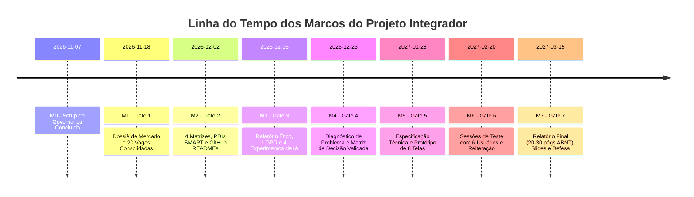

# Cronograma Geral do Projeto Integrador e Rodízio de Liderança

O cronograma foi estruturado em regime modular, incorporando **15% de margem de contingência e revisão** em cada ciclo de entrega.

---

## 1. Rodízio de Liderança por Etapa

Para assegurar o protagonismo, a responsabilidade compartilhada e a avaliação individual exigida pelo DESAFIO_PRATICO, a coordenação direta de cada etapa é rotativa:

| Etapa | Tema Central | Integrante Líder (Coordenação) | Subagente de Suporte | Revisores Obrigatórios |
|---|---|---|---|---|
| **Etapa 0** | Governança, Infraestrutura e Gates | Gabriel Amancio | SA-1 | Luiz Miguel, Gustavo Antonio |
| **Etapa 1** | Investigação do Mercado de TI (20 Vagas) | Gabriel Amancio | SA-1 | Luiz Miguel, Paulo Germano |
| **Etapa 2** | Identidade Profissional e Carreira (4 PDIs) | Luiz Miguel | SA-2 | Gabriel Amancio, Gustavo Antonio |
| **Etapa 3** | Ética Tecnológica, LGPD e Experimentos IA | Paulo Germano | SA-3 | Gabriel Amancio, Luiz Miguel |
| **Etapa 4** | Diagnóstico de Problema Social/Ambiental | Gustavo Antonio | SA-4 / SA-1 | Paulo Germano, Luiz Miguel |
| **Etapa 5** | Projeto Técnico da Solução e Protótipo | Gabriel Amancio | SA-4 / SA-3 | Gustavo Antonio, Paulo Germano |
| **Etapa 6** | Testes de Usabilidade (6 voluntários) | Luiz Miguel | SA-2 / SA-4 | Gabriel Amancio, Gustavo Antonio |
| **Etapa 7** | Relatório Integrado ABNT, Slides e Defesa | Todos (Coordenação Conjunta) | SA-1, 2, 3, 4 | Todos os 4 Integrantes |

---

## 2. Linha do Tempo e Marcos de Entrega (Milestones)

> *Nota: Os marcos abaixo consideram o ritmo acadêmico regular com folga preventiva de 15%. Prazos podem ser ajustados mediante resposta do usuário na pergunta de alinhamento.*

---

## 3. Detalhamento dos Ciclos com Folga Preventiva

| Ciclo | Início | Término Previsto | Folga (15%) | Gate de Aprovação | Entregável Principal |
|---|---|---|---|---|---|
| **Etapa 1: Mercado** | 2026-11-08 | 2026-11-16 | 2026-11-17 a 18 | Gate 1 | `01_mercado/dossie_mercado.md` + Planilha |
| **Etapa 2: Carreira** | 2026-11-19 | 2026-11-28 | 2026-11-29 a 30 | Gate 2 | `02_carreira/dossie_carreira.md` + 4 pastas de aluno |
| **Etapa 3: Ética & IA** | 2026-12-01 | 2026-12-12 | 2026-12-13 a 15 | Gate 3 | `03_etica_ia/dossie_etica.md` + 4 logs reais |
| **Etapa 4: Problema** | 2026-12-16 | 2026-12-21 | 2026-12-22 a 23 | Gate 4 | `04_problema/dossie_problema.md` + Matriz Decisão |
| **Etapa 5: Solução** | 2027-01-05 | 2027-01-24 | 2027-01-25 a 28 | Gate 5 | `05_solucao/dossie_solucao.md` + Figma Protótipo |
| **Etapa 6: Testes** | 2027-01-29 | 2027-02-16 | 2027-02-17 a 20 | Gate 6 | `06_testes/dossie_testes.md` + Dados anonimizados |
| **Etapa 7: Defesa** | 2027-02-21 | 2027-03-10 | 2027-03-11 a 15 | Gate 7 | `07_relatorio/relatorio_final.md` + Slides + Roteiro |

---

## 4. Gestão de Contingência

Caso ocorra atraso em qualquer etapa superior a 3 dias úteis:
1. Reunião de alinhamento emergencial do grupo.
2. Redistribuição de tarefas periféricas (revisão de formatação, coleta complementar de fontes).
3. Consumo da folga de 15% sem comprometer a data-limite do Gate seguinte.
