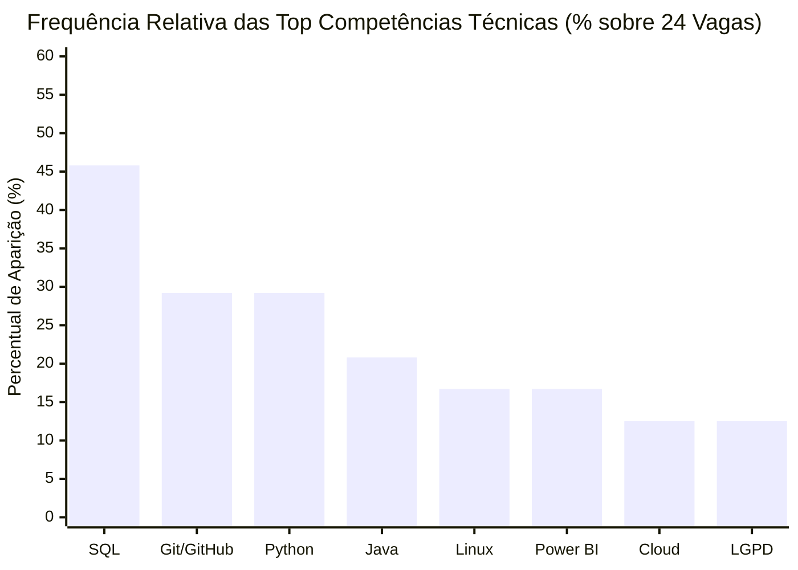
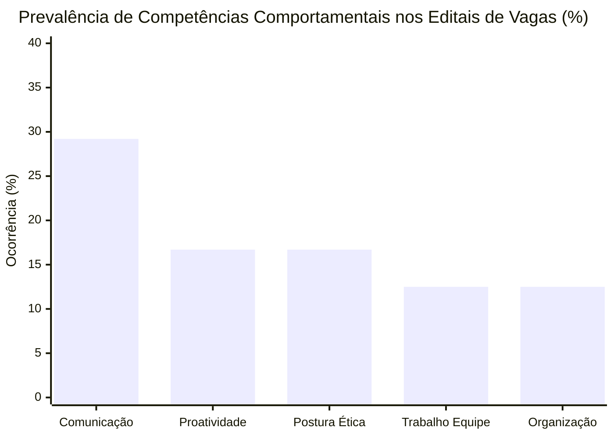
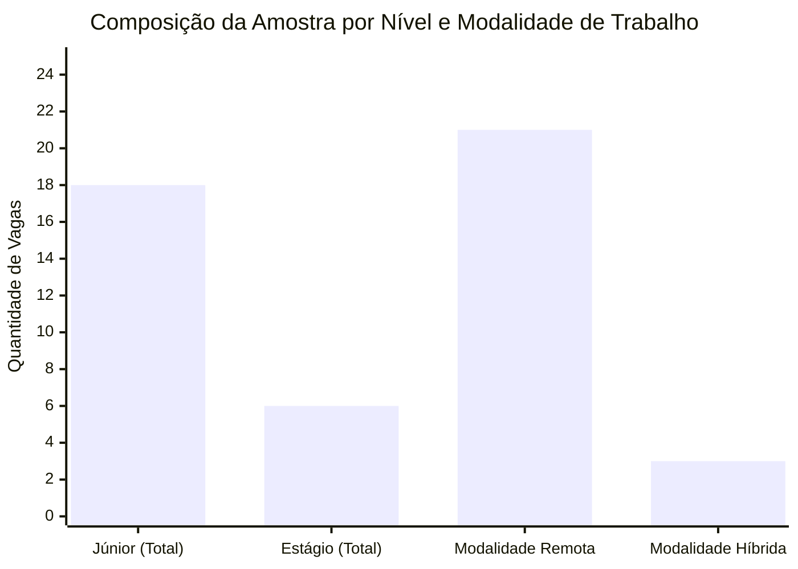
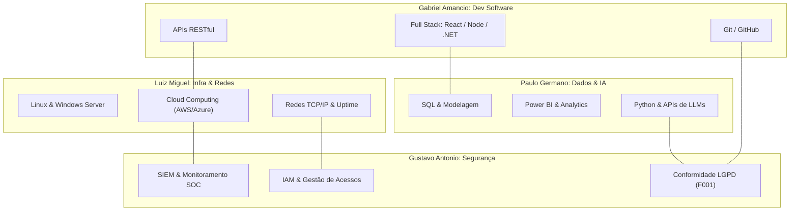

# Dossiê da Etapa 1: Investigação do Mercado de Trabalho em Tecnologia da Informação

**Instituição:** UNIPÊ (Centro Universitário de João Pessoa)  
**Curso:** Superior de Tecnologia em Análise e Desenvolvimento de Sistemas (ADS)  
**Disciplina:** Projeto Integrador: Design Profissional  
**Líder da Etapa 1:** Paulo Germano (Coordenação e Mercado de TI)  
**Revisores Pares:** Gabriel Amancio, Luiz Miguel, Gustavo Antonio  

---

## 1. Introdução e Contexto

O setor de Tecnologia da Informação e Comunicação (TIC) no Brasil passa por transformações impulsionadas pela expansão do trabalho remoto e pela busca por profissionais com conhecimentos técnicos e de comunicação `[F021]`. Projeções da Brasscom `[F021]` indicam crescimento na demanda por mão de obra técnica no país, com desafios na transição e absorção de profissionais em início de carreira.

Neste contexto, este documento reúne os resultados da Etapa 1 do Projeto Integrador no curso de Análise e Desenvolvimento de Sistemas do UNIPÊ `[F008]`. O estudo analisou 24 anúncios de vagas abertas no mercado nacional, distribuídos em quatro áreas de atuação:
1. Desenvolvimento de Software (Gabriel Amancio);
2. Infraestrutura e Redes (Luiz Miguel);
3. Dados e Inteligência Artificial (Paulo Germano);
4. Segurança da Informação (Gustavo Antonio).

O objetivo é mapear as exigências de conhecimentos técnicos, competências comportamentais e formação acadêmica, compreender os desafios de contratação das empresas e subsidiar os planos individuais de carreira (Etapa 2) e a concepção da solução tecnológica (Etapa 5).

---

## 2. Metodologia de Investigação e Organização dos Dados

A pesquisa combinou levantamento quantitativo e qualitativo de caráter descritivo, a partir de dados públicos de processos seletivos abertos no Brasil em novembro de 2026 `[F020]`.

### 2.1 Critérios de Amostragem e Recorte
- **Universo amostral:** páginas corporativas e plataformas de recrutamento, com ênfase no Portal Gupy `[F020]` pela padronização das descrições de vagas.
- **Tamanho da amostra:** 24 vagas analisadas (6 vagas para cada uma das 4 funções), cobrindo o mínimo de 20 vagas estipulado nas diretrizes do projeto.
- **Filtros aplicados:** formato de trabalho remoto ou oportunidades em polos do Nordeste (com foco em Paraíba e Pernambuco) `[F022]`, em níveis de estágio e júnior.
- **Rastreabilidade dos dados:** os registros brutos constam no arquivo [`01_mercado/vagas_brutas.csv`](vagas_brutas.csv) e em formato JSON [`01_mercado/vagas_brutas.json`](vagas_brutas.json), servindo de base para as análises do projeto.

---

## 3. Apresentação da Base de Anúncios Coletados

A Tabela 1 reúne os 24 anúncios coletados, discriminando ID, empresa, cargo, localidade, modalidade e nível de senioridade.

### Tabela 1: Síntese da Base Amostral de Vagas de TI Coletadas

| ID | Função Profissional | Empresa | Cargo Oficial do Anúncio | Localidade / Abrangência | Modalidade | Nível | Fonte / Data |
|---|---|---|---|---|---|---|---|
| **VAG-001** | Desenvolvimento de Software | BIP Brasil | Desenvolvedor Full Stack - Junior | São Paulo - SP (Brasil) | Remoto | Júnior | Gupy / 06/11/2026 `[F020]` |
| **VAG-002** | Desenvolvimento de Software | Localiza&Co | Software Developer Júnior - .NET | Belo Horizonte - MG (Brasil) | Remoto | Júnior | Gupy / 06/11/2026 `[F020]` |
| **VAG-003** | Desenvolvimento de Software | SoftExpert | Desenvolvedor(a) Full Stack Júnior | Joinville - SC (Brasil) | Remoto | Júnior | Gupy / 06/11/2026 `[F020]` |
| **VAG-004** | Desenvolvimento de Software | Viceri | Pessoa Desenvolvedora FullStack Jr | São Paulo - SP (Brasil) | Remoto | Júnior | Gupy / 06/11/2026 `[F020]` |
| **VAG-005** | Desenvolvimento de Software | Visagio / v(dev) | Estágio em Desenvolvimento de Software | Recife - PE / João Pessoa - PB | Remoto | Estágio | Gupy / 06/11/2026 `[F020]` |
| **VAG-006** | Desenvolvimento de Software | ZG Soluções | Estágio em Desenvolvimento de Sistemas | Goiânia - GO (Brasil) | Remoto | Estágio | Gupy / 06/11/2026 `[F020]` |
| **VAG-007** | Infraestrutura e Redes | Winover Contact Center | Analista de Infraestrutura Jr. | São Paulo - SP (Brasil) | Remoto | Júnior | Gupy / 06/11/2026 `[F020]` |
| **VAG-008** | Infraestrutura e Redes | Raízen | Analista de Infraestrutura de TI Jr | Piracicaba - SP (Brasil) | Híbrido | Júnior | Gupy / 06/11/2026 `[F020]` |
| **VAG-009** | Infraestrutura e Redes | Vivo Vita | Analista Suporte Redes Jr | São Paulo - SP (Brasil) | Remoto | Júnior | Gupy / 06/11/2026 `[F020]` |
| **VAG-010** | Infraestrutura e Redes | Dedalus | Analista de Operações Cloud Júnior | São Paulo - SP (Brasil) | Remoto | Júnior | Gupy / 06/11/2026 `[F020]` |
| **VAG-011** | Infraestrutura e Redes | CVC Corp | Analista de Infraestrutura e Redes Jr | Santo André - SP (Brasil) | Remoto | Júnior | Gupy / 06/11/2026 `[F020]` |
| **VAG-012** | Infraestrutura e Redes | Fundação Unimed | Estágio em TI - Infraestrutura | Belo Horizonte - MG (Brasil) | Remoto | Estágio | Gupy / 06/11/2026 `[F020]` |
| **VAG-013** | Dados e IA | Porto | Analista de Inteligência de Dados Jr | São Paulo - SP (Brasil) | Remoto | Júnior | Gupy / 06/11/2026 `[F020]` |
| **VAG-014** | Dados e IA | Afya | Analista de Dados Júnior | Nova Lima - MG (Brasil) | Remoto | Júnior | Gupy / 06/11/2026 `[F020]` |
| **VAG-015** | Dados e IA | Movida | Analista de Dados Júnior (Analytics) | São Paulo - SP (Brasil) | Híbrido | Júnior | Gupy / 06/11/2026 `[F020]` |
| **VAG-016** | Dados e IA | BIP Brasil | Desenvolvedor de IA/RPA - Junior | São Paulo - SP (Brasil) | Remoto | Júnior | Gupy / 06/11/2026 `[F020]` |
| **VAG-017** | Dados e IA | Visagio | Estágio em Engenharia e Dados | Recife - PE / Paraíba | Remoto | Estágio | Gupy / 06/11/2026 `[F020]` |
| **VAG-018** | Dados e IA | Indicium Tech | Estagiário de BI & Analytics | Florianópolis - SC (Brasil) | Remoto | Estágio | Gupy / 06/11/2026 `[F020]` |
| **VAG-019** | Segurança da Informação | RD Saúde | Analista Jr Cibersegurança (Cloud) | São Paulo - SP (Brasil) | Híbrido | Júnior | Gupy / 06/11/2026 `[F020]` |
| **VAG-020** | Segurança da Informação | Hitss Brasil | Analista de Segurança da Informação Jr | São Paulo - SP (Brasil) | Remoto | Júnior | Gupy / 06/11/2026 `[F020]` |
| **VAG-021** | Segurança da Informação | Giga+ | Analista de Segurança da Informação Jr | Campinas - SP (Brasil) | Remoto | Júnior | Gupy / 06/11/2026 `[F020]` |
| **VAG-022** | Segurança da Informação | Vivo Vita | Analista de Segurança Jr (SecOps) | São Paulo - SP (Brasil) | Remoto | Júnior | Gupy / 06/11/2026 `[F020]` |
| **VAG-023** | Segurança da Informação | Vem Ser Binario | Analista de Segurança da Informação Jr | Curitiba - PR (Brasil) | Remoto | Júnior | Gupy / 06/11/2026 `[F020]` |
| **VAG-024** | Segurança da Informação | CI&T | Estágio em Cibersegurança e Privacidade | Campinas - SP / João Pessoa - PB | Remoto | Estágio | Gupy / 06/11/2026 `[F020]` |

*Fonte: Dados da pesquisa empírica organizados pelos autores com base no Portal Gupy `[F020]`.*

---

## 4. Análise Comparativa de Competências por Função

A padronização das competências brutas extraídas dos editais gerou a Tabela 2, que relaciona as principais exigências técnicas, comportamentais e formativas discriminadas por função investigada.

### Tabela 2: Frequência Absoluta e Relativa de Competências Padronizadas por Função

| Competência Padronizada | Categoria | Dev. Software (n=6) | Infra e Redes (n=6) | Dados e IA (n=6) | Segurança Info (n=6) | Frequência Geral (N=24) | % Geral |
|---|---|---|---|---|---|---|---|
| **SQL (PostgreSQL/SQL Server/MySQL)** | Técnica | 6 (100,0%) | 0 (0,0%) | 5 (83,3%) | 0 (0,0%) | 11 | 45,8% |
| **Comunicação Clara e Transparente** | Comportamental | 2 (33,3%) | 1 (16,7%) | 2 (33,3%) | 2 (33,3%) | 7 | 29,2% |
| **Git / GitHub (Controle de Versão)** | Técnica | 5 (83,3%) | 0 (0,0%) | 2 (33,3%) | 0 (0,0%) | 7 | 29,2% |
| **Python (Dados / Dev / Automação)** | Técnica | 2 (33,3%) | 1 (16,7%) | 4 (66,7%) | 0 (0,0%) | 7 | 29,2% |
| **Java / Spring Boot** | Técnica | 5 (83,3%) | 0 (0,0%) | 0 (0,0%) | 0 (0,0%) | 5 | 20,8% |
| **Linux (Ubuntu/Debian)** | Técnica | 0 (0,0%) | 4 (66,7%) | 0 (0,0%) | 0 (0,0%) | 4 | 16,7% |
| **Power BI / Visualização de Dados** | Técnica | 0 (0,0%) | 0 (0,0%) | 4 (66,7%) | 0 (0,0%) | 4 | 16,7% |
| **Proatividade e Iniciativa** | Comportamental | 1 (16,7%) | 1 (16,7%) | 1 (16,7%) | 1 (16,7%) | 4 | 16,7% |
| **Postura Ética e Sigilo Profissional** | Comportamental | 0 (0,0%) | 1 (16,7%) | 1 (16,7%) | 2 (33,3%) | 4 | 16,7% |
| **JavaScript** | Técnica | 3 (50,0%) | 0 (0,0%) | 0 (0,0%) | 0 (0,0%) | 3 | 12,5% |
| **Trabalho em Equipe e Cooperação** | Comportamental | 2 (33,3%) | 1 (16,7%) | 0 (0,0%) | 0 (0,0%) | 3 | 12,5% |
| **Organização Operacional e Disciplina** | Comportamental | 0 (0,0%) | 1 (16,7%) | 1 (16,7%) | 1 (16,7%) | 3 | 12,5% |
| **Cloud Computing (AWS/Azure)** | Técnica | 0 (0,0%) | 1 (16,7%) | 0 (0,0%) | 2 (33,3%) | 3 | 12,5% |
| **LGPD e Privacidade por Padrão** | Técnica / Legal | 0 (0,0%) | 0 (0,0%) | 0 (0,0%) | 3 (50,0%) | 3 | 12,5% |
| **TypeScript** | Técnica | 2 (33,3%) | 0 (0,0%) | 0 (0,0%) | 0 (0,0%) | 2 | 8,3% |
| **React** | Técnica | 2 (33,3%) | 0 (0,0%) | 0 (0,0%) | 0 (0,0%) | 2 | 8,3% |
| **APIs RESTful** | Técnica | 2 (33,3%) | 0 (0,0%) | 0 (0,0%) | 0 (0,0%) | 2 | 8,3% |
| **Redes e Protocolos TCP/IP** | Técnica | 0 (0,0%) | 1 (16,7%) | 0 (0,0%) | 1 (16,7%) | 2 | 8,3% |

*Fonte: Compilação analítica derivada de [`01_mercado/planilha_Frequencia_por_Funcao.csv`](planilha_Frequencia_por_Funcao.csv).*

---

## 5. Representação Gráfica dos Resultados

Apresentam-se a seguir as quatro visualizações estruturadas a partir dos dados coletados, acompanhadas de suas análises.

### Gráfico 1: Frequência das Competências Técnicas Transversais no Mercado de TI
O gráfico apresenta as competências técnicas mais frequentes na amostra de 24 vagas.

**Interpretação do Gráfico 1:** SQL (45,8%) e Git/GitHub (29,2%) aparecem com destaque entre as vagas de entrada. O SQL é cobrado tanto em desenvolvimento de software quanto em análise de dados. As linguagens Python (29,2%) e Java (20,8%) atendem, respectivamente, a demandas de dados, rotinas de automação e sistemas corporativos de backend.

---

### Gráfico 2: Distribuição de Competências Comportamentais no Trabalho Remoto
O modelo remoto e híbrido valoriza a comunicação escrita, a autonomia e a colaboração entre equipes.

**Interpretação do Gráfico 2:** A comunicação clara (29,2%) e a proatividade (16,7%) figuram entre as competências comportamentais mais citadas. No modelo remoto, a clareza para redigir chamados, documentar código e participar de reuniões de alinhamento é necessária para evitar ruídos de comunicação. A postura ética e o trabalho em equipe também aparecem como requisitos frequentes nas descrições das vagas.

---

### Gráfico 3: Distribuição da Amostra por Nível de Experiência e Modalidade
A caracterização dos 24 anúncios coletados indica o perfil das vagas mapeadas.

**Interpretação do Gráfico 3:** A amostra reúne 75,0% de vagas de nível Júnior (18 vagas) e 25,0% de Estágio (6 vagas). Na modalidade de trabalho, 87,5% dos anúncios (21 vagas) são no formato remoto, permitindo a atuação de estudantes residentes na Paraíba e no Nordeste em empresas de alcance nacional `[F022]`. As vagas híbridas representam 12,5% (3 vagas), demandando deslocamento para polos corporativos.

---

### Gráfico 4: Relações Técnicas entre as Quatro Funções Investigadas
O diagrama ilustra os pontos de contato técnico entre as quatro áreas estudadas, mostrando como o projeto integrador combina esses conhecimentos na prática.

**Interpretação do Gráfico 4:** A arquitetura da solução depende da articulação entre as áreas: as APIs desenvolvidas em software conectam-se à infraestrutura em nuvem; os dados modelados fornecem suporte à aplicação; e os fluxos e acessos devem seguir os requisitos de segurança e as diretrizes da LGPD `[F001]`.

---

## 6. Discussão dos Desafios e Demandas dos Contratantes

A análise dos requisitos e diferenciais descritos nos editais permitiu mapear cinco desafios recorrentes no processo de contratação:

### 6.1 Volume de Requisitos em Cargos de Entrada (DES-01)
Identificou-se que anúncios classificados formalmente como "Júnior" por vezes solicitam conhecimentos práticos em arquiteturas complexas (microsserviços, mensageria e rotinas de CI/CD), a exemplo de **VAG-001**, **VAG-002** e **VAG-010**. Para candidatos recém-formados ou em transição, a apresentação de projetos práticos e código documentado no GitHub torna-se uma forma de demonstrar capacidade técnica sem depender de longa experiência prévia (tópico trabalhado na Etapa 2).

### 6.2 Importância da Comunicação no Trabalho Remoto (DES-02)
Com 87,5% das vagas em modelo remoto, a comunicação escrita clara é fator decisivo no processo seletivo, como evidenciado em **VAG-004**, **VAG-009** e **VAG-014**. O trabalho distribuído requer clareza na abertura de *pull requests*, na redação de documentações e no relato de impedimentos para manter o ritmo de trabalho da equipe.

### 6.3 Requisitos de Conformidade e Proteção de Dados (DES-03)
A fiscalização da Autoridade Nacional de Proteção de Dados (ANPD) em relação à LGPD `[F001]` impulsionou a exigência de práticas de menor privilégio, gestão de identidades e proteção de dados sensíveis mesmo em posições operacionais (**VAG-019**, **VAG-021** e **VAG-024**).

### 6.4 Uso Prático de Inteligência Artificial Generativa (DES-04)
Os anúncios **VAG-006** (ZG Soluções) e **VAG-016** (BIP Brasil) apontam para a demanda por uso orientado de assistentes de código e integração com APIs de modelos de linguagem, com atenção a validação de respostas e controle de dados.

### 6.5 Interdisciplinaridade e Perfil Multidisciplinar (DES-05)
A divisão estrita entre funções técnicas tem sido atenuada no mercado. Desenvolvedores são chamados a compreender contêineres Docker e noções de nuvem (**VAG-001**, **VAG-004**); analistas de infraestrutura utilizam scripts de automação em Bash ou PowerShell (**VAG-010**, **VAG-023**); e analistas de segurança analisam o código da aplicação sob diretrizes de segurança como o OWASP Top 10 (**VAG-024**).

---

## 7. Limitações da Pesquisa

Em conformidade com critérios acadêmicos `[F004]`, registram-se as seguintes limitações metodológicas:
1. **Concentração de plataforma:** a coleta baseou-se predominantemente no portal Gupy `[F020]`, retratando a dinâmica de médias e grandes empresas e podendo sub-representar dinâmicas de contratação de pequenas empresas locais.
2. **Recorte temporal:** os dados foram coletados em novembro de 2026, refletindo condições de mercado desse período e sujeitos a variações sazonais de fim de ano.
3. **Informações salariais parciais:** a maior parte dos anúncios omitiu valores exatos de remuneração, inviabilizando a análise estatística direta entre exigências técnicas e faixa salarial.

---

## 8. Considerações Finais e Desdobramentos para as Etapas Seguintes

A análise empírica do mercado de trabalho de TI indicou que posições de entrada combinam fundamentos técnicos de programação, versionamento e bancos de dados com autonomia e comunicação para trabalho em equipe.

Os resultados obtidos fornecem subsídios para as etapas seguintes:
- **Etapa 2 (Carreira e Identidade):** os quatro estudantes (Gabriel, Luiz, Paulo e Gustavo) utilizam a frequência de competências levantada para construir suas matrizes de autoavaliação (mínimo de 10 competências) e estruturar planos individuais de desenvolvimento com metas SMART, direcionando esforços para lacunas identificadas.
- **Etapa 5 (Solução Tecnológica):** tecnologias e práticas identificadas na pesquisa (APIs RESTful, bancos relacionais, computação em nuvem e adequação à LGPD `[F001]`) orientam as decisões de arquitetura e especificação do protótipo ÁguaViva PB.

---

## 9. Referências Normativas e Bibliográficas

- **[F001]** BRASIL. **Lei nº 13.709, de 14 de agosto de 2018**. Dispõe sobre a proteção de dados pessoais e altera a Lei nº 12.965, de 23 de abril de 2014 (Lei Geral de Proteção de Dados Pessoais - LGPD). Diário Oficial da União: seção 1, Brasília, DF, 15 ago. 2018. Disponível em: <https://www.planalto.gov.br/ccivil_03/_ato2015-2018/2018/lei/l13709.htm>. Acesso em: 06 nov. 2026.
- **[F004]** ASSOCIAÇÃO BRASILEIRA DE NORMAS TÉCNICAS. **ABNT NBR 14724: Informação e documentação — Trabalhos acadêmicos — Apresentação**. Rio de Janeiro: ABNT, 2011.
- **[F005]** ASSOCIAÇÃO BRASILEIRA DE NORMAS TÉCNICAS. **ABNT NBR 6023: Informação e documentação — Referências — Elaboração**. Rio de Janeiro: ABNT, 2018.
- **[F008]** UNIPÊ. **Manual de Normas Acadêmicas e Diretrizes do Projeto Integrador de ADS**. João Pessoa: Centro Universitário de João Pessoa, 2026.
- **[F020]** GUPY TECNOLOGIA LTDA. **Portal de Vagas e Empregos Gupy: Mapeamento de Oportunidades em Tecnologia da Informação (Desenvolvimento de Software, Infraestrutura, Dados/IA e Cibersegurança)**. São Paulo: Gupy, 2026. Disponível em: <https://portal.gupy.io/>. Acesso em: 06 nov. 2026.
- **[F021]** ASSOCIAÇÃO DAS EMPRESAS DE TECNOLOGIA DA INFORMAÇÃO E COMUNICAÇÃO (BRASSCOM). **Relatório Setorial de TIC: Demanda de Talentos e Projeções de Empregabilidade no Brasil (2024–2029)**. São Paulo: Brasscom, 2024. Disponível em: <https://brasscom.org.br/>. Acesso em: 06 nov. 2026.
- **[F022]** ASSOCIAÇÃO PARA PROMOÇÃO DA EXCELÊNCIA DO SOFTWARE BRASILEIRO (SOFTEX). **Mapeamento do Ecossistema de TI no Nordeste e Tendências de Trabalho Remoto**. Brasília: Softex, 2024. Disponível em: <https://softex.br/>. Acesso em: 06 nov. 2026.
