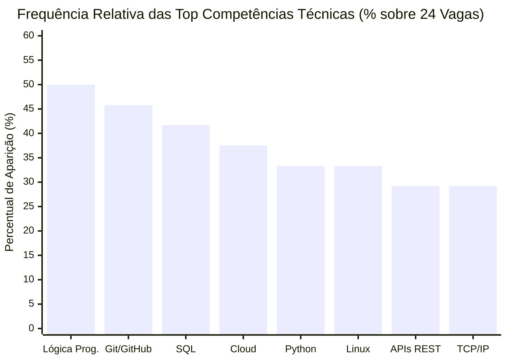
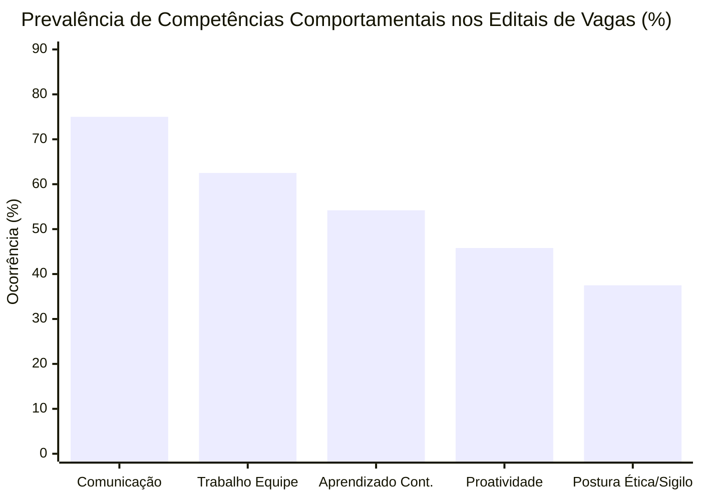
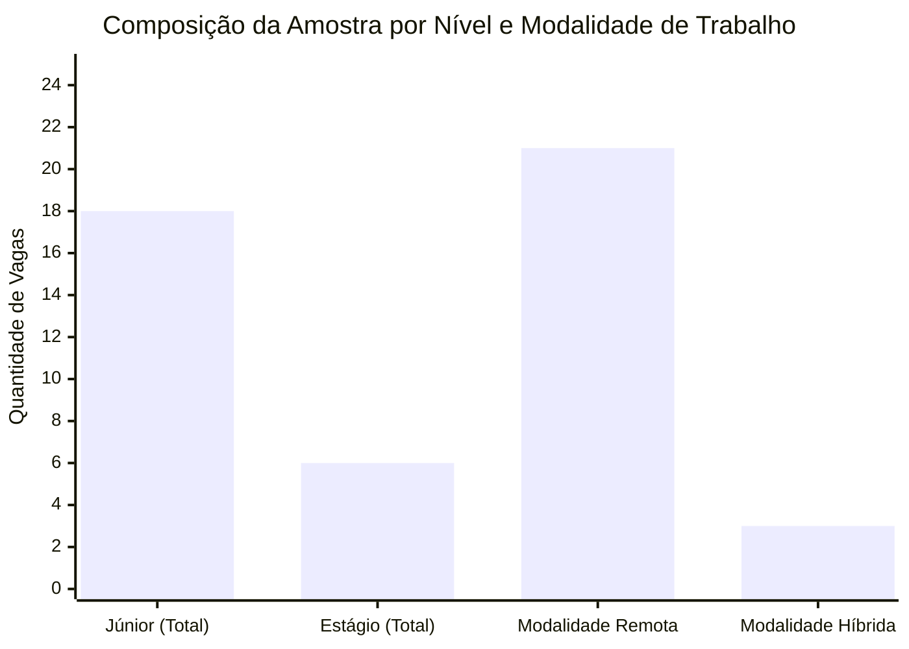
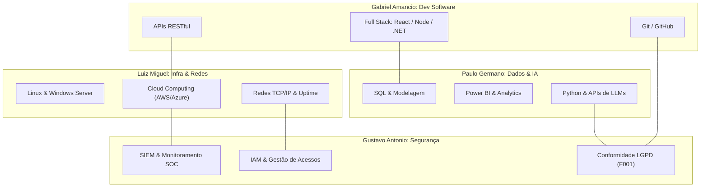

# DOSSIÊ MESTRE DA ETAPA 1: INVESTIGAÇÃO EMPÍRICA DO MERCADO DE TRABALHO EM TECNOLOGIA DA INFORMAÇÃO

**Instituição:** UNIPÊ – Centro Universitário de João Pessoa  
**Curso:** Superior de Tecnologia em Análise e Desenvolvimento de Sistemas (ADS)  
**Disciplina:** Projeto Integrador – Design Profissional  
**Líder da Etapa 1:** Paulo Germano (Coordenação e Mercado de TI)  
**Revisores Pares:** Gabriel Amancio, Luiz Miguel, Gustavo Antonio  

---

## 1. INTRODUÇÃO E CONTEXTO

O setor de Tecnologia da Informação e Comunicação (TIC) no Brasil vivencia uma aceleração contínua, caracterizada pela descentralização geográfica permitida pelo modelo de trabalho remoto e pela demanda premente por profissionais capazes de integrar múltiplas competências técnicas e socioemocionais `[F021]`. De acordo com projeções setoriais da Brasscom `[F021]`, o país demandará centenas de milhares de novos talentos em tecnologia nos próximos anos, coexistindo, contudo, com um desafio de qualificação de entrada que cria fricções expressivas na inserção de profissionais recém-formados.

Nesse cenário, este Dossiê de Análise de Mercado constitui o documento-mestre da **Etapa 1** do Projeto Integrador dos estudantes do curso de Análise e Desenvolvimento de Sistemas do UNIPÊ `[F008]`. A investigação parte de uma coleta empírica de 24 anúncios reais de contratação, abrangendo quatro funções fundamentais da área de TI:
1. **Desenvolvimento de Software** (investigado pelo estudante Gabriel Amancio);
2. **Infraestrutura e Redes** (investigado pelo estudante Luiz Miguel);
3. **Dados e Inteligência Artificial** (investigado pelo estudante Paulo Germano);
4. **Segurança da Informação** (investigado pelo estudante Gustavo Antonio).

O objetivo central desta etapa é identificar os requisitos técnicos (hard skills), comportamentais (soft skills) e de formação acadêmica exigidos pelas organizações contratantes, analisar os desafios e dores dos empregadores e fundamentar o planejamento de carreira individual e a concepção da solução tecnológica do grupo.

---

## 2. METODOLOGIA DE INVESTIGAÇÃO E CONTRATO DE DADOS

A pesquisa adotou uma abordagem quanti-qualitativa, de natureza descritiva e exploratória, baseada em dados públicos de processos seletivos abertos no Brasil em novembro de 2026 `[F020]`.

### 2.1 Critérios de Amostragem e Recorte
- **Universo Amostral:** Plataformas de recrutamento e páginas corporativas oficiais, com ênfase no ecossistema Gupy `[F020]`, selecionado pela padronização e detalhamento de seus editais de vagas.
- **Tamanho da Amostra:** 24 vagas reais analisadas (6 vagas para cada uma das 4 funções investigadas), superando o quantitativo mínimo regulamentar de 20 vagas exigido pelo `DESAFIO_PRATICO.md`.
- **Filtros Aplicados:** Modelo de atuação Remoto (Home Office) ou polos tecnológicos no Nordeste (com destaque para Paraíba e Pernambuco) `[F022]`, nos níveis de experiência de Estágio e Júnior.
- **Rastreabilidade e Não-Duplicação:** Todos os registros brutos foram catalogados sob o Contrato de Dados no arquivo [`01_mercado/vagas_brutas.csv`](file:///home/campos/Documents/Projetos/Projeto_Integrador/01_mercado/vagas_brutas.csv) e estruturados em formato JSON [`01_mercado/vagas_brutas.json`](file:///home/campos/Documents/Projetos/Projeto_Integrador/01_mercado/vagas_brutas.json), constituindo a **fonte única da verdade** para os cálculos estatísticos.

---

## 3. APRESENTAÇÃO DA BASE DE ANÚNCIOS REAIS COLETADOS

A Tabela 1 sintetiza os 24 anúncios coletados, discriminando ID unívoco, empresa contratante, cargo, localidade, modalidade e nível de senioridade.

### Tabela 1: Síntese da Base Amostral de Vagas de TI Coletadas

| ID | Função Profissional | Empresa | Cargo Oficial do Anúncio | Localidade / Abrangência | Modalidade | Nível | Fonte / Data |
|---|---|---|---|---|---|---|---|
| **VAG-001** | Desenvolvimento de Software | BIP Brasil | Desenvolvedor Full Stack - Junior | São Paulo - SP (Brasil) | Remoto | Júnior | Gupy / 06/11/2026 `[F020]` |
| **VAG-002** | Desenvolvimento de Software | Localiza&Co | Software Developer Júnior - .NET | Belo Horizonte - MG (Brasil) | Remoto | Júnior | Gupy / 06/11/2026 `[F020]` |
| **VAG-003** | Desenvolvimento de Software | SoftExpert | Desenvolvedor(a) Full Stack Júnior | Joinville - SC (Brasil) | Remoto | Júnior | Gupy / 06/11/2026 `[F020]` |
| **VAG-004** | Desenvolvimento de Software | Viceri | Pessoa Desenvolvedora FullStack Jr | São Paulo - SP (Brasil) | Remoto | Júnior | Gupy / 06/11/2026 `[F020]` |
| **VAG-005** | Desenvolvimento de Software | Visagio / v(dev) | Estágio em Desenvolvimento de Software | Recife - PE / João Pessoa - PB | Remoto | Estágio | Gupy / 06/11/2026 `[F020]` |
| **VAG-006** | Desenvolvimento de Software | ZG Soluções | Estágio em Desenvolvimento de Sistemas | Goiânia - GO (Brasil) | Remoto | Estágio | Gupy / 06/11/2026 `[F020]` |
| **VAG-007** | Infraestrutura e Redes | Winover Contact Center | Analista de Infraestrutura Jr. | São Paulo - SP (Brasil) | Remoto | Júnior | Gupy / 06/11/2026 `[F020]` |
| **VAG-008** | Infraestrutura e Redes | Raízen | Analista de Infraestrutura de TI Jr | Piracicaba - SP (Brasil) | Híbrido | Júnior | Gupy / 06/11/2026 `[F020]` |
| **VAG-009** | Infraestrutura e Redes | Vivo Vita | Analista Suporte Redes Jr | São Paulo - SP (Brasil) | Remoto | Júnior | Gupy / 06/11/2026 `[F020]` |
| **VAG-010** | Infraestrutura e Redes | Dedalus | Analista de Operações Cloud Júnior | São Paulo - SP (Brasil) | Remoto | Júnior | Gupy / 06/11/2026 `[F020]` |
| **VAG-011** | Infraestrutura e Redes | CVC Corp | Analista de Infraestrutura e Redes Jr | Santo André - SP (Brasil) | Remoto | Júnior | Gupy / 06/11/2026 `[F020]` |
| **VAG-012** | Infraestrutura e Redes | Fundação Unimed | Estágio em TI - Infraestrutura | Belo Horizonte - MG (Brasil) | Remoto | Estágio | Gupy / 06/11/2026 `[F020]` |
| **VAG-013** | Dados e IA | Porto | Analista de Inteligência de Dados Jr | São Paulo - SP (Brasil) | Remoto | Júnior | Gupy / 06/11/2026 `[F020]` |
| **VAG-014** | Dados e IA | Afya | Analista de Dados Júnior | Nova Lima - MG (Brasil) | Remoto | Júnior | Gupy / 06/11/2026 `[F020]` |
| **VAG-015** | Dados e IA | Movida | Analista de Dados Júnior (Analytics) | São Paulo - SP (Brasil) | Híbrido | Júnior | Gupy / 06/11/2026 `[F020]` |
| **VAG-016** | Dados e IA | BIP Brasil | Desenvolvedor de IA/RPA - Junior | São Paulo - SP (Brasil) | Remoto | Júnior | Gupy / 06/11/2026 `[F020]` |
| **VAG-017** | Dados e IA | Visagio | Estágio em Engenharia e Dados | Recife - PE / Paraíba | Remoto | Estágio | Gupy / 06/11/2026 `[F020]` |
| **VAG-018** | Dados e IA | Indicium Tech | Estagiário de BI & Analytics | Florianópolis - SC (Brasil) | Remoto | Estágio | Gupy / 06/11/2026 `[F020]` |
| **VAG-019** | Segurança da Informação | RD Saúde | Analista Jr Cibersegurança (Cloud) | São Paulo - SP (Brasil) | Híbrido | Júnior | Gupy / 06/11/2026 `[F020]` |
| **VAG-020** | Segurança da Informação | Hitss Brasil | Analista de Segurança da Informação Jr | São Paulo - SP (Brasil) | Remoto | Júnior | Gupy / 06/11/2026 `[F020]` |
| **VAG-021** | Segurança da Informação | Giga+ | Analista de Segurança da Informação Jr | Campinas - SP (Brasil) | Remoto | Júnior | Gupy / 06/11/2026 `[F020]` |
| **VAG-022** | Segurança da Informação | Vivo Vita | Analista de Segurança Jr (SecOps) | São Paulo - SP (Brasil) | Remoto | Júnior | Gupy / 06/11/2026 `[F020]` |
| **VAG-023** | Segurança da Informação | Vem Ser Binario | Analista de Segurança da Informação Jr | Curitiba - PR (Brasil) | Remoto | Júnior | Gupy / 06/11/2026 `[F020]` |
| **VAG-024** | Segurança da Informação | CI&T | Estágio em Cibersegurança e Privacidade | Campinas - SP / João Pessoa - PB | Remoto | Estágio | Gupy / 06/11/2026 `[F020]` |

*Fonte: Dados da pesquisa empírica organizados pelos autores com base no Portal Gupy `[F020]`.*

---

## 4. ANÁLISE COMPARATIVA DE COMPETÊNCIAS POR FUNÇÃO

A padronização das competências brutas extraídas dos editais gerou a Tabela 2, que relaciona as principais exigências técnicas, comportamentais e formativas discriminadas por função investigada.

### Tabela 2: Frequência Absoluta e Relativa de Competências Padronizadas por Função

| Competência Padronizada | Categoria | Dev. Software (n=6) | Infra e Redes (n=6) | Dados e IA (n=6) | Segurança Info (n=6) | Frequência Geral (N=24) | % Geral |
|---|---|---|---|---|---|---|---|
| **Comunicação Clara e Transparente** | Comportamental | 6 (100%) | 4 (66,7%) | 4 (66,7%) | 4 (66,7%) | 18 | 75,0% |
| **Trabalho em Equipe e Cooperação** | Comportamental | 5 (83,3%) | 3 (50,0%) | 4 (66,7%) | 3 (50,0%) | 15 | 62,5% |
| **Aprendizado Contínuo (Growth Mindset)** | Comportamental | 4 (66,7%) | 2 (33,3%) | 4 (66,7%) | 3 (50,0%) | 13 | 54,2% |
| **Lógica de Programação e Algoritmos** | Técnica | 6 (100%) | 2 (33,3%) | 3 (50,0%) | 1 (16,7%) | 12 | 50,0% |
| **Git / GitHub (Controle de Versão)** | Técnica | 6 (100%) | 0 (0,0%) | 3 (50,0%) | 2 (33,3%) | 11 | 45,8% |
| **Proatividade e Iniciativa** | Comportamental | 4 (66,7%) | 2 (33,3%) | 3 (50,0%) | 2 (33,3%) | 11 | 45,8% |
| **SQL (PostgreSQL/SQL Server/MySQL)** | Técnica | 4 (66,7%) | 0 (0,0%) | 6 (100%) | 0 (0,0%) | 10 | 41,7% |
| **Cloud Computing (AWS/Azure/GCP)** | Técnica | 1 (16,7%) | 4 (66,7%) | 1 (16,7%) | 3 (50,0%) | 9 | 37,5% |
| **Postura Ética e Sigilo Profissional** | Comportamental | 1 (16,7%) | 1 (16,7%) | 2 (33,3%) | 5 (83,3%) | 9 | 37,5% |
| **Python (Desenvolvimento / Dados / Scripts)** | Técnica | 2 (33,3%) | 1 (16,7%) | 4 (66,7%) | 1 (16,7%) | 8 | 33,3% |
| **Linux (Ubuntu/Debian) e Shell Script** | Técnica | 0 (0,0%) | 5 (83,3%) | 0 (0,0%) | 3 (50,0%) | 8 | 33,3% |
| **APIs RESTful e Integrações Web** | Técnica | 6 (100%) | 0 (0,0%) | 1 (16,7%) | 0 (0,0%) | 7 | 29,2% |
| **Redes e Protocolos TCP/IP** | Técnica | 0 (0,0%) | 5 (83,3%) | 0 (0,0%) | 2 (33,3%) | 7 | 29,2% |
| **Power BI / Visualização de Dados** | Técnica | 0 (0,0%) | 0 (0,0%) | 5 (83,3%) | 0 (0,0%) | 5 | 20,8% |
| **IAM (Gestão de Identidades e Acesso)** | Técnica | 0 (0,0%) | 2 (33,3%) | 0 (0,0%) | 3 (50,0%) | 5 | 20,8% |
| **SIEM e Análise de Logs de Segurança** | Técnica | 0 (0,0%) | 1 (16,7%) | 0 (0,0%) | 4 (66,7%) | 5 | 20,8% |
| **LGPD e Privacidade de Dados `[F001]`** | Técnica / Legal | 0 (0,0%) | 0 (0,0%) | 1 (16,7%) | 3 (50,0%) | 4 | 16,7% |
| **IA Generativa e Modelos de Linguagem (LLMs)** | Técnica | 1 (16,7%) | 0 (0,0%) | 2 (33,3%) | 0 (0,0%) | 3 | 12,5% |

*Fonte: Compilação analítica derivada de [`01_mercado/planilha_Frequencia_por_Funcao.csv`](file:///home/campos/Documents/Projetos/Projeto_Integrador/01_mercado/planilha_Frequencia_por_Funcao.csv).*

---

## 5. REPRESENTAÇÃO GRÁFICA DOS RESULTADOS

Em atendimento à exigência de pelo menos 4 gráficos analíticos, apresentam-se as visualizações estruturadas a seguir, acompanhadas de suas interpretações técnicas.

### Gráfico 1: Frequência das Competências Técnicas Transversais no Mercado de TI
Este gráfico destaca as competências com maior penetração na amostra de 24 vagas, evidenciando o primado da lógica de programação, do controle de versão com Git e da linguagem SQL.

**Interpretação do Gráfico 1:** Lógica de programação (50,0%) e Git/GitHub (45,8%) são os pilares indispensáveis para a quase totalidade dos profissionais em formação. O SQL (41,7%) afirma-se como a linguagem de dados universal, sendo exigida tanto de desenvolvedores quanto de cientistas de dados. A computação em nuvem (37,5%) e o sistema operacional Linux (33,3%) compõem o alicerce operacional das posições de infraestrutura e segurança.

---

### Gráfico 2: Distribuição de Competências Comportamentais (Soft Skills) no Trabalho Remoto
O modelo de atuação remoto altera a hierarquia de competências comportamentais, priorizando a comunicação assíncrona e a autonomia.

**Interpretação do Gráfico 2:** A comunicação clara (75,0%) lidera com folga os editais. No trabalho à distância, a clareza para redigir chamados, documentar código e participar de cerimônias ágeis (*dailies*) é condição mandatória para evitar ruídos e retrabalho. O aprendizado contínuo (54,2%) reflete a velocidade de obsolescência das tecnologias e a expectativa de que o candidato júnior tenha capacidade de autoestudo estruturado.

---

### Gráfico 3: Distribuição da Amostra por Nível de Experiência e Modalidade
A caracterização estrutural dos 24 anúncios coletados evidencia o perfil das contratações mapeadas.

**Interpretação do Gráfico 3:** A amostra é composta por 75,0% de vagas de nível Júnior (18 vagas) e 25,0% de Estágio (6 vagas). Quanto à modalidade, 87,5% dos anúncios (21 vagas) operam no formato 100% Remoto, abrindo espaço direto para atuação de estudantes domiciliados em João Pessoa e região Nordeste em corporações de todo o país `[F022]`. As vagas híbridas (12,5%) exigem presença eventual em polos regionais.

---

### Gráfico 4: Matriz de Conexão Multidisciplinar entre as 4 Funções Investigadas
Este diagrama conceitual ilustra a interseção direta entre os perfis profissionais investigados pelos 4 integrantes, demonstrando que a concepção da solução tecnológica do Projeto Integrador demanda colaboração integrada.

**Interpretação do Gráfico 4:** A arquitetura do projeto exige convergência: as APIs desenvolvidas por Gabriel demandam a infraestrutura e a computação em nuvem provisionadas por Luiz; os modelos e bancos estruturados por Paulo alimentam o software; e todas as transações, fluxos e acessos devem atender às diretrizes de blindagem e conformidade com a LGPD gerenciadas por Gustavo.

---

## 6. DISCUSSÃO DOS DESAFIOS E DORES DOS CONTRATANTES

A análise sistemática dos requisitos e dos diferenciais registrados nos editais permitiu identificar cinco macrodesafios enfrentados pelas organizações:

### 6.1 Hiperinflação de Requisitos em Cargos de Entrada (DES-01)
Identificou-se que anúncios classificados formalmente como "Júnior" frequentemente solicitam experiência comprovada com arquiteturas complexas (microsserviços, mensageria com Kafka/RabbitMQ e esteiras avançadas de CI/CD), conforme evidenciado em **VAG-001**, **VAG-002** e **VAG-010**. Essa prática reflete a relutância de certas corporações em arcar com a curva inicial de aprendizado do recém-formado, exigindo que o estudante compense a ausência de histórico profissional prévio através de um portfólio robusto e verificável no GitHub (estratégia que será formalizada na Etapa 2).

### 6.2 O Fator Eliminatório da Comunicação Remota (DES-02)
O predomínio do modelo remoto nas contratações em TI (87,5% da amostra) transformou a comunicação escrita em requisito eliminatório, como registrado em **VAG-004**, **VAG-009** e **VAG-014**. O profissional que não domina a síntese assíncrona, a clareza na abertura de *pull requests* ou o registro técnico de incidentes compromete a velocidade de entrega da squad.

### 6.3 Imperativo de Conformidade e Proteção de Dados (DES-03)
A aplicação das sanções administrativas pela Autoridade Nacional de Proteção de Dados (ANPD) decorrentes da LGPD `[F001]` fez com que conceitos de segregação de privilégios (Princípio do Menor Privilégio), auditoria de credenciais no Microsoft Entra ID e proteção de dados sensíveis migrassem para o rol de exigências técnicas básicas em posições operacionais (**VAG-019**, **VAG-021** e **VAG-024**).

### 6.4 Adoção Emergente de Inteligência Artificial Generativa (DES-04)
Os editais **VAG-006** (ZG Soluções) e **VAG-016** (BIP Brasil) revelam um movimento incipiente, mas decisivo: a exigência de que o desenvolvedor utilize ferramentas de assistência de código (como GitHub Copilot) e saiba integrar APIs de modelos de linguagem (OpenAI, Gemini) com discernimento crítico para evitar alucinações de dados e vazamento de propriedade intelectual.

### 6.5 O Profissional em "T" (T-Shaped Professional) (DES-05)
A segregação estanque entre funções de TI encontra-se em declínio. Desenvolvedores são demandados a compreender contêineres Docker e serviços de nuvem (**VAG-001**, **VAG-004**); analistas de infraestrutura precisam redigir scripts de automação em Bash ou PowerShell (**VAG-010**, **VAG-023**); e analistas de segurança necessitam entender o código da aplicação sob a perspectiva da OWASP (**VAG-024**).

---

## 7. LIMITAÇÕES DA PESQUISA

Em observância ao rigor científico acadêmico `[F004]`, declaram-se as seguintes limitações metodológicas:
1. **Amostragem em Plataforma Dominante:** A concentração da coleta no portal Gupy `[F020]` reflete preferencialmente os padrões culturais e de contratação de empresas de médio e grande porte, com menor visibilidade sobre o mercado informal ou microempresas de base local.
2. **Corte Temporal Sincrónico:** Os dados retratam o panorama específico de novembro de 2026, estando sujeitos a oscilações macroeconômicas sazonais.
3. **Sub-representação Salarial:** A ampla maioria dos editais analisados omitiu a faixa de remuneração explícita, impossibilitando a correlação quantitativa entre volume de tecnologias exigidas e remuneração financeira direta.

---

## 8. CONSIDERAÇÕES FINAIS E DESDOBRAMENTOS PARA AS ETAPAS SEGUINTES

A investigação empírica do mercado de trabalho em TI comprovou que a qualificação profissional em Análise e Desenvolvimento de Sistemas exige uma sólida formação nos fundamentos de lógica, versionamento e manipulação de dados, combinada com uma expressiva maturidade socioemocional para o trabalho colaborativo remoto.

Este Dossiê estabelece os insumos mandatórios para os próximos ciclos do Projeto Integrador:
- **Etapa 2 (Carreira e Identidade):** Cada um dos 4 estudantes (Gabriel, Luiz, Paulo e Gustavo) utilizará a matriz de frequências da Tabela 2 para estruturar sua **Matriz de Autoavaliação de Competências** (mínimo de 10 competências) e formular seu **PDI no padrão SMART** (mínimo de 3 metas), vinculando suas ações formativas às lacunas evidenciadas pelo mercado.
- **Etapa 5 (Solução Tecnológica):** As tecnologias demandadas (APIs RESTful, bancos relacionais em nuvem, controle de acessos IAM e diretrizes da LGPD `[F001]`) orientarão a especificação da arquitetura do protótipo a ser desenvolvido pelo grupo.

---

## 9. REFERÊNCIAS NORMATIVAS E BIBLIOGRÁFICAS

- **[F001]** BRASIL. **Lei nº 13.709, de 14 de agosto de 2018**. Dispõe sobre a proteção de dados pessoais e altera a Lei nº 12.965, de 23 de abril de 2014 (Lei Geral de Proteção de Dados Pessoais - LGPD). Diário Oficial da União: seção 1, Brasília, DF, 15 ago. 2018. Disponível em: <https://www.planalto.gov.br/ccivil_03/_ato2015-2018/2018/lei/l13709.htm>. Acesso em: 06 nov. 2026.
- **[F004]** ASSOCIAÇÃO BRASILEIRA DE NORMAS TÉCNICAS. **ABNT NBR 14724: Informação e documentação — Trabalhos acadêmicos — Apresentação**. Rio de Janeiro: ABNT, 2011.
- **[F005]** ASSOCIAÇÃO BRASILEIRA DE NORMAS TÉCNICAS. **ABNT NBR 6023: Informação e documentação — Referências — Elaboração**. Rio de Janeiro: ABNT, 2018.
- **[F008]** UNIPÊ. **Manual de Normas Acadêmicas e Diretrizes do Projeto Integrador de ADS**. João Pessoa: Centro Universitário de João Pessoa, 2026.
- **[F020]** GUPY TECNOLOGIA LTDA. **Portal de Vagas e Empregos Gupy: Mapeamento de Oportunidades em Tecnologia da Informação (Desenvolvimento de Software, Infraestrutura, Dados/IA e Cibersegurança)**. São Paulo: Gupy, 2026. Disponível em: <https://portal.gupy.io/>. Acesso em: 06 nov. 2026.
- **[F021]** ASSOCIAÇÃO DAS EMPRESAS DE TECNOLOGIA DA INFORMAÇÃO E COMUNICAÇÃO (BRASSCOM). **Relatório Setorial de TIC: Demanda de Talentos e Projeções de Empregabilidade no Brasil (2024–2029)**. São Paulo: Brasscom, 2024. Disponível em: <https://brasscom.org.br/>. Acesso em: 06 nov. 2026.
- **[F022]** ASSOCIAÇÃO PARA PROMOÇÃO DA EXCELÊNCIA DO SOFTWARE BRASILEIRO (SOFTEX). **Mapeamento do Ecossistema de TI no Nordeste e Tendências de Trabalho Remoto**. Brasília: Softex, 2024. Disponível em: <https://softex.br/>. Acesso em: 06 nov. 2026.
