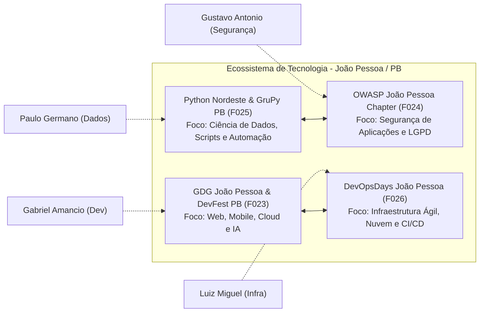

# DOSSIÊ MESTRE DA ETAPA 2: IDENTIDADE PROFISSIONAL, COMPETÊNCIAS E PLANEJAMENTO DE CARREIRA EM TI

**Instituição:** UNIPÊ - Centro Universitário de João Pessoa  
**Curso:** Superior de Tecnologia em Análise e Desenvolvimento de Sistemas (ADS)  
**Disciplina:** Projeto Integrador: Design Profissional  
**Líder da Etapa 2:** Luiz Miguel (Infraestrutura e Redes)  
**Revisores Pares:** Gabriel Amancio, Paulo Germano, Gustavo Antonio  

---

## 1. INTRODUÇÃO E OBJETIVOS DA ETAPA

A transição da faculdade para o mercado de trabalho em tecnologia exige planejamento consciente e autodiagnóstico realista. Com base nas vagas analisadas na Etapa 1 `[F020]` e nos dados setoriais da Brasscom `[F021]`, a **Etapa 2** estrutura a identidade profissional de cada um dos quatro estudantes da equipe, comparando seus conhecimentos com as demandas reais das contratações.

Este dossiê reúne os resultados de quatro instrumentos individuais desenvolvidos por cada integrante:
1. **Matrizes Individuais de Autoavaliação de Competências** (com 11 competências técnicas e socioemocionais fundamentadas no mercado);
2. **Planos Individuais de Desenvolvimento de Carreira (PDI)** no padrão metodológico SMART (com pelo menos 3 metas de curto e médio prazo por aluno);
3. **Perfis Profissionais Digitais Estruturados** para o LinkedIn;
4. **Portfólios e READMEs Profissionais de GitHub**, organizados em repositório público com projetos práticos.

Apresentamos também a **Síntese Comparativa Coletiva** dos quatro perfis, identificando a complementaridade técnica da equipe na construção da solução do Projeto Integrador, as lacunas compartilhadas de formação e o ecossistema regional de comunidades e eventos na Paraíba `[F022]`.

---

## 2. METODOLOGIA DE CONSTRUÇÃO DOS PERFIS INDIVIDUAIS

Para manter as avaliações realistas e evitar generalizações, montamos as matrizes de competências com base nas exigências mais frequentes mapeadas na Tabela 2 da Etapa 1. Cada estudante utilizou a escala canônica de proficiência:
- **Nível 0 (Sem contato):** Ausência de conhecimento prático ou teórico.
- **Nível 1 (Iniciante):** Compreensão conceitual básica, com dependência de tutoriais passo a passo.
- **Nível 2 (Em Desenvolvimento):** Aplicação prática inicial em projetos da faculdade, com consulta ativa à documentação.
- **Nível 3 (Intermediário / Autônomo):** Capacidade de desenvolver funcionalidades e resolver problemas rotineiros de forma independente.
- **Nível 4 (Avançado):** Domínio aprofundado, boas práticas de arquitetura e atenção a desempenho.
- **Nível 5 (Referência Técnica):** Capacidade de orientar colegas e desenhar soluções para problemas complexos.

Todos os artefatos individuais completos estão organizados nas pastas de cada integrante:
- [`02_carreira/por_integrante/gabriel_amancio/`](por_integrante/gabriel_amancio/)
- [`02_carreira/por_integrante/luiz_miguel/`](por_integrante/luiz_miguel/)
- [`02_carreira/por_integrante/paulo_germano/`](por_integrante/paulo_germano/)
- [`02_carreira/por_integrante/gustavo_antonio/`](por_integrante/gustavo_antonio/)

---

## 3. SÍNTESE DAS AUTOAVALIAÇÕES E DIAGNÓSTICO DE LACUNAS

A Tabela 1 consolida as notas de autoavaliação dos estudantes nas principais competências transversais mapeadas no mercado de trabalho.

### Tabela 1: Síntese Comparativa das Autoavaliações de Competências (Nível 0 a 5)

| Competência Analisada | Categoria | Gabriel Amancio (Dev) | Luiz Miguel (Infra) | Paulo Germano (Dados) | Gustavo Antonio (Segurança) | Média do Grupo | Lacuna Coletiva Identificada |
|---|---|---|---|---|---|---|---|
| **Lógica e Algoritmos** | Técnica | 3 | 2 | 2 | 2 | 2,25 | Estruturas de dados complexas e eficiência algorítmica |
| **Git / GitHub Colaborativo** | Técnica | 3 | 2 | 2 | 2 | 2,25 | Fluxos de rebase, resolução de conflitos e CI/CD básico |
| **Linguagem Python** | Técnica | 1 | 2 | 3 | 1 | 1,75 | Uso multidisciplinar (análise de dados, scripts e segurança) |
| **Bancos de Dados e SQL** | Técnica | 2 | 1 | 3 | 1 | 1,75 | Consultas analíticas avançadas e modelagem de dados |
| **Cloud Computing (AWS/Azure)** | Técnica | 1 | 2 | 1 | 2 | 1,50 | Provisionamento em nuvem pública e arquitetura de redes |
| **Sistemas Linux e Shell Script**| Técnica | 1 | 3 | 1 | 2 | 1,75 | Administração de servidores e scripts de automação Bash |
| **Segurança e LGPD `[F001]`** | Técnica/Legal | 1 | 2 | 3 | 3 | 2,25 | Implementação de privacidade por padrão no código e na infraestrutura |
| **Comunicação Clara/Assíncrona**| Comportamental| 3 | 3 | 3 | 3 | 3,00 | Padronização de documentações técnicas e rotinas remotas |
| **Trabalho em Equipe e Ágil** | Comportamental| 4 | 4 | 4 | 4 | 4,00 | Principal ponto forte compartilhado pelo grupo |
| **Aprendizado Contínuo (Growth)**| Comportamental| 3 | 3 | 3 | 4 | 3,25 | Disciplina de estudo e acompanhamento de editais |

*Fonte: Dados extraídos diretamente das matrizes individuais de autoavaliação dos estudantes em `02_carreira/por_integrante/*/matriz.md`.*

---

## 4. CONSOLIDAÇÃO DOS PLANOS INDIVIDUAIS DE CARREIRA (METAS SMART)

Cada estudante estruturou um Plano Individual de Desenvolvimento de Carreira com pelo menos três metas no padrão **SMART** (Específica, Mensurável, Atingível, Relevante e Temporal). A Tabela 2 apresenta o quadro com as 12 metas estabelecidas pelo grupo.

### Tabela 2: Matriz Geral de Metas SMART dos 4 Estudantes

| Integrante | Função | ID | Meta SMART Resumida | Indicador de Medição (M) | Prazo-Limite (T) | Conexão com o Mercado `[F020]` |
|---|---|---|---|---|---|---|
| **Gabriel Amancio** | Dev | **GAB-M1** | Desenvolvimento de API RESTful com TypeScript e Node.js | Repositório público com Swagger e >70% de cobertura de testes | 25/01/2027 | VAG-001, VAG-004 (exigência em 100% de Dev) |
| **Gabriel Amancio** | Dev | **GAB-M2** | Formação em Java 17 e Spring Boot corporativo | Certificado de curso de 40h e aplicação no protótipo | 30/04/2027 | VAG-002, VAG-004 e alinhamento Oracle `[F030]` |
| **Gabriel Amancio** | Dev | **GAB-M3** | Participação presencial em meetups do GDG João Pessoa `[F023]` | Presença em 2 encontros e 5 conexões ativas no LinkedIn | 15/12/2026 | Ampliação de rede técnica e contato com o mercado local |
| **Luiz Miguel** | Infra | **LUI-M1** | Obtenção da Certificação AWS Cloud Practitioner `[F029]` | Certificado oficial emitido com pontuação acima de 750/1000 | 28/02/2027 | VAG-008, VAG-010 (Cloud presente em 66,7% de Infra) |
| **Luiz Miguel** | Infra | **LUI-M2** | Configuração de Servidor Linux monitorado com Zabbix/Grafana | Documentação técnica com métricas e alertas integrados | 15/01/2027 | VAG-007, VAG-010 (sustentação de serviços) |
| **Luiz Miguel** | Infra | **LUI-M3** | Conexão com a comunidade DevOpsDays João Pessoa `[F026]` | Participação em 1 evento e relato reflexivo no diário | 20/12/2026 | Transição para cultura ágil de operações (DevOps) |
| **Paulo Germano** | Dados | **PAU-M1** | Certificação Microsoft Power BI Data Analyst (PL-300) `[F028]` | Aprovação oficial no exame com score acima de 700 pontos | 15/03/2027 | VAG-013 a VAG-018 (Power BI em 83,3% de Dados) |
| **Paulo Germano** | Dados | **PAU-M2** | Pipeline de dados em Python (Pandas + PostgreSQL + Dashboard) | Repositório no GitHub documentado sobre bases públicas | 20/01/2027 | Conexão com indicadores da Etapa 4 do projeto |
| **Paulo Germano** | Dados | **PAU-M3** | Engajamento na comunidade Python Nordeste / GruPy PB `[F025]` | Presença em evento técnico e 5 conexões no LinkedIn | 10/12/2026 | Troca de experiências no ecossistema regional de dados `[F022]` |
| **Gustavo Antonio**| Seg. | **GUS-M1** | Certificação em Fundamentos da LGPD pela Enap `[F027]` | Certificado de 20h e relatório de impacto para o PI | 31/12/2026 | VAG-019, VAG-021, VAG-024 (LGPD exigida no perfil) |
| **Gustavo Antonio**| Seg. | **GUS-M2** | Preparação para Certificação Internacional CompTIA Security+ `[F031]` | Aproveitamento acima de 80% em 3 simulados oficiais | 30/04/2027 | Credencial de entrada para analistas de SOC e defesa cibernética |
| **Gustavo Antonio**| Seg. | **GUS-M3** | Integração nas reuniões do capítulo OWASP João Pessoa `[F024]` | Presença confirmada em encontro e 5 conexões no LinkedIn | 15/12/2026 | Prática com OWASP Top 10 e segurança defensiva local |

*Fonte: Compilação dos PDIs individuais em `02_carreira/por_integrante/*/pdi.md`.*

---

## 5. FORMAÇÃO CONTINUADA E MAPA DE OPORTUNIDADES

Para apoiar a superação das lacunas identificadas, o grupo mapeou cursos livres, capacitações gratuitas e exames de certificação de relevância técnica (Tabela 3).

### Tabela 3: Catálogo de Oportunidades de Formação Continuada Mapeadas

| Área / Função | Curso / Certificação Mapeada | Instituição Provedora | Carga Horária / Formato | Custo Aproximado | Fonte / Acesso `[Fxxx]` |
|---|---|---|---|---|---|
| **Desenvolvimento** | Java SE 17 Developer (Exame 1Z0-829) | Oracle University | Formato autoestudo + Exame Oficial | Exame: ~US$ 245 | Oracle `[F030]` |
| **Desenvolvimento** | Trilha Full Stack JavaScript / TypeScript | Plataformas MOOC (Coursera / DIO / Alura) | 60 horas (Online) | Gratuito ou Assinatura | Gupy / Mercado `[F020]` |
| **Infraestrutura** | AWS Certified Cloud Practitioner (CLF-C02) | AWS Training and Certification | 40 horas + Exame Proctored | Exame: US$ 100 (treino grátis) | AWS `[F029]` |
| **Infraestrutura** | Administração de Servidores Linux e Redes | 4Linux / Escola Superior de Redes (RNP) | 40 horas (Online/EaD) | Cursos livres / Bolsas | Softex `[F022]` |
| **Dados e IA** | Microsoft Certified: Power BI Data Analyst (PL-300) | Microsoft Learn / Pearson VUE | Trilha oficial ~35h + Exame | Exame: US$ 100 (treino grátis) | Microsoft `[F028]` |
| **Dados e IA** | Python para Análise de Dados e Manipulação com Pandas | DataCamp / USP Open Courseware | 30 horas (Online) | Gratuito para estudantes | Python Brasil `[F025]` |
| **Segurança Info** | Fundamentos da Lei Geral de Proteção de Dados (LGPD) | Escola Nacional de Administração Pública (Enap) | 20 horas (EaD Assíncrono) | **Gratuito** com certificado | Enap EV.G `[F027]` |
| **Segurança Info** | CompTIA Security+ (Exame SY0-701) | CompTIA / Centro de Treinamento Autorizado | 50 horas de estudo + Exame | Exame: ~US$ 392 | CompTIA `[F031]` |

---

## 6. COMUNIDADES DE PRÁTICA, EVENTOS E NETWORKING REGIONAL

O aprendizado técnico em tecnologia ganha consistência quando acompanhado da participação em comunidades de prática, onde ocorrem discussões sobre cenários reais, divulgação de vagas e mentoria informal `[F022]`. O levantamento na Paraíba e no Nordeste destacou quatro iniciativas ativas:

1. **Google Developers Group (GDG João Pessoa) `[F023]`:** Comunidade ativa na capital que realiza meetups gratuitos em instituições de ensino e organiza o **DevFest João Pessoa**, aproximando estudantes de profissionais de desenvolvimento web, mobile e inteligência artificial.
2. **OWASP João Pessoa Chapter `[F024]`:** Capítulo local da fundação de segurança de software. Promove encontros sobre prevenção de vulnerabilidades (OWASP Top 10), proteção em APIs e conformidade com a privacidade de dados, servindo de contato prático para os estudos de segurança.
3. **Python Nordeste e GruPy Paraíba `[F025]`:** Comunidade voltada ao ecossistema Python na região Nordeste, com encontros sobre análise de dados, automação de rotinas e desenvolvimento backend.
4. **DevOpsDays João Pessoa e Meetups de Infraestrutura `[F026]`:** Fórum regional para discussões sobre automação de infraestrutura, computação em nuvem, contêineres e práticas integradas de segurança (DevSecOps).

---

## 7. SÍNTESE COMPARATIVA COLETIVA DO GRUPO

A comparação direta entre os quatro perfis, validada por toda a equipe, aponta três conclusões práticas para o desenvolvimento do projeto:

### 7.1 Complementaridade das Especialidades para a Solução Tecnológica
A equipe distribui papéis técnicos de forma equilibrada, cobrindo o ciclo de desenvolvimento da aplicação:
- **Gabriel Amancio** cuida da lógica da aplicação, arquitetura do software, interfaces web e consumo de APIs;
- **Luiz Miguel** cuida do ambiente operacional, estabilidade de redes, virtualização e planejamento da hospedagem em nuvem com alta disponibilidade;
- **Paulo Germano** cuida da modelagem do banco de dados, consultas analíticas em SQL, visualização de métricas e integração ética de inteligência artificial;
- **Gustavo Antonio** cuida dos princípios de segurança defensiva e privacidade (Security e Privacy by Design), gerenciando acessos e conformidade com a LGPD `[F001]`.

### 7.2 Necessidades Comuns de Formação (Gaps Compartilhados)
Três competências técnicas apresentaram médias abaixo de 2,0 na Tabela 1 e demandam dedicação coletiva:
1. **Computação em Nuvem na Prática:** O grupo precisa avançar da teoria sobre IaaS e PaaS para a configuração de serviços em nuvens públicas (AWS e Azure);
2. **Scripts e Automação em Python e Bash:** A escrita de scripts para extração de dados, testes e tarefas rotineiras de sustentação é necessária aos quatro estudantes;
3. **Versionamento Colaborativo:** Praticar fluxos de branches, resolução de conflitos e revisões de código entre pares, superando o uso apenas básico do Git.

### 7.3 Oportunidades de Colaboração nas Etapas Seguintes
Essa divisão de competências orienta o trabalho nas etapas seguintes:
- **Na Etapa 3 (Ética e IA):** Paulo e Gabriel conduzem os testes com ferramentas de IA, enquanto Gustavo analisa as implicações legais e éticas e Luiz monitora os impactos operacionais e de infraestrutura.
- **Na Etapa 4 (Problema Social):** Paulo organiza os microdados públicos de fontes oficiais (IBGE e DATASUS), apoiando a matriz de decisão com indicadores quantitativos.
- **Na Etapa 5 (Solução):** Gabriel desenvolve as interfaces; Gustavo projeta o modelo de proteção de dados; Paulo estrutura o banco de dados; Luiz define o ambiente de deploy e execução.

---

## 8. CONSIDERAÇÕES FINAIS E APROVAÇÃO DO GATE 2

A **Etapa 2** cumpriu os objetivos pedagógicos previstos:
- [x] 4 Matrizes individuais de autoavaliação contendo 11 competências padronizadas;
- [x] 4 Planos Individuais de Desenvolvimento de Carreira contendo pelo menos 3 metas SMART por estudante;
- [x] 4 Rascunhos estruturados de perfis profissionais digitais para o LinkedIn;
- [x] 4 Portfólios e arquivos README profissionais para o GitHub;
- [x] Síntese comparativa coletiva, catálogo de formação continuada e mapeamento de comunidades da Paraíba e Nordeste com fontes catalogadas.

Com esses artefatos validados, o grupo conclui o Gate 2 e avança para a **Etapa 3: Inteligência Artificial, Ética e Cidadania Digital**.

---

## 9. REFERÊNCIAS NORMATIVAS E BIBLIOGRÁFICAS

- **[F001]** BRASIL. **Lei nº 13.709, de 14 de agosto de 2018**. Dispõe sobre a proteção de dados pessoais e altera a Lei nº 12.965, de 23 de abril de 2014 (LGPD). Brasília, DF, 2018.
- **[F004]** ASSOCIAÇÃO BRASILEIRA DE NORMAS TÉCNICAS. **ABNT NBR 14724: Trabalhos acadêmicos: Apresentação**. Rio de Janeiro: ABNT, 2011.
- **[F005]** ASSOCIAÇÃO BRASILEIRA DE NORMAS TÉCNICAS. **ABNT NBR 6023: Referências: Elaboração**. Rio de Janeiro: ABNT, 2018.
- **[F008]** UNIPÊ. **Manual de Normas Acadêmicas e Diretrizes do Projeto Integrador de ADS**. João Pessoa: UNIPÊ, 2026.
- **[F020]** GUPY TECNOLOGIA LTDA. **Portal de Vagas e Empregos Gupy: Mapeamento de Oportunidades em TI**. São Paulo: Gupy, 2026.
- **[F021]** BRASSCOM. **Relatório Setorial de TIC: Demanda de Talentos no Brasil (2024-2029)**. São Paulo: Brasscom, 2024.
- **[F022]** SOFTEX. **Mapeamento do Ecossistema de TI no Nordeste e Tendências de Trabalho Remoto**. Brasília: Softex, 2024.
- **[F023]** GOOGLE DEVELOPERS GROUP. **Comunidade GDG João Pessoa e DevFest Paraíba**. 2026.
- **[F024]** OPEN WORLDWIDE APPLICATION SECURITY PROJECT (OWASP). **OWASP João Pessoa Chapter**. 2026.
- **[F025]** ASSOCIAÇÃO PYTHON BRASIL. **Comunidade Python Nordeste e GruPy Paraíba**. 2026.
- **[F026]** DEVOPSDAYS ORG. **DevOpsDays João Pessoa**. 2026.
- **[F027]** ENAP. **Curso Fundamentos da Lei Geral de Proteção de Dados (LGPD)**. Brasília: Enap, 2024.
- **[F028]** MICROSOFT LEARN. **Certificação PL-300: Microsoft Power BI Data Analyst**. Redmond: Microsoft, 2024.
- **[F029]** AMAZON WEB SERVICES. **AWS Certified Cloud Practitioner (CLF-C02)**. Seattle: AWS, 2024.
- **[F030]** ORACLE CORPORATION. **Java SE 17 Developer (1Z0-829)**. Austin: Oracle, 2024.
- **[F031]** COMPTIA. **CompTIA Security+ Certification (SY0-701)**. Downers Grove: CompTIA, 2024.
