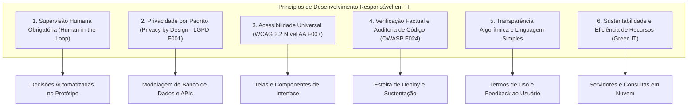

# DOSSIÊ MESTRE DA ETAPA 3: INTELIGÊNCIA ARTIFICIAL, ÉTICA TECNOLÓGICA E CIDADANIA DIGITAL

**Instituição:** UNIPÊ – Centro Universitário de João Pessoa  
**Curso:** Superior de Tecnologia em Análise e Desenvolvimento de Sistemas (ADS)  
**Disciplina:** Projeto Integrador – Design Profissional  
**Líder da Etapa 3:** Gabriel Amancio (Desenvolvimento de Software)  
**Revisores Pares:** Paulo Germano, Luiz Miguel, Gustavo Antonio  

---

## 1. INTRODUÇÃO E OBJETIVOS DA INVESTIGAÇÃO ÉTICA

O avanço vertiginoso dos ecossistemas digitais e a integração acelerada de sistemas de Inteligência Artificial generativa e preditiva no cotidiano das organizações impõem uma reflexão ética inadiável sobre a responsabilidade social dos futuros tecnólogos em ADS `[F008]`. Longe de constituir uma ferramenta neutra, o software reflete as intenções, os vieses históricos e os modelos econômicos de seus desenvolvedores e gestores `[F021]`.

Nesse sentido, a **Etapa 3** do Projeto Integrador tem como propósito investigar as fronteiras entre inovação tecnológica, integridade ética, cidadania digital e conformidade regulatória no Brasil. O presente Dossiê Mestre consolida quatro eixos investigativos estruturados:
1. **Análise Crítica e Documentada de Dois Casos Reais:** Um dilema envolvendo sistemas de Inteligência Artificial e direitos fundamentais (biometria e viés algorítmico) e um caso focado em governança de privacidade, incidentes de segurança e sanções regulatórias da ANPD sob a LGPD `[F001]`;
2. **Matriz de Riscos Éticos e Operacionais:** Mapeamento preventivo de 8 ameaças críticas inerentes ao desenvolvimento de sistemas, com causas-raiz e planos de mitigação;
3. **Consolidação dos Experimentos Práticos com Ferramentas de IA:** Avaliação empírica realizada individualmente pelos quatro integrantes do grupo (Gabriel, Luiz, Paulo e Gustavo), demonstrando na prática as limitações, alucinações e riscos de automação cega;
4. **Recomendações para o Desenvolvimento Responsável de Tecnologias:** Diretrizes operacionais para nortear a concepção da solução tecnológica do grupo nas Etapas 4 e 5.

---

## 2. ANÁLISE CRÍTICA DOS CASOS REAIS DE ÉTICA TECNOLÓGICA

### 2.1 Caso Real 1: Algoritmos de Reconhecimento Facial na Segurança Pública e o Viés Racial no Brasil

#### 2.1.1 Contexto e Organizações Envolvidas
A partir de 2019, diversas secretarias estaduais de segurança pública no Brasil passaram a implantar sistemas automatizados de videovigilância por reconhecimento facial em espaços públicos (estações de metrô, vias urbanas e eventos populares) `[F050]`. A tecnologia foi adquirida de fornecedores privados sob a premissa de modernização investigativa e captura de foragidos da justiça. O processo gerou intensa contestação por parte de entidades da sociedade civil, destacando-se o Centro de Estudos de Segurança e Cidadania (CESeC, através do projeto *O Panóptico*) `[F050]` e as Defensorias Públicas dos Estados do Rio de Janeiro, Bahia, Ceará e da União.

#### 2.1.2 Cronologia dos Acontecimentos e Consequências
- **2019–2021:** Implantação massiva de câmeras com algoritmos biométricos sem audiências públicas ou estudos prévios de impacto aos direitos fundamentais.
- **2021–2024:** Relatórios técnicos consolidados pelas Defensorias Públicas estaduais revelaram que mais de **80% das pessoas presas ou abordadas indevidamente** por falsos positivos do reconhecimento facial eram **homens negros** `[F050]`. Casos emblemáticos documentaram cidadãos inocentes encarcerados por semanas devido a alertas errôneos de softwares que confundiram fotos de documentos com transeuntes em vias públicas.
- **Consequências:** Graves violações da dignidade da pessoa humana, estigmatização social, traumas psicológicos profundos às vítimas e judicialização em massa, culminando em diretrizes do Conselho Nacional de Justiça (CNJ) que vedaram prisões baseadas exclusivamente em reconhecimento fotográfico ou automatizado sem confirmação probatória idônea.

#### 2.1.3 Problema Ético Central
O dilema ético primordial reside no **Viés Algorítmico Estrutural e na Discriminação Algorítmica**. Os modelos de visão computacional foram treinados majoritariamente sobre bases fotográficas desbalanceadas (predomínio de rostos de indivíduos brancos), resultando em taxas de erro exponencialmente mais elevadas na identificação de pessoas negras `[F050]`. Além disso, a confiança cega depositada pelos agentes policiais na máquina eliminou a presunção de inocência, transformando a opacidade matemática em instrumento de violência institucional.

#### 2.1.4 Enquadramento Legal e Ético
- **Constituição Federal de 1988:** Violação do princípio da dignidade da pessoa humana (art. 1º, III), da igualdade perante a lei (art. 5º, *caput*) e da presunção de inocência (art. 5º, LVII).
- **LGPD (Lei nº 13.709/2018) `[F001]`:** Infração ao art. 6º, IX (Princípio da Não Discriminação: impossibilidade de tratamento para fins discriminatórios ilícitos ou abusivos) e desrespeito ao art. 20 (Direito à revisão por pessoa natural de decisões tomadas unicamente com base em tratamento automatizado).
- **Marco Civil da Internet (Lei nº 12.965/2014) `[F002]`:** Descumprimento das garantias de preservação da privacidade e dos direitos humanos na rede.

---

### 2.2 Caso Real 2: Processos Administrativos Sancionadores da ANPD e o Treinamento Não Autorizado de IA

#### 2.2.1 Contexto e Organizações Envolvidas
Com a plena vigência das sanções administrativas da Lei Geral de Proteção de Dados Pessoais `[F001]`, a Autoridade Nacional de Proteção de Dados (ANPD) iniciou processos sancionadores contra organizações públicas e privadas por incidentes de vazamento, comercialização irregular de dados e coleta predatória de dados de usuários `[F051]`. Casos de destaque incluíram a primeira multa aplicada à empresa Telekall Infoservice (por comércio ilícito de dados de eleitores sem Encarregado de Dados) e a medida preventiva histórica contra a Meta (Facebook/Instagram), que alterou unilateralmente seus termos de uso para capturar postagens públicas, fotos e textos de brasileiros com o fito de treinar seus modelos de IA generativa `[F051]`.

#### 2.2.2 Cronologia dos Acontecimentos e Consequências
- **Agosto de 2021:** Entrada em vigor dos artigos 52 a 54 da LGPD relativos a penalidades administrativas.
- **Julho de 2023:** Aplicação da primeira sanção pecuniária pela ANPD no caso Telekall, com multas simples cumulativas e determinação de eliminação de bases ilegais `[F051]`.
- **Julho de 2024:** Abertura de processo de fiscalização e expedição de **Medida Cautelar Preventiva** pela Coordenação-Geral de Fiscalização da ANPD com imposição de multa diária de R$ 50 mil, suspendendo no Brasil a eficácia da nova política de privacidade da Meta que pretendia treinar IA generativa com dados de titulares brasileiros sem fornecer transparência adequada ou mecanismo viável de recusa (*opt-out*) `[F051]`.
- **Consequências:** Fixação de precedente regulatório nacional de que o treinamento de algoritmos de inteligência artificial em território brasileiro deve respeitar estritamente a autodeterminação informativa e a soberania dos dados pessoais dos cidadãos.

#### 2.2.3 Problema Ético Central
O cerne do conflito abrange **Privacidade, Autonomia Individual e Consentimento Informado**. Grandes corporações trataram o patrimônio de dados pessoais de milhões de indivíduos como "recurso natural livremente explorável" para ganho corporativo, omitindo dos usuários o impacto do processamento de suas criações e comunicações para geração de modelos de linguagem proprietários.

#### 2.2.4 Enquadramento Legal e Ético
- **LGPD (Lei nº 13.709/2018) `[F001]`:** Infração aos artigos 6º, I e VI (Princípios da Finalidade e Transparência), art. 7º (Ausência de base legal legítima para o tratamento de dados pessoais com finalidade distinta da original) e art. 18 (Cerceamento do direito de oposição e livre revogação).
- **Lei de Direitos Autorais (Lei nº 9.610/1998) `[F003]`:** Violação de prerrogativas morais e patrimoniais de autores cujas obras artísticas e textuais foram ingeridas em esteiras de aprendizado de máquina sem créditos ou autorização expressa.

---

## 3. MATRIZ CONSOLIDADA DE RISCOS ÉTICOS E REGULATÓRIOS

A Tabela 1 detalha os 8 riscos prioritários mapeados pelo grupo, estabelecendo a conexão direta entre a causa técnica, o impacto regulatório e a medida de salvaguarda implementada no projeto.

### Tabela 1: Matriz de Riscos Éticos, Regulatórios e Socioambientais do Projeto

| ID | Risco Identificado | Causa Primária | Consequência | Prob. | Impacto | Severidade | Medida de Mitigação | Responsável |
|---|---|---|---|---|---|---|---|---|
| **RSK-E01** | Viés Algorítmico e Discriminação Indireta `[F050]` | Treinamento sobre bases de dados desbalanceadas e históricas | Exclusão de minorias e decisões automatizadas lesivas | Média | Crítico | **Crítico** | Testes de equidade estatística, uso de datasets balanceados e supervisão humana obrigatória (*Human-in-the-Loop*). | Paulo Germano (Dados/IA) |
| **RSK-E02** | Vazamento de Dados e Não Conformidade com a LGPD `[F001]` | Fragilidades em controles de acesso (IAM) e ausência de criptografia | Sanções da ANPD `[F051]`, multas e danos morais a titulares | Média | Alto | **Alto** | *Privacy by Design*, princípio da minimização, uso de HTTPS/TLS 1.3 e segregação de privilégios. | Gustavo Antonio (Segurança) |
| **RSK-E03** | Alucinação Factual e Dependência Cega de LLMs | Limitações probabilísticas de predição de tokens dos modelos | Códigos vulneráveis em produção e decisões baseadas em falsidades | Alta | Alto | **Alto** | Protocolo de checagem factual obrigatória (*fact-checking*), testes em interpretador e log em `uso_ia.md`. | Gabriel Amancio (Dev) |
| **RSK-E04** | Opacidade Algorítmica e Falta de Explicabilidade | Modelos de aprendizado profundo tipo "caixa-preta" sem interpretabilidade | Descumprimento do dever de transparência do Marco Civil `[F002]` | Média | Médio | **Médio** | Adoção de modelos explicáveis, geração de justificativas em linguagem simples e direito a recurso humano. | Paulo Germano (Dados/IA) |
| **RSK-E05** | Barreiras de Acessibilidade Digital | Não atendimento às diretrizes internacionais WCAG 2.2 `[F007]` | Exclusão de pessoas com deficiência e descumprimento legal | Média | Alto | **Alto** | Conformidade estrita com WCAG 2.2 AA, navegação completa por teclado, contraste e testes na Etapa 6. | Gabriel Amancio (Dev) |
| **RSK-E06** | Injeção de Código e Vulnerabilidades em APIs | Falta de sanitização de entradas HTTP (OWASP Top 10 `[F024]`) | Invasão de banco de dados, roubo de credenciais e indisponibilidade | Baixa | Crítico | **Alto** | Validação com schemas estritos (Zod), uso de ORM parametrizado e esteiras automatizadas de SAST. | Gustavo Antonio (Segurança) |
| **RSK-E07** | Falhas de Disponibilidade e Perda de Backups | Ausência de redundância e negligência em testes de restore | Parada prolongada de serviços e perda irreversível de informações | Baixa | Alto | **Médio** | Estratégia de backup 3-2-1, monitoramento de saúde via Zabbix/Grafana e testes de recuperação de desastres. | Luiz Miguel (Infra) |
| **RSK-E08** | Pegada Energética e Consumo de Nuvem (Green IT) | Microsserviços ociosos e pipelines de dados ineficientes | Desperdício de recursos naturais e impacto no aquecimento global | Média | Médio | **Médio** | Arquitetura de computação sustentável (Green IT): desligamento de ambientes ociosos e cache inteligente. | Luiz Miguel (Infra) |

*Fonte: Consolidação analítica do artefato canônico [`03_etica_ia/matriz_riscos.md`](matriz_riscos.md).*

---

## 4. SÍNTESE DOS EXPERIMENTOS PRÁTICOS COM FERRAMENTAS DE IA REAL

Em observância à regra de autoria e metodologia empírica do DESAFIO_PRATICO, os quatro estudantes conduziram experimentos práticos reais utilizando diferentes ferramentas de Inteligência Artificial generativa de mercado, registrando prompts exatos, avaliações críticas e a posterior conferência humana dos resultados. A Tabela 2 sintetiza os experimentos documentados em detalhes na pasta [`03_etica_ia/experimentos/`](experimentos/).

### Tabela 2: Síntese dos Experimentos Individuais com Ferramentas de IA

| ID | Integrante Responsável | Ferramenta Utilizada | Objetivo Prático Submetido | Alucinação / Falha Crítica Identificada | Procedimento de Verificação Humana (Fact-Checking) |
|---|---|---|---|---|---|
| **EXP-01** | **Gabriel Amancio** (Dev) | ChatGPT (GPT-4o) | Geração de endpoint de autenticação com Express, TypeScript e PostgreSQL | Omissão de proteção contra força bruta (*rate limiting*) e assunção insegura de variável de ambiente. | Compilação em ambiente de laboratório Node.js v20 e teste de estresse simulando ataques de repetição. |
| **EXP-02** | **Luiz Miguel** (Infra) | Claude 3.5 Sonnet | Automação de script Bash para configuração de firewall perimétrico com iptables | **Erro de precedência de comandos:** o script inseria `INPUT DROP` antes de liberar a porta SSH (22), o que trava o acesso remoto da máquina. | Execução em máquina virtual isolada Ubuntu Server 22.04 no VirtualBox, comprovando a queda da sessão. |
| **EXP-03** | **Paulo Germano** (Dados) | Google Gemini 1.5 Pro | Resolução de cálculos estatísticos descritivos (média, mediana e desvio padrão) sobre vetor bruto de idades | **Alucinação aritmética:** o modelo errou a soma dos dados por 56 unidades, gerando média falsa de 33,2 anos (o real é 29,47 anos). | Execução de script determinístico em Python com bibliotecas científicas `numpy` e `scipy`. |
| **EXP-04** | **Gustavo Antonio** (Segurança) | Microsoft Copilot (GPT-4) | Elaboração de cláusula de consentimento informado para coleta de dados sob a LGPD | Inclusão de cláusula abusiva de isenção unilateral de responsabilidade civil em caso de vazamento de dados. | Confronto direto com a redação dos artigos 7º, 8º, 18 e 42 da Lei nº 13.709/2018 (LGPD) `[F001]`. |

---

## 5. RECOMENDAÇÕES PARA O DESENVOLVIMENTO RESPONSÁVEL DE TECNOLOGIAS

Com base na reflexão ética dos casos investigados e nos achados empíricos dos testes práticos, o grupo estabelece seis diretrizes mandatórias a serem adotadas na concepção do protótipo e da arquitetura do Projeto Integrador:

1. **Supervisão Humana Inegociável (*Human-in-the-Loop*):** Nenhuma decisão algorítmica automatizada que afete direitos, notas, diagnósticos ou privilégios de usuários poderá ser executada sem a existência de um canal acessível para revisão e contestação por um ser humano competente `[F050]`.
2. **Privacidade por Concepção (*Privacy by Design*):** A coleta de dados no sistema será balizada pelo princípio da estrita necessidade (minimização). Não serão armazenados dados pessoais sensíveis ou identificadores diretos desnecessários à funcionalidade principal `[F001]`.
3. **Acessibilidade Digital Universal:** A interface da solução tecnológica cumprirá as diretrizes WCAG 2.2 `[F007]`, garantindo contraste mínimo de cores de 4.5:1, compatibilidade integral com leitores de tela e navegação funcional via teclado.
4. **Auditoria de Código e Repúdio a Alucinações:** Nenhum trecho de software gerado por ferramentas de IA generativa será integrado à base do projeto sem teste prévio em compilador/interpretador e auditoria de vulnerabilidades segundo o padrão OWASP Top 10 `[F024]`.
5. **Transparência e Linguagem Simples (*Legal Design*):** Os termos de utilização, telas de carregamento e mensagens de erro do sistema serão redigidos em português claro e direto, expurgando cláusulas ambíguas ou termos abusivos de exoneração de responsabilidade.
6. **Eficiência Computacional e Sustentabilidade:** As consultas ao banco de dados e a arquitetura de nuvem serão projetadas para minimizar o tráfego de rede e o consumo computacional desnecessário, mitigando a pegada de carbono da infraestrutura.

---

## 6. CONSIDERAÇÕES FINAIS E DESDOBRAMENTOS

A investigação empreendida na Etapa 3 demonstrou de forma inequívoca que a excelência técnica em Análise e Desenvolvimento de Sistemas é indissociável da responsabilidade social e ética. 

Ao desmistificar a falibilidade da Inteligência Artificial por meio de experimentos reais e ao identificar as causas estruturais do viés algorítmico e dos vazamentos de dados na sociedade brasileira, o grupo estabelece um alicerce sólido para os ciclos subsequentes:
- **Etapa 4 (Problema Social ou Ambiental):** O diagnóstico dos problemas socioambientais será conduzido sob a lente da justiça distributiva e inclusão de populações vulneráveis, evitando o tecnosolucionismo ingênuo;
- **Etapa 5 (Solução Tecnológica):** A especificação dos requisitos funcionais e não funcionais incorporará diretamente os controles da Matriz de Riscos (RSK-E01 a RSK-E08) e as recomendações de *Privacy by Design* e acessibilidade WCAG.

---

## 7. REFERÊNCIAS NORMATIVAS E BIBLIOGRÁFICAS

- **[F001]** BRASIL. **Lei nº 13.709, de 14 de agosto de 2018**. Dispõe sobre a proteção de dados pessoais e altera a Lei nº 12.965, de 23 de abril de 2014 (LGPD). Brasília, DF, 2018.
- **[F002]** BRASIL. **Lei nº 12.965, de 23 de abril de 2014**. Estabelece princípios, garantias, direitos e deveres para o uso da Internet no Brasil (Marco Civil da Internet). Brasília, DF, 2014.
- **[F003]** BRASIL. **Lei nº 9.610, de 19 de fevereiro de 1998**. Altera, atualiza e consolida a legislação sobre direitos autorais. Brasília, DF, 1998.
- **[F004]** ASSOCIAÇÃO BRASILEIRA DE NORMAS TÉCNICAS. **ABNT NBR 14724: Trabalhos acadêmicos — Apresentação**. Rio de Janeiro: ABNT, 2011.
- **[F005]** ASSOCIAÇÃO BRASILEIRA DE NORMAS TÉCNICAS. **ABNT NBR 6023: Referências — Elaboração**. Rio de Janeiro: ABNT, 2018.
- **[F007]** W3C. **Web Content Accessibility Guidelines (WCAG) 2.2**. W3C Recommendation, 2023.
- **[F008]** UNIPÊ. **Manual de Normas Acadêmicas e Diretrizes do Projeto Integrador de ADS**. João Pessoa: UNIPÊ, 2026.
- **[F020]** GUPY TECNOLOGIA LTDA. **Portal de Vagas e Empregos Gupy: Mapeamento de Oportunidades em TI**. São Paulo: Gupy, 2026.
- **[F021]** BRASSCOM. **Relatório Setorial de TIC: Demanda de Talentos no Brasil (2024–2029)**. São Paulo: Brasscom, 2024.
- **[F024]** OPEN WORLDWIDE APPLICATION SECURITY PROJECT (OWASP). **OWASP João Pessoa Chapter**. 2026.
- **[F027]** ENAP. **Curso Fundamentos da Lei Geral de Proteção de Dados (LGPD)**. Brasília: Enap, 2024.
- **[F050]** CENTRO DE ESTUDOS DE SEGURANÇA E CIDADANIA (CESeC). **O Panóptico: Reconhecimento Facial e Desigualdades no Sistema de Justiça Criminal**. Rio de Janeiro: CESeC, 2023.
- **[F051]** AUTORIDADE NACIONAL DE PROTEÇÃO DE DADOS (ANPD). **Processos Administrativos Sancionadores e Medida Preventiva sobre IA**. Brasília: ANPD, 2024.
