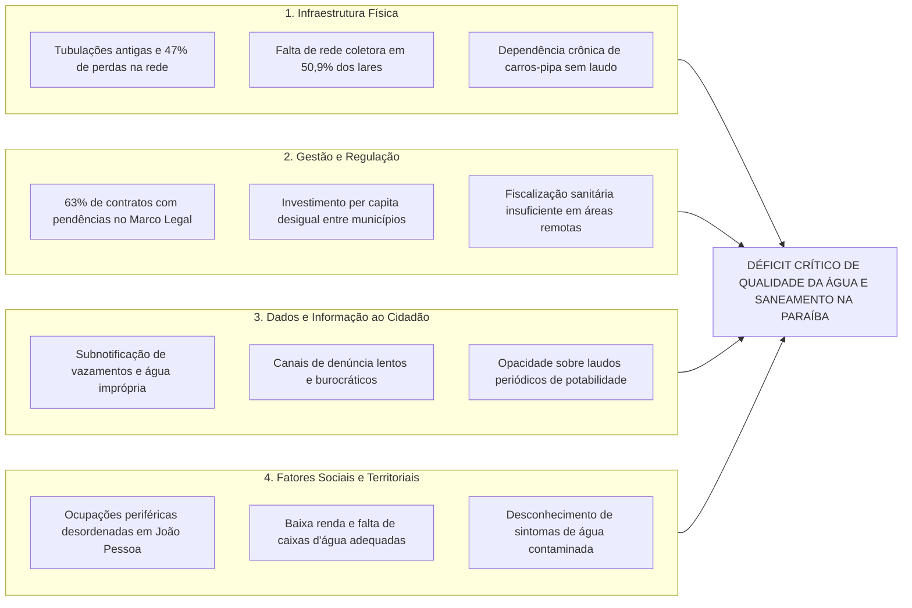

# DOSSIÊ MESTRE DA ETAPA 4: INVESTIGAÇÃO E DIAGNÓSTICO FUNDAMENTADO DE UM PROBLEMA SOCIAL E AMBIENTAL

**Instituição:** UNIPÊ – Centro Universitário de João Pessoa  
**Curso:** Superior de Tecnologia em Análise e Desenvolvimento de Sistemas (ADS)  
**Disciplina:** Projeto Integrador – Design Profissional  
**Líder da Etapa 4:** Gustavo Antonio (Segurança da Informação)  
**Revisores Pares:** Gabriel Amancio, Luiz Miguel, Paulo Germano  

---

## 1. INTRODUÇÃO E DELIBERAÇÃO DO GRUPO

A formação de tecnólogos em Análise e Desenvolvimento de Sistemas pelo UNIPÊ orienta-se pela premissa de que a inovação tecnológica só atinge sua plenitude quando colocada a serviço da cidadania, da redução das desigualdades históricas e da sustentabilidade socioambiental `[F008]`. 

Em cumprimento às diretrizes do DESAFIO_PRATICO e com base na deliberação consensual da equipe técnica e aprovação dos gates de governança, o grupo definiu como tema prioritário a ser enfrentado no Projeto Integrador:

> **"Ineficiência no monitoramento participativo da qualidade da água potável, desabastecimento crônico e déficit de esgotamento sanitário em comunidades vulneráveis e periferias no Estado da Paraíba (Alinhamento direto ao ODS 6 da ONU: Água Potável e Saneamento Básico)."**

Este Dossiê Mestre apresenta o diagnóstico estruturado e cientificamente fundamentado desse problema socioambiental, ancorando-se em indicadores censitários e epidemiológicos oficiais do IBGE `[F070]`, do Sistema Nacional de Informações sobre Saneamento (SNIS / Instituto Trata Brasil) `[F071]` e do DATASUS `[F072]`.

---

## 2. DIAGNÓSTICO COMPARATIVO DAS TRÊS ALTERNATIVAS INVESTIGADAS

Antes da escolha definitiva, o grupo investigou três cenários de relevância socioambiental no Nordeste e no estado da Paraíba, sintetizados na Tabela 1.

### Tabela 1: Quadro Comparativo dos Três Problemas Socioambientais Investigados

| Problema Investigado | Enquadramento nos ODS da ONU | Indicadores Oficiais de Gravidade | População Impactada no Estado | Justificativa de Priorização / Descarte |
|---|---|---|---|---|
| **Problema 1: Qualidade da Água e Esgotamento Sanitário** | **ODS 6** (Água Potável e Saneamento) | 50,92% dos lares da PB sem esgoto; 1,4 milhão com descarte inadequado `[F070]`; 47% de perdas na rede `[F071]`; surtos de doenças diarreicas `[F072]`. | Mais de 2 milhões de cidadãos paraibanos (periferias e zona rural). | **Selecionado com nota 9,05/10 na Matriz de Decisão.** Elevado impacto direto na saúde pública e plena viabilidade técnica em ADS. |
| **Problema 2: Insegurança Alimentar e Desperdício de Comida** | **ODS 2** (Fome Zero) e **ODS 12** (Consumo Responsável) | Índices de insegurança alimentar moderada/grave no Nordeste acima de 30% (dados IPEA); toneladas de perdas em feiras livres. | Famílias em vulnerabilidade extrema e cooperativas de coleta. | *Descartado.* Complexidade logística física excessiva de transporte refrigerado e perecibilidade de alimentos fora do escopo de software. |
| **Problema 3: Alagamentos e Desastres em Encostas Urbanas** | **ODS 11** (Cidades Sustentáveis) e **ODS 13** (Ação Climática) | Centenas de pontos críticos mapeados pela Defesa Civil de João Pessoa em margens de rios (Jaguaribe/Santhau) e barreiras. | Comunidades ribeirinhas de João Pessoa e encostas urbanas. | *Descartado.* Elevada dependência de hardware e sensores geotécnicos/pluviométricos de alto custo, inviabilizando testes com protótipo visual. |

*Fonte: Elaborado pelos autores com base em [`04_problema/matriz_decisao.md`](matriz_decisao.md).*

---

## 3. FUNDAMENTAÇÃO E ESTATÍSTICAS OFICIAIS DO PROBLEMA SELECIONADO

A seleção do monitoramento de água e saneamento apoia-se em evidências empíricas contundentes colhidas de fontes governamentais e institucionais de referência:

### 3.1 O Abastecimento de Água e a Precariedade Censitária (Censo 2022 - IBGE `[F070]`)
- Conforme o Censo Demográfico 2022 do IBGE `[F070]`, embora 74,49% dos lares paraibanos possuam conexão à rede geral, a distribuição padece de intermitência severa.
- Em termos comparativos nacionais, **8 dos 10 municípios com os piores índices de atendimento hídrico do Brasil situam-se no estado da Paraíba** (casos de Santa Cecília e Baraúna, onde a taxa de inadequação do fornecimento ultrapassa 99%) `[F070]`.
- Nesses territórios, a população depende historicamente de reservatórios comunitários precários e carros-pipa sem certificação contínua de potabilidade, expondo cidadãos a águas salobras ou contaminadas.

### 3.2 O Abismo do Esgotamento Sanitário e Perdas Hídricas (Trata Brasil / SNIS `[F071]`)
- **50,92% dos domicílios da Paraíba** (totalizando 698.949 residências) não possuem ligação à rede geral de esgotamento sanitário `[F070]`.
- Aproximadamente **1,4 milhão de pessoas** (35% da população paraibana) realizam o descarte de dejetos por fossas rudimentares, buracos a céu aberto ou deságue direto em rios, lagoas e córregos urbanos `[F070]`.
- Mesmo na capital, **João Pessoa**, mais de 88 mil moradores (cerca de 11% da população municipal) vivem em áreas desprovidas de esgoto tratado, concentrando-se em comunidades periféricas e bairros informais `[F070]`.
- O relatório do Instituto Trata Brasil `[F071]` aponta que o índice de perdas de água tratada na distribuição física da concessionária estadual alcança alarmantes **47%**, demonstrando que quase metade da água limpa se perde por vazamentos em tubulações obsoletas antes de alcançar a torneira da população vulnerável.

### 3.3 Impactos Diretos na Saúde Pública e Doenças de Veiculação Hídrica (DATASUS `[F072]`)
- Dados do Sistema de Informações Hospitalares do SUS (SIH/DATASUS `[F072]`) evidenciam correlação direta entre o déficit de saneamento e picos recorrentes de internações hospitalares por Doenças Diarreicas Agudas (DDA), esquistossomose, hepatite A, febre tifóide e gastroenterites bacterianas infecciosas na Paraíba.
- O contingente mais impactado recai sobre a faixa etária pediátrica (crianças de 0 a 5 anos) e idosos, gerando despesas hospitalares vultosas ao erário e perpetuando o ciclo de absenteísmo escolar e laboral nas famílias de baixa renda `[F072]`.

---

## 4. ANÁLISE DE CAUSAS-RAIZ (DIAGRAMA DE ISHIKAWA)

Para compreender as múltiplas dimensões que alimentam a crise hídrica e sanitária no estado, estruturou-se o Diagrama de Ishikawa (Espinha de Peixe) abaixo:

---

## 5. CARACTERIZAÇÃO DOS PÚBLICOS AFETADOS

A identificação precisa das personas orientará a formulação dos requisitos e a interface na Etapa 5:
1. **Cidadãos e Famílias Residentes em Periferias e Assentamentos Rurais:**
   - *Perfil:* Renda de até 2 salários mínimos, usuários de smartphones Android de entrada, alfabetização funcional, enfrentam constantes interrupções no fornecimento de água e utilizam fossas sépticas precárias.
   - *Necessidade:* Canal gratuito, rápido, visualmente simples e sem consumo excessivo de dados para reportar falta de água, coloração turva ou vazamento de esgoto e receber alertas no celular.
2. **Agentes Comunitários de Saúde (ACS) e Lideranças de Bairro:**
   - *Perfil:* Profissionais que visitam os domicílios e mantêm contato diário com a comunidade, necessitando registrar ocorrências locais de contaminação e surtos de vômito/diarreia.
   - *Necessidade:* Painel simples para registrar relatórios em lote, visualizar histórico georreferenciado e cobrar ações emergenciais das concessionárias.
3. **Gestores Públicos, Concessionárias e Órgãos de Defesa do Consumidor (PROCON/ANVISA):**
   - *Perfil:* Técnicos que necessitam de dados consolidados e mapas de calor para priorizar reparos e fiscalizar o cumprimento das metas do Novo Marco Legal `[F071]`.

---

## 6. MAPEAMENTO DE SOLUÇÕES TECNOLÓGICAS EXISTENTES E SUAS LACUNAS

A pesquisa analisou as ferramentas digitais e canais atualmente operantes no estado da Paraíba:

| Solução Existente | O que Faz | Lacunas e Limitações Identificadas |
|---|---|---|
| **Canais Telefônicos / Agência Virtual da Concessionária (ex: CAGEPA)** | Registro formal de chamados de vazamento e emissão de 2ª via de fatura. | Atendimento moroso, formulários extensos que demandam número de matrícula da conta (excluindo quem não tem ligação formal), ausência de mapa público em tempo real e linguagem burocrática. |
| **Sistemas Industriais Internos de Telemetria (SCADA)** | Monitoramento automatizado de pressão e vazão nas adutoras principais. | Dados restritos ao uso interno das empresas; a população não tem acesso a laudos de potabilidade do seu bairro ou previsão de retorno do serviço. |
| **Aplicativos Genéricos de Zeladoria Urbana (ex: Colab)** | Permite ao cidadão apontar buracos de rua e iluminação pública. | Não especializado nas métricas de saúde hídrica (parâmetros de turbidez, cloro, odor, sintomas de saúde da família e conformidade com a LGPD `[F001]`). |

---

## 7. DELIMITAÇÃO RIGOROSA DO ESCOPO DA PROPOSTA

Para garantir viabilidade técnica dentro do cronograma do Projeto Integrador e consonância com a formação dos estudantes em ADS, o escopo da solução foi delimitado com exatidão:

### 7.1 O que a Solução Tecnológica FARÁ (Dentro do Escopo)
- Plataforma web e mobile responsiva (aplicação web progressiva / PWA) focada em acessibilidade WCAG 2.2 `[F007]`;
- Registro simplificado e georreferenciado de ocorrências relatadas pela população (falta d'água, água com cor/odor/sabor alterado, vazamento de esgoto a céu aberto, tubulação estourada);
- Painel analítico com mapas de calor e gráficos de tendências cruzando as denúncias comunitárias com dados abertos históricos de saúde do DATASUS `[F072]`;
- Sistema preventivo de alertas comunitários avisando os moradores sobre cortes programados ou riscos sanitários identificados na localidade;
- Blindagem total de privacidade, permitindo denúncias e relatos 100% anonimizados em observância estrita à LGPD `[F001]`.

### 7.2 O que a Solução Tecnológica NÃO FARÁ (Fora do Escopo)
- Não realizará intervenções físicas na rede hidráulica ou obras de canalização de esgoto;
- Não substituirá laudos físico-químicos e bacteriológicos laboratoriais certificados da concessionária ou vigilância sanitária;
- Não exigirá a instalação de sensores físicos proprietários (IoT) de alto custo nas residências, garantindo gratuidade e ampla acessibilidade digital.

---

## 8. OBJETIVOS E RESULTADOS ESPERADOS (MENSURÁVEIS)

### 8.1 Objetivo Geral
Projetar e prototipar uma plataforma tecnológica aberta, participativa, ética e inclusiva para monitoramento comunitário da qualidade da água, mapeamento de falhas de saneamento e apoio à vigilância em saúde ambiental em territórios vulneráveis da Paraíba.

### 8.2 Objetivos Específicos
1. Desenvolver a especificação técnica completa (mínimo de 10 requisitos funcionais e 6 não funcionais) com foco em privacidade por padrão (LGPD `[F001]`) e acessibilidade WCAG 2.2 `[F007]`;
2. Modelar a arquitetura de software, diagramas de fluxo de usuário e modelo relacional de banco de dados;
3. Prototipar a interface visual (mínimo de 8 telas e estados) orientada a dispositivos móveis de baixo custo;
4. Validar o protótipo através de sessões de teste de usabilidade empíricas com pelo menos 6 voluntários adultos anonimizados (P1 a P6), medindo tempo de conclusão e taxa de sucesso.

### 8.3 Resultados Esperados Mensuráveis
- **Taxa de Conclusão de Tarefas:** Conclusão de mais de 80% das tarefas de reporte de água em até 2 minutos por usuários leigos;
- **Acessibilidade:** Alcance de 100% de conformidade com os critérios essenciais de acessibilidade (contraste mínimo 4.5:1, rótulos textuais para botões e navegação por teclado);
- **Governança de Privacidade:** Zero vazamento de identificadores de munícipes nas telas de mapa público (anonimização completa).

---

## 9. LIMITAÇÕES DA PROPOSTA

1. **Dependência de Conectividade:** A ferramenta depende de acesso esporádico à internet móvel ou Wi-Fi comunitário para sincronização das ocorrências, embora possa armazenar dados em cache offline local (*Service Workers*).
2. **Triagem de Relatos Subjetivos:** A percepção do cidadão sobre turbidez ou odor é subjetiva, exigindo algoritmos de agregação de ocorrências por bairro para validação de anomalias estatísticas antes da emissão de alertas públicos.
3. **Escopo Acadêmico do Protótipo:** Trata-se de um projeto integrador acadêmico focado em modelagem, arquitetura e prototipagem de alta fidelidade com testes de usabilidade, não operando como serviço governamental oficial no presente ciclo.

---

## 10. REFERÊNCIAS NORMATIVAS E BIBLIOGRÁFICAS

- **[F001]** BRASIL. **Lei nº 13.709, de 14 de agosto de 2018**. Dispõe sobre a proteção de dados pessoais (LGPD). Brasília, DF, 2018.
- **[F004]** ASSOCIAÇÃO BRASILEIRA DE NORMAS TÉCNICAS. **ABNT NBR 14724: Trabalhos acadêmicos — Apresentação**. Rio de Janeiro: ABNT, 2011.
- **[F005]** ASSOCIAÇÃO BRASILEIRA DE NORMAS TÉCNICAS. **ABNT NBR 6023: Referências — Elaboração**. Rio de Janeiro: ABNT, 2018.
- **[F007]** W3C. **Web Content Accessibility Guidelines (WCAG) 2.2**. 2023.
- **[F008]** UNIPÊ. **Manual de Normas Acadêmicas e Diretrizes do Projeto Integrador de ADS**. João Pessoa: UNIPÊ, 2026.
- **[F020]** GUPY TECNOLOGIA LTDA. **Portal de Vagas e Empregos Gupy: Mapeamento de Oportunidades em TI**. 2026.
- **[F021]** BRASSCOM. **Relatório Setorial de TIC: Demanda de Talentos no Brasil (2024–2029)**. São Paulo: Brasscom, 2024.
- **[F070]** INSTITUTO BRASILEIRO DE GEOGRAFIA E ESTATÍSTICA (IBGE). **Censo Demográfico 2022: Características dos Domicílios, Abastecimento de Água e Esgotamento Sanitário na Paraíba**. Rio de Janeiro: IBGE, 2024.
- **[F071]** INSTITUTO TRATA BRASIL. **Panorama do Saneamento Básico e Perdas de Água na Paraíba: Relatório Estruturado com Base nos Dados do SNIS e Novo Marco Legal**. São Paulo: Instituto Trata Brasil, 2024.
- **[F072]** MINISTÉRIO DA SAÚDE. **DATASUS: Internações e Morbidade Hospitalar por Doenças Infecciosas de Veiculação Hídrica na Paraíba**. Brasília: DATASUS, 2024.
