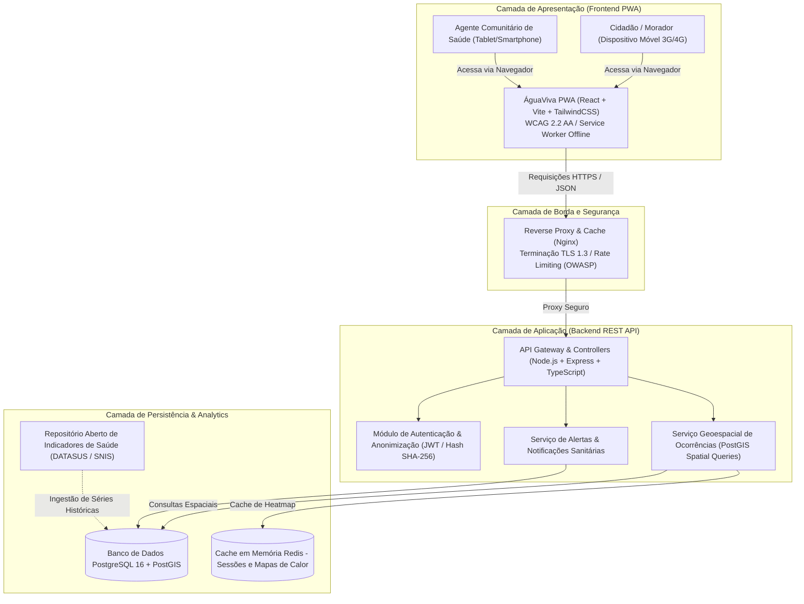

# Diagrama de Arquitetura de Software e Infraestrutura – ÁguaViva PB

Este documento modela a arquitetura técnica da solução **ÁguaViva PB**, demonstrando a separação em camadas, a integração entre frontend e backend, a persistência geoespacial e os controles de segurança e privacidade.

---

## 1. Diagrama de Contexto e Containers (Arquitetura Geral)

---

## 2. Descrição dos Componentes da Arquitetura
1. **Frontend PWA (React + Vite):** Interface responsiva, leve e acessível segundo a WCAG 2.2 `[F007]`. Utiliza *Service Workers* para permitir que moradores registrem denúncias mesmo quando a conexão móvel estiver instável.
2. **Reverse Proxy Nginx:** Ponto único de entrada na infraestrutura. Aplica cabeçalhos de segurança (CSP, HSTS), limite de taxa contra ataques de negação de serviço (*rate limiting*) e terminação SSL/TLS 1.3 `[F024]`.
3. **Backend Node.js & TypeScript:** Implementado em arquitetura modular limpa (Clean Architecture), provendo rotas RESTful documentadas e tipagem estrita contra erros em tempo de execução.
4. **PostgreSQL com PostGIS:** Banco de dados relacional com suporte nativo a dados georreferenciados (pontos de ocorrência, polígonos de bairros e buffers de proximidade a focos de contaminação).
5. **Módulo de Anonimização (LGPD `[F001]`):** Assegura que o identificador do cidadão seja substituído por um código hash irreversível antes de ser gravado na tabela pública de ocorrências.
