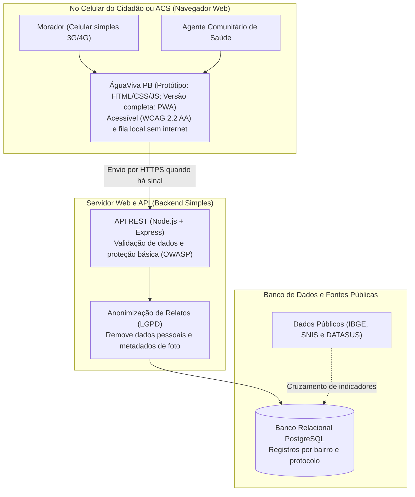

# Diagrama de Funcionamento e Arquitetura – ÁguaViva PB

Este documento descreve como o **ÁguaViva PB** funciona do ponto de vista do protótipo entregue (navegador mobile) e como seria organizado em uma versão completa para produção, mantendo infraestrutura simples e de baixo custo.

## 1. Diagrama de Funcionamento da Aplicação

## 2. Descrição dos Componentes

1. **Interface Web no Navegador (Protótipo entregue e versão PWA):** Páginas leves em HTML/CSS/JS (com evolução prevista para PWA com *Service Worker*) para que moradores consigam registrar faltas d'água mesmo com conexão fraca ou sem internet no momento.
2. **Backend REST (Node.js + Express):** Recebe os relatos do formulário, valida os campos obrigatórios e aplica proteções básicas contra entradas inválidas `[F024]`.
3. **Camada de Privacidade (LGPD `[F001]`):** Não exige CPF, RG ou telefone, remove metadados de fotos e agrupa a localização por bairro/região para evitar exposição individual de quem denuncia.
4. **Banco de Dados (PostgreSQL):** Armazena as ocorrências com data, tipo de problema, bairro e número de protocolo, permitindo gerar relatórios e cruzar informações com dados abertos de saúde e saneamento.
