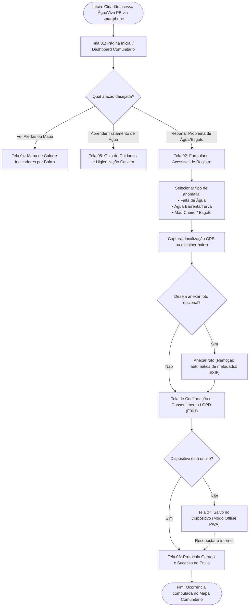

# Fluxo de Interação do Usuário (User Journey) – ÁguaViva PB

Este documento mapeia o fluxo navegacional completo vivenciado pelo cidadão desde o acesso inicial à plataforma até o recebimento de alertas e confirmação anônima de reporte de saneamento.

---

## 1. Diagrama de Fluxo de Navegação (Jornada do Cidadão)

---

## 2. Princípios de Acessibilidade no Fluxo (WCAG 2.2 `[F007]`)
- O fluxo de envio principal pode ser concluído em **no máximo 3 toques/cliques** a partir da tela inicial.
- Toda transição de tela possui foco gerenciado para tecnologias assistivas (leitores de tela anunciam o carregamento e o resultado do envio).
- As mensagens de validação de formulário são apresentadas inline com texto explícito e contraste alto, sem depender unicamente de diferenciação de cores.
