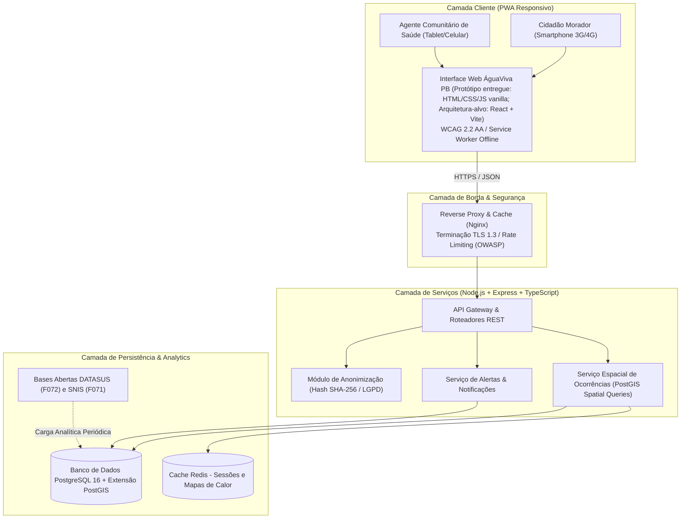
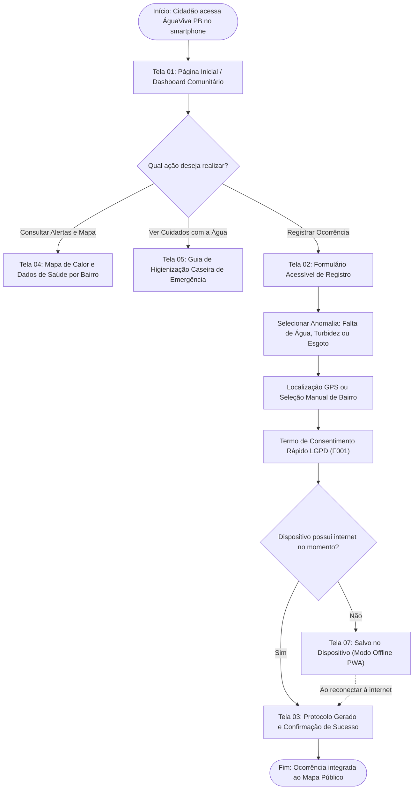

# DOSSIÊ MESTRE DA ETAPA 5: PROJETO TÉCNICO E DESENVOLVIMENTO DA SOLUÇÃO TECNOLÓGICA "ÁGUAVIVA PB"

**Instituição:** UNIPÊ – Centro Universitário de João Pessoa  
**Curso:** Superior de Tecnologia em Análise e Desenvolvimento de Sistemas (ADS)  
**Disciplina:** Projeto Integrador – Design Profissional  
**Líder da Etapa 5:** Gabriel Amancio (Desenvolvimento de Software)  
**Revisores Pares:** Gustavo Antonio, Paulo Germano, Luiz Miguel  

---

## 1. NOME, FINALIDADE E CONTEXTO DA SOLUÇÃO

- **Nome da Aplicação:** **ÁguaViva PB – Plataforma Participativa de Monitoramento Hídrico e Saneamento Comunitário**
- **Finalidade:** Fornecer aos cidadãos, líderes comunitários e agentes de saúde da Paraíba uma ferramenta digital gratuita, leve, acessível e segura para reporte georreferenciado de falhas no abastecimento de água potável, contaminação visível (turbidez/odor) e vazamentos de esgoto a céu aberto. A plataforma converte os relatos populares em mapas de calor públicos em tempo real, dissemina alertas preventivos de saúde sanitária e cruza ocorrências com dados epidemiológicos do DATASUS `[F072]`, instrumentalizando a cobrança pública por melhorias perante concessionárias e órgãos fiscalizadores no âmbito do **ODS 6 (Água Potável e Saneamento)**.

---

## 2. CARACTERIZAÇÃO DOS USUÁRIOS E PERSONAS DO SISTEMA

Com base nas evidências empíricas de precariedade hídrica levantadas no Censo 2022 do IBGE `[F070]` e no Instituto Trata Brasil `[F071]`, foram estruturadas três personas representativas:

### Persona 1: Dona Maria de Fátima (Cidadã / Moradora de Periferia)
- **Perfil Demográfico:** 52 anos, residente no bairro Mandacaru (João Pessoa - PB), trabalhadora autônoma, usuária de smartphone Android de entrada com plano de dados pré-pago limitado.
- **Dores e Necessidades:** Sofre com cortes de água sem aviso que duram dias e, quando a água retorna, apresenta cor barrenta e cheiro forte. Precisa de uma ferramenta extremamente simples, em português direto, que permita registrar a falta d'água em poucos segundos sem burocracias cadastrais e que ensine como higienizar a água para as crianças.

### Persona 2: Carlos Eduardo (Agente Comunitário de Saúde - ACS)
- **Perfil Demográfico:** 29 anos, atua na Unidade de Saúde da Família (USF) em área metropolitana/rural da Paraíba, realizando visitas domiciliares cotidianas.
- **Dores e Necessidades:** Observa repetidos casos de gastroenterite e diarreia infantil vinculados a esgotos abertos na rua. Necessita registrar múltiplos relatos de famílias visitadas em lote no seu celular e gerar dados objetivos para embasar notificações à vigilância sanitária municipal.

### Persona 3: Juliana Silva (Engenheira Sanitarista / Analista de Políticas Públicas)
- **Perfil Demográfico:** 35 anos, técnica atuante em órgão de defesa do consumidor/promotoria pública de meio ambiente em João Pessoa.
- **Dores e Necessidades:** Dificuldade em obter dados transparentes e atualizados das concessionárias sobre o índice real de perdas (que chega a 47% `[F071]`) e áreas cronicamente desabastecidas. Necessita de mapas de calor analíticos e relatórios em PDF/CSV para fundamentar termos de ajustamento de conduta (TAC).

---

## 3. ESPECIFICAÇÃO DE REQUISITOS DO SISTEMA

A especificação harmoniza a viabilidade técnica dos estudantes com as diretrizes de governança da LGPD `[F001]` e acessibilidade WCAG 2.2 `[F007]`.

### 3.1 Requisitos Funcionais (12 Requisitos com Classificação MoSCoW)
- **RF-01 (Must Have):** Registro simplificado de ocorrência hídrica (falta de água, turbidez, odor, sabor alterado) em até 3 etapas.
- **RF-02 (Must Have):** Reporte georreferenciado de esgoto a céu aberto, fossas rompidas e vazamentos de tubulação limpa na via pública.
- **RF-03 (Must Have):** Captura de localização automática via GPS do smartphone ou seleção manual assistida de bairro/cidade da Paraíba.
- **RF-04 (Must Have):** Opção mandatória de reporte anônimo (pseudonimização automática sob a LGPD `[F001]`).
- **RF-05 (Must Have):** Mapa público comunitário interativo de calor (*heatmap*) exibindo manchas de concentração de queixas nas últimas 24h a 30 dias.
- **RF-06 (Should Have):** Sistema de alerta preventivo emitindo avisos geolocalizados de manutenções programadas ou riscos sanitários.
- **RF-07 (Should Have):** Módulo especializado de login institucional para Agentes Comunitários de Saúde (ACS) com registro em lote.
- **RF-08 (Should Have):** Painel analítico de correlação espacial entre denúncias e morbidade hospitalar por doenças hídricas do DATASUS `[F072]`.
- **RF-09 (Should Have):** Guia prático e ilustrado de educação sanitária (dosagem de hipoclorito, fervura correta e limpeza de caixas d'água).
- **RF-10 (Must Have):** Operação em modo offline PWA via *Service Workers*, permitindo salvar relatos na memória local e sincronizar ao reconectar.
- **RF-11 (Could Have):** Upload facultativo de 1 fotografia comprobatória com remoção automática de metadados de privacidade (EXIF).
- **RF-12 (Could Have):** Exportação de relatórios técnicos consolidados de ocorrências em formatos abertos (PDF e CSV).

### 3.2 Requisitos Não Funcionais (8 Requisitos com Métricas Verificáveis)
- **RNF-01 (Acessibilidade):** Conformidade integral com as diretrizes internacionais **WCAG 2.2 Nível AA** `[F007]` (contraste mínimo 4.5:1, alvos de toque ≥ 44x44px, navegação por teclado e rótulos para leitores de tela).
- **RNF-02 (Desempenho e Leveza):** Tempo de Largest Contentful Paint (LCP) **≤ 2,0 segundos** em conexão 3G móvel; peso total da página inicial **≤ 1,5 MB**.
- **RNF-03 (Privacidade - LGPD `[F001]`):** *Privacy by Design* absoluto; expurgo imediato de endereço IP do cidadão e criptografia em trânsito com TLS 1.3 e em repouso com AES-256.
- **RNF-04 (Segurança de Software):** Blindagem contra o catálogo **OWASP Top 10** `[F024]`, com consultas SQL 100% parametrizadas via ORM e sanitização estrita de entradas.
- **RNF-05 (Disponibilidade):** Disponibilidade operacional mensal de **≥ 99,5% de uptime**, com monitoramento contínuo de integridade via Zabbix/Grafana.
- **RNF-06 (Usabilidade Aferível):** Taxa de conclusão de envio de reporte por voluntários leigos de **≥ 80% sem auxílio**, com tempo médio de preenchimento **≤ 120 segundos**.
- **RNF-07 (Responsividade e PWA):** Adaptabilidade fluida a telas de 320px a 1920px de largura, permitindo instalação na tela inicial sem necessidade de download em lojas de apps.
- **RNF-08 (Green IT):** Arquitetura com baixo consumo de processamento, compressão de imagens em WebP e cache inteligente via Nginx para mitigação de consumo energético.

---

## 4. MODELAGEM DA ARQUITETURA E DIAGRAMAS DE SISTEMA

### 4.1 Diagrama de Arquitetura de Software e Containers
A arquitetura adota o padrão modular desacoplado em camadas:

---

### 4.2 Diagrama do Fluxo de Interação do Usuário (User Flow)
O percurso do munícipe prioriza velocidade e inclusão digital:

---

## 5. HISTÓRIAS DE USUÁRIO (USER STORIES NO FORMATO BDD)

Para assegurar rastreabilidade entre requisitos e implementação, estruturaram-se 8 histórias de usuário contendo critérios de aceitação no padrão **Dado / Quando / Então**:

### US-01: Reporte Rápido de Falta de Água por Morador Vulnerável
- **História:** *Como* moradora de comunidade periférica sem água encanada há dias, *quero* reportar a interrupção no fornecimento informando meu bairro em menos de 1 minuto, *para que* o problema seja visibilizado no mapa público da cidade.
- **Critérios de Aceitação (BDD):**
  - **Dado** que a usuária acessa o formulário de reporte na Tela 02;
  - **Quando** ela seleciona a categoria "Falta de Água" e clica em "Usar minha localização";
  - **Então** o sistema preenche o bairro automaticamente, gera um protocolo anônimo e exibe a mensagem de sucesso na Tela 03 em até 2 segundos.

---

### US-02: Notificação de Esgoto a Céu Aberto com Foto Comprobatória
- **História:** *Como* cidadão que convive com esgoto transbordando na calçada, *quero* enviar uma foto da ocorrência pelo smartphone, *para* comprovar a urgência da denúncia sanitária.
- **Critérios de Aceitação (BDD):**
  - **Dado** que o usuário anexa uma imagem no formato JPEG ou PNG;
  - **Quando** ele confirma o envio do formulário;
  - **Então** o backend remove automaticamente todos os metadados EXIF de localização privada e dispositivo da foto antes de salvá-la em armazenamento seguro.

---

### US-03: Visualização do Mapa de Calor Comunitário de Queixas
- **História:** *Como* morador de João Pessoa, *quero* visualizar quais bairros da capital apresentam maior incidência de água imprópria ou desabastecimento, *para* me precaver e cobrar ações da concessionária.
- **Critérios de Aceitação (BDD):**
  - **Dado** que o usuário clica na aba "Mapa de Queixas" na Tela 04;
  - **Quando** ele seleciona o filtro "Últimos 7 dias";
  - **Então** o mapa renderiza camadas de calor dinâmicas em cores acessíveis com contraste visual, agrupando pontos críticos por polígono de bairro.

---

### US-04: Envio em Modo Offline para Comunidades sem Conexão Móvel
- **História:** *Como* morador de assentamento rural da Paraíba sem sinal de telefonia móvel, *quero* registrar uma denúncia de água barrenta mesmo desconectado, *para que* o envio ocorra automaticamente quando eu chegar a uma área com sinal.
- **Critérios de Aceitação (BDD):**
  - **Dado** que o dispositivo do usuário está em modo avião ou sem sinal de rede;
  - **Quando** ele finaliza o preenchimento da ocorrência;
  - **Então** o *Service Worker* salva os dados criptografados no IndexedDB do navegador, exibe a Tela 07 (Modo Offline) e dispara a transmissão no primeiro momento de reconexão.

---

### US-05: Módulo de Registro em Lote para Agente Comunitário de Saúde (ACS)
- **História:** *Como* Agente Comunitário de Saúde em visitas domiciliares, *quero* cadastrar ocorrências de múltiplos domicílios da minha microárea em lote, *para* alertar a vigilância epidemiológica sobre riscos de diarreia infantil.
- **Critérios de Aceitação (BDD):**
  - **Dado** que o ACS realizou login institucional no módulo especializado (Tela 06);
  - **Quando** ele marca 10 residências da Rua do Sol com água turva e sintomas de vômito;
  - **Então** o sistema computa as 10 ocorrências vinculadas à matrícula do posto de saúde e emite um alerta para a coordenação municipal da USF.

---

### US-06: Consulta a Alertas Sanitários e Previsão de Retorno da Água
- **História:** *Como* morador cadastrado no sistema, *quero* receber notificações claras sobre cortes programados de água no meu bairro, *para que* minha família possa armazenar água potável com antecedência.
- **Critérios de Aceitação (BDD):**
  - **Dado** que a concessionária ou defesa civil publica uma manutenção na adutora da zona sul;
  - **Quando** o morador acessa a Tela 01;
  - **Então** o card de alerta superior destaca a mensagem com contraste WCAG 2.2 e informa a data e horário estimados para normalização do serviço.

---

### US-07: Aprendizado de Medidas Caseiras de Descontaminação Hídrica
- **História:** *Como* mãe de família em situação de emergência hídrica com água de poço duvidosa, *quero* instruções ilustradas de como purificar a água em casa, *para* evitar que meus filhos adoeçam.
- **Critérios de Aceitação (BDD):**
  - **Dado** que a usuária clica na aba "Guia de Saúde" na Tela 05;
  - **Quando** ela seleciona a opção "Como clorar a água com segurança";
  - **Então** o sistema exibe passos visuais em linguagem simples orientando a proporção de 2 gotas de água sanitária por litro de água com repouso de 30 minutos.

---

### US-08: Exercício dos Direitos do Titular sob a LGPD (Revogação e Exclusão)
- **História:** *Como* denunciante de um vazamento de esgoto, *quero* solicitar a exclusão de qualquer dado de contato que tenha fornecido, *para* assegurar que minha privacidade seja respeitada.
- **Critérios de Aceitação (BDD):**
  - **Dado** que o cidadão insere o número do seu protocolo de denúncia na página de privacidade;
  - **Quando** ele clica no botão "Solicitar Exclusão Definitiva dos meus Dados";
  - **Então** o sistema apaga os registros correlacionados do banco de dados em conformidade com o art. 18 da Lei nº 13.709/2018 `[F001]` e emite um comprovante de eliminação.

---

## 6. STACK TECNOLÓGICA E RECURSOS NECESSÁRIOS

A escolha da stack foi orientada diretamente pelas competências identificadas como prioritárias no mercado de trabalho de TI (Etapa 1 `[F020]`), viabilidade econômica de código aberto e baixo consumo energético (Green IT):

| Camada | Tecnologia Selecionada | Versão / Padrão | Justificativa Técnica e Acadêmica |
|---|---|---|---|
| **Frontend Web** | Protótipo: HTML/CSS/JS vanilla; Arquitetura-alvo: React + Vite + TailwindCSS | Protótipo entregue / PWA alvo | Protótipo conceitual em vanilla JS para validação rápida; React + Vite como arquitetura-alvo para produção e ecossistema PWA. |
| **Backend / API** | Node.js + Express + TypeScript | Node 20 LTS | Arquitetura RESTful tipada, assíncrona, de alto desempenho para concorrência de requisições e de fácil manutenção pelo estudante de Dev (Gabriel). |
| **Banco de Dados** | PostgreSQL + PostGIS | Postgres 16 | Banco relacional robusto com extensão espacial líder mundial para consultas de latitude/longitude e agregação em polígonos de bairros (Paulo). |
| **Borda e Infraestrutura** | Docker + Nginx Reverse Proxy | Nginx Alpine | Contêineres leves, baixo consumo de memória RAM, terminação SSL/TLS 1.3 e esteira de sustentação administrada pelo estudante de Infra (Luiz). |
| **Segurança e Identidade** | Helmet, Bcrypt e JWT | Padrões OWASP `[F024]` | Módulo de segurança defensiva, sanitização de requisições e anonimização rigorosa sob supervisão do estudante de Segurança (Gustavo). |
| **Prototipagem Visual** | Figma | Versão Cloud | Criação dos wireframes de alta fidelidade, guia de estilos de cores acessíveis e montagem dos slides de apresentação final. |

---

## 7. ESPECIFICAÇÃO DAS 8 TELAS E ESTADOS DE INTERFACE PARA O PROTÓTIPO (FIGMA)

O protótipo do **ÁguaViva PB** contempla a jornada de ponta a ponta dos usuários, documentada detalhadamente no artefato canônico [`05_solucao/prototipo/especificacao_telas.md`](prototipo/especificacao_telas.md):

1. **Tela 01 – Página Inicial / Dashboard Comunitário (Home):** Visão rápida de alertas de desabastecimento ativos no topo com alto contraste, botão central destacado de reporte ("Reportar Falta de Água ou Esgoto") e mini-mapa de queixas nas últimas 24 horas.
2. **Tela 02 – Formulário Acessível de Registro de Ocorrência:** Seleção rápida em 4 cartões com ícones ilustrativos (Falta d'Água, Água Turva/Barrenta, Esgoto a Céu Aberto, Cano Estourado), localização assistida por GPS/Bairro e campo opcional de foto com metadados removidos.
3. **Tela 03 – Confirmação de Envio com Protocolo Anônimo (Sucesso):** Checkmark verde de sucesso, código identificador único (ex.: `#AV-2026-8941`) e declaração explícita de anonimização conforme a LGPD `[F001]`.
4. **Tela 04 – Mapa Interativo de Calor e Dados de Saúde (Heatmap):** Camadas com manchas de calor georreferenciadas por bairro e painel lateral correlacionando denúncias a indicadores de saúde pública do DATASUS `[F072]`.
5. **Tela 05 – Guia Prático de Cuidados e Higienização da Água:** Passo a passo ilustrado de cloração caseira de emergência (2 gotas por litro), fervura correta e sinais clínicos de desidratação infantil para encaminhamento ao SUS.
6. **Tela 06 – Módulo Especializado do Agente Comunitário de Saúde (ACS):** Visão autenticada por matrícula institucional para registro em lote de queixas comunitárias durante visitas e envio direto à Secretaria Municipal de Saúde.
7. **Tela 07 – Estado Vazio e Conexão Offline (Empty State):** Mensagem de orientação avisando que o aparelho está temporariamente sem internet, assegurando que o relato foi guardado no cache local do celular e será transmitido automaticamente.
8. **Tela 08 – Estado de Erro e Tratamento Acessível de Falha (Error State):** Interface amigável de recuperação em linguagem simples, sem códigos técnicos, permitindo tentar o reenvio com um clique.

---

## 8. PLANO RESPONSÁVEL: PRIVACIDADE, ACESSIBILIDADE E SUSTENTABILIDADE

### 8.1 Privacidade e Proteção de Dados (LGPD - Lei nº 13.709/2018 `[F001]`)
- **Minimização de Dados (Art. 6º, III):** O sistema não coleta RG, CPF, biometria ou dados bancários do cidadão denunciante. A geolocalização é arredondada em nível de trecho de rua/bairro para evitar a identificação domiciliar exata de quem reporta.
- **Anonimização Irreversível:** Os identificadores de sessão são transformados em códigos hash criptográficos SHA-256 unidirecionais.
- **Canal de Atendimento ao Titular (Art. 18):** Disponibilização de link direto no rodapé da aplicação para requisição de eliminação de dados ou esclarecimentos sobre privacidade.

### 8.2 Acessibilidade Digital e Inclusão (WCAG 2.2 Nível AA `[F007]`)
- **Contraste de Cores:** Todos os textos possuem razão de contraste mínima de 4.5:1 em relação ao plano de fundo. Botões de ação prioritária utilizam cores primárias sólidas com bordas destacadas.
- **Navegação Assistida:** Ordem de tabulação lógica (`tabindex`) para usuários que utilizam navegadores exclusivamente via teclado ou acionadores assistivos.
- **Linguagem Simples (*Plain Language*):** Supressão de jargões técnicos de engenharia hidráulica ou jurídica, adotando termos populares compreensíveis por cidadãos de todos os níveis de escolaridade (ex.: "Água Barrenta" em vez de "Turbidez elevada acima de 5,0 uT").

### 8.3 Sustentabilidade Computacional (Green IT)
- A arquitetura PWA elimina o consumo excessivo de downloads pesados de lojas de aplicativos;
- As imagens são comprimidas no formato moderno WebP com redução média de 70% no peso de transferência de dados;
- O banco de dados PostgreSQL utiliza índices espaciais (GIST) otimizados para evitar que consultas de mapa de calor sobrecarreguem o processador do servidor.

---

## 9. CONSIDERAÇÕES FINAIS E APROVAÇÃO DO GATE 5

O projeto técnico da solução **ÁguaViva PB** integra de forma harmônica as competências dos quatro integrantes do grupo (Dev, Infra, Dados e Segurança), respondendo com maturidade técnica, rigor acadêmico e responsabilidade social ao problema da qualidade da água e do saneamento básico na Paraíba `[F070]`.

O conjunto documental encontra-se concluído e pronto para fundamentar o planejamento e a realização dos testes de usabilidade com participantes voluntários na **Etapa 6**.

---

## 10. REFERÊNCIAS NORMATIVAS E BIBLIOGRÁFICAS

- **[F001]** BRASIL. **Lei nº 13.709, de 14 de agosto de 2018**. Dispõe sobre a proteção de dados pessoais (LGPD). Brasília, DF, 2018.
- **[F004]** ASSOCIAÇÃO BRASILEIRA DE NORMAS TÉCNICAS. **ABNT NBR 14724: Trabalhos acadêmicos — Apresentação**. Rio de Janeiro: ABNT, 2011.
- **[F005]** ASSOCIAÇÃO BRASILEIRA DE NORMAS TÉCNICAS. **ABNT NBR 6023: Referências — Elaboração**. Rio de Janeiro: ABNT, 2018.
- **[F007]** W3C. **Web Content Accessibility Guidelines (WCAG) 2.2**. W3C Recommendation, 2023.
- **[F008]** UNIPÊ. **Manual de Normas Acadêmicas e Diretrizes do Projeto Integrador de ADS**. João Pessoa: UNIPÊ, 2026.
- **[F020]** GUPY TECNOLOGIA LTDA. **Portal de Vagas e Empregos Gupy: Mapeamento de Oportunidades em TI**. 2026.
- **[F021]** BRASSCOM. **Relatório Setorial de TIC: Demanda de Talentos no Brasil (2024–2029)**. São Paulo: Brasscom, 2024.
- **[F024]** OPEN WORLDWIDE APPLICATION SECURITY PROJECT (OWASP). **OWASP Top 10 Application Security Risks**. 2026.
- **[F027]** ENAP. **Curso Fundamentos da Lei Geral de Proteção de Dados (LGPD)**. Brasília: Enap, 2024.
- **[F070]** INSTITUTO BRASILEIRO DE GEOGRAFIA E ESTATÍSTICA (IBGE). **Censo Demográfico 2022: Abastecimento de Água e Esgotamento Sanitário na Paraíba**. Rio de Janeiro: IBGE, 2024.
- **[F071]** INSTITUTO TRATA BRASIL. **Panorama do Saneamento Básico e Perdas de Água na Paraíba (SNIS)**. São Paulo: Trata Brasil, 2024.
- **[F072]** MINISTÉRIO DA SAÚDE. **DATASUS: Morbidade Hospitalar por Doenças Infecciosas de Veiculação Hídrica na Paraíba**. Brasília: DATASUS, 2024.
