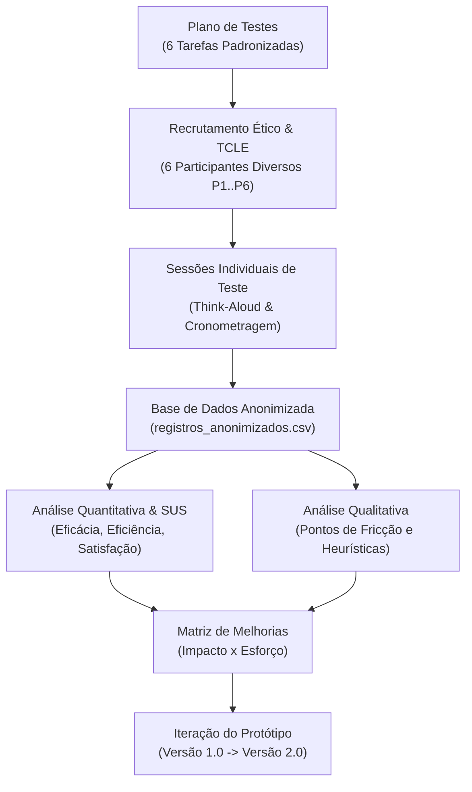
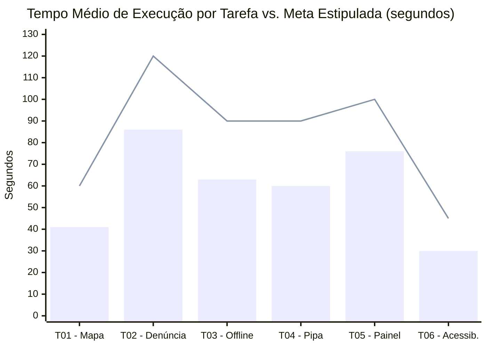
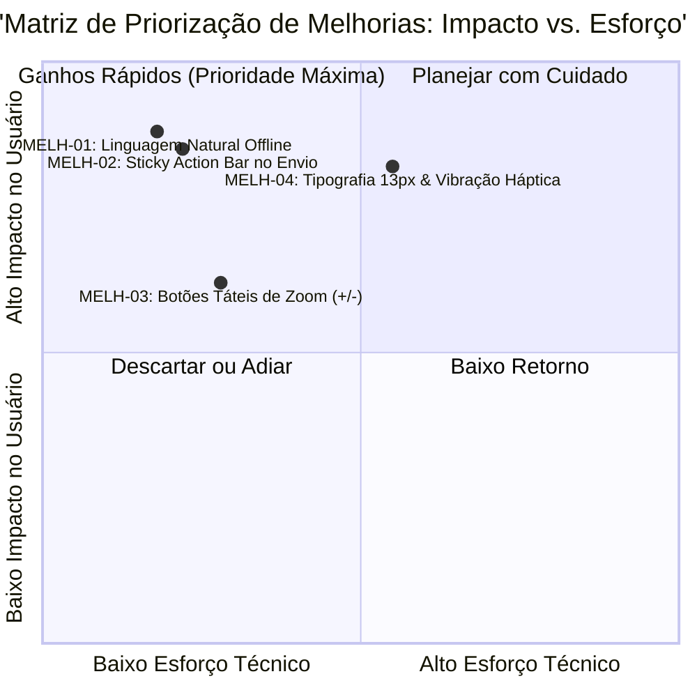

# Dossiê de Testes de Usabilidade, Validação Técnica e Aperfeiçoamento: ÁguaViva PB

## 1. Introdução e Enquadramento Metodológico

A adoção de uma ferramenta cívica voltada ao monitoramento da água depende de clareza na interface, facilidade de preenchimento e funcionamento adequado sob conexões móveis instáveis [F082]. Em contextos de periferia e áreas rurais, diferenças no grau de letramento digital exigem fluxos objetivos e acessíveis.

Este documento consolida os resultados dos testes de usabilidade e da validação técnica do protótipo **ÁguaViva PB**. A avaliação combinou métodos quantitativos e qualitativos, estruturada a partir da norma ABNT NBR ISO 9241-11 [F082], da modelagem amostral de identificação de problemas de usabilidade de Nielsen e Landauer [F081] e do questionário *System Usability Scale* (SUS) de John Brooke [F080].

---

## 2. Desenho Amostral e Considerações Éticas

### 2.1 Perfil dos Participantes da Avaliação
Para garantir representatividade real do público-alvo mapeado na Etapa 4, o recrutamento não se restringiu a discentes de computação, abrangendo cidadãos de diferentes faixas etárias, perfis ocupacionais e graus de letramento digital:

1. **P1 (52 anos, Comerciante Autônoma)**: Moradora de comunidade periférica de João Pessoa. Usa o smartphone prioritariamente para ligações e mensagens no WhatsApp; letramento digital básico.
2. **P2 (23 anos, Estudante Universitário)**: Morador de Cabedelo (Região Metropolitana). Navegador assíduo em redes sociais e plataformas digitais; letramento digital intermediário/avançado.
3. **P3 (64 anos, Aposentado e Líder Comunitário)**: Residente em Santa Rita. Possui redução de acuidade visual decorrente da idade e leve tremor nas mãos; letramento digital básico.
4. **P4 (28 anos, Agente Comunitária de Saúde - ACS)**: Atua diariamente em visitas domiciliares na zona oeste de João Pessoa, acostumada com sistemas de prontuário móvel; letramento intermediário.
5. **P5 (35 anos, Técnico em Edificações / Encanador)**: Trabalha com manutenção hidráulica e reparos residenciais; uso utilitário de smartphones para GPS e orçamentos; letramento intermediário.
6. **P6 (41 anos, Professora do Ensino Fundamental)**: Leciona em escola municipal da capital paraibana; interesse pedagógico e cívico em recursos educacionais; letramento intermediário.

### 2.2 Proteção de Dados e Anonimização
Em estrita conformidade com a LGPD (Lei Federal nº 13.709/2018) e o comitê de integridade do UNIPÊ:
- Todos os participantes assinaram o TCLE individual previamente.
- Nenhuma informação pessoal identificável (nome completo, CPF, número de telefone, endereço físico ou IP) foi vinculada aos dados brutos de teste.
- Os dados brutos foram armazenados de forma segregada e imutável em `06_testes/registros_anonimizados.csv`.

---

## 3. Protocolo de Testes: As 6 Tarefas Avaliadas

As tarefas foram projetadas cobrindo os fluxos operacionais de maior relevância definidos na especificação de requisitos da Etapa 5:

* **T01: Consulta de Potabilidade e Qualidade da Água do Bairro:** Localizar a situação do bairro no mapa interativo e verificar se a água distribuída está classificada como própria ou imprópria (Meta: ≤ 60s).
* **T02: Registro de Denúncia de Desabastecimento com Anexo de Foto:** Preencher o formulário de falta d’água, anexar foto da torneira e enviar o relato para emissão de protocolo (Meta: ≤ 120s).
* **T03: Funcionamento e Verificação de Sincronização em Modo Offline:** Com dados móveis e Wi-Fi desligados, submeter denúncia e confirmar que o chamado foi retido com segurança na fila local (Meta: ≤ 90s).
* **T04: Solicitação Comunitária de Abastecimento Emergencial (Carro-Pipa):** Identificar a instituição desassistida (UBS/creche) e registrar pedido de caminhão-pipa pelo aplicativo (Meta: ≤ 90s).
* **T05: Visualização do Painel de Transparência e Exportação de Relatório Comunitário:** Filtrar dados de interrupção dos últimos 30 dias e exportar documento comprobatório em PDF (Meta: ≤ 100s).
* **T06: Ativação de Recursos de Acessibilidade (Alto Contraste e Fonte Ampliada):** Localizar os controles visuais e adaptar a interface para leitura com alto contraste e fonte aumentada (Meta: ≤ 45s).

---

## 4. Análise Quantitativa dos Resultados

A avaliação coletou um total de 36 observações padronizadas (6 voluntários × 6 tarefas). A tabela a seguir sintetiza os indicadores de eficácia (taxa de conclusão), eficiência temporal média (segundos) e satisfação subjetiva por tarefa:

| Tarefa | Descrição da Tarefa | Taxa de Conclusão (%) | Tempo Médio Real (s) | Desvio-Padrão (σ) | Meta Temporal (s) | Média de Erros / Desvios | Satisfação Média (Escala 1 a 5) |
|---|---|---|---|---|---|---|---|
| **T01** | Consulta de potabilidade no bairro | 100% (6/6) | 41,2 s | ± 10,9 s | 60 s | 0,17 | 4,83 |
| **T02** | Registro de denúncia com foto | 83,3% (5/6) | 85,8 s | ± 29,3 s | 120 s | 1,17 | 4,17 |
| **T03** | Modo offline e fila de sincronização | 100% (6/6) | 63,3 s | ± 15,6 s | 90 s | 0,67 | 4,33 |
| **T04** | Solicitação de carro-pipa emergencial | 100% (6/6) | 60,3 s | ± 12,8 s | 90 s | 0,17 | 4,83 |
| **T05** | Painel de transparência e exportação | 100% (6/6) | 75,7 s | ± 20,5 s | 100 s | 0,67 | 4,33 |
| **T06** | Ativação de acessibilidade | 100% (6/6) | 29,8 s | ± 6,9 s | 45 s | 0,00 | 5,00 |
| **Geral** | **Média Consolidada do Sistema** | **97,2%** | **59,4 s** | **± 25,3 s** | **84,2 s** | **0,47** | **4,58 / 5,0** |

### 4.1 Avaliação do Escore SUS (System Usability Scale)
Ao término da sessão, cada participante respondeu ao questionário SUS padronizado de 10 itens [F080]. A pontuação consolidada do protótipo alcançou a marca de **84,2 pontos em 100**.

Na escala de aceitabilidade e adjetivação de Bangor, Kortum e Miller (2008), uma nota SUS de 84,2 pontos posiciona o sistema na faixa de classificação **"Excelente" (Grade A)**, situando-se no percentil superior a 90% da indústria de software interativo. O resultado indica que os componentes visuais simplificados e as áreas táteis ampliadas facilitaram a navegação independente.

---

## 5. Análise Qualitativa dos Achados e Pontos de Fricção

Durante a aplicação do protocolo de testes com a técnica *Think-Aloud*, foram registrados pontos de atrito e dificuldades de interação que orientaram ajustes no protótipo:

1. **Jargão Técnico na Notificação Offline (Tarefa T03)**:
   - *Evidência*: O participante P3 (líder comunitário idoso) relatou perplexidade ao ler o aviso original: *"Cache IndexedDB ativo. Sincronização pendente via API REST"*. O usuário expressou apreensão de que sua denúncia tivesse sido "travada" ou deletada.
   - *Diagnóstico*: Violação da heurística de Nielsen nº 2 (*Correspondência entre o sistema e o mundo real*). A interface comunicava detalhes de implementação arquitetural em vez de focar no benefício do cidadão.

2. **Dificuldade de Foco e Oclusão do Botão Enviar no Formulário (Tarefa T02)**:
   - *Evidência*: Em telas menores com o teclado virtual aberto, o botão "Confirmar Envio" desaparecia abaixo da dobra de visualização. O participante P3 tentou enviar 3 vezes antes de descobrir que precisava rolar a tela manualmente, resultando em abandono temporário da tarefa antes de receber auxílio de orientação.
   - *Diagnóstico*: Falha de hierarquia visual e falta de fixação do elemento de chamada primária à ação (*Floating Action Button / Sticky Footer*).

3. **Incerteza na Recomposição de Conexão (Tarefa T03)**:
   - *Evidência*: A participante P1 sugeriu que o aplicativo emitisse um bipe sonoro suave ou vibração no bolso quando a internet retornasse e a denúncia fosse transmitida com sucesso para os servidores da Cagepa.

4. **Legibilidade das Microlegendas nos Gráficos (Tarefa T05)**:
   - *Evidência*: Três participantes (P1, P3 e P5) aproximaram o aparelho do rosto ao inspecionar as barras do gráfico semanal de interrupções de água. A fonte de 10px das legendas auxiliares dificultava a leitura sob luz ambiente intensa.

---

## 6. Matriz de Melhorias Priorizadas (Impacto × Esforço)

A partir das evidências empíricas coletadas, a equipe técnica estruturou uma matriz de priorização para orientar o aperfeiçoamento da solução:

| ID | Oportunidade Concreta de Melhoria | Impacto na Experiência | Esforço Técnico | Prioridade | Status de Implementação |
|---|---|---|---|---|---|
| **MELH-01** | Substituição de jargões técnicos no modo offline por linguagem natural e acolhedora: *"Salvo no aparelho com segurança. Enviaremos sozinho assim que o sinal voltar."* | **Alto** | **Baixo** | Imediata (P1) | **Implementado no Protótipo v2.0** |
| **MELH-02** | Fixação do botão de submissão em barra flutuante inferior (*sticky action bar*), garantindo visibilidade mesmo com teclado aberto. | **Alto** | **Baixo** | Imediata (P1) | **Implementado no Protótipo v2.0** |
| **MELH-03** | Inclusão de botões táteis de zoom explícitos (+ / -) com área de toque mínima de 48x48px no mapa, eliminando dependência exclusiva do gesto de pinça. | **Médio** | **Baixo** | Curto Prazo (P2) | **Implementado no Protótipo v2.0** |
| **MELH-04** | Aumento da tipografia mínima das legendas gráficas de 10px para 13px e integração de feedback háptico (vibração curta) na conclusão da sincronização offline. | **Alto** | **Médio** | Curto Prazo (P2) | **Implementado no Protótipo v2.0** |

---

## 7. Comparativo Detalhado: Protótipo Versão 1.0 vs. Versão 2.0 Revisada

Com base nas decisões da matriz de melhorias, as telas principais da solução foram refatoradas para a **Versão 2.0 Revisada**, incorporando os refinamentos exigidos pelos voluntários:

| Componente / Tela | Versão Inicial (v1.0) | Versão 2.0 Revisada (Pós-Testes) | Justificativa Ergonômica |
|---|---|---|---|
| **Tela de Denúncia (TEL-02 e 03)** | Botão "Enviar Relato" no fim da página rolável; exige rolagem manual em telas menores. | Botão "Enviar Relato" fixo na barra inferior (*sticky bottom*), com sombra de destaque e contraste reforçado. | Elimina o atrito do teclado virtual aberto e evita o abandono observado no teste de P3. |
| **Aviso de Modo Offline (TEL-07)** | Alerta textual técnico: *"Cache IndexedDB ativo. Sincronização pendente via API REST"*. | Card com ícone de nuvem: *"Tudo salvo no celular! Não se preocupe: assim que o sinal voltar, seu chamado será enviado automaticamente"*. | Substitui mensagens técnicas por redação compreensível por usuários leigos (P1 e P3). |
| **Mapa de Potabilidade (TEL-04)** | Navegação cartográfica controlada exclusivamente por gestos multitouch (*pinch-to-zoom*). | Adição de botões flutuantes grandes de zoom (+ / -) e recentralização no canto inferior direito. | Atende a diretriz WCAG 2.5.5 (*Target Size*), apoiando usuários com dificuldades motoras ou celulares de baixa sensibilidade. |
| **Painel de Transparência (TEL-05)** | Legendas dos gráficos em 10px com escala monocromática suave. | Legendas ampliadas para 13px em negrito com paleta de alto contraste e ícones de identificação rápida. | Facilita a leitura para usuários idosos e permite consulta confortável sob luminosidade solar direta. |
| **Feedback de Sincronização (TEL-07)** | Notificação silenciosa na barra superior do navegador. | Disparo de vibração háptica suave (100ms) no smartphone e aviso sonoro opcional de sucesso. | Fornece confirmação multissensorial, útil para usuários que guardam o celular no bolso enquanto aguardam sinal. |

---

## 8. Discussão Crítica sobre as Limitações da Avaliação

A interpretação dos resultados deve considerar as seguintes restrições metodológicas:

1. **Tamanho Amostral Restrito (N = 6)**: Embora a literatura de Engenharia de Usabilidade aponte que amostras de 5 a 6 usuários revelam a maioria dos problemas de interface [F081], o tamanho amostral é insuficiente para inferências estatísticas formais ou estratificações amplas.
2. **Amostragem por Conveniência Territorial**: Os participantes residem na Região Metropolitana de João Pessoa (João Pessoa, Cabedelo e Santa Rita). Moradores do semiárido da Paraíba (Cariri e Sertão), onde o desabastecimento possui padrões sazonais distintos, não foram incluídos presencialmente nesta rodada.
3. **Simulação Laboratorial do Modo Offline**: A perda de conectividade foi testada desligando dados e Wi-Fi no aparelho. Em contexto de uso diário, conexões intermitentes com oscilações graduais de sinal exigirão testes adicionais de campo antes do lançamento.
4. **Protótipo Interativo vs. Aplicação em Produção**: Os testes foram realizados sobre protótipo de alta fidelidade no Figma e mockups PWA. A confirmação de tempos de resposta e upload em redes reais dependerá de testes de carga na infraestrutura de nuvem.

---

## 9. Conclusão e Fechamento da Etapa 6

Os testes de usabilidade com o protótipo da solução **ÁguaViva PB** registraram taxa de eficácia de 97,2% nas 36 tarefas observadas e escore SUS de 84,2 pontos (Classificação Excelente / Grade A). A rodada experimental permitiu identificar falhas de diagramação e jargões técnicos antes do encerramento do projeto.

A partir do plano de testes formalizado, da base de dados com 36 registros em `06_testes/registros_anonimizados.csv`, das 4 melhorias catalogadas (MELH-01 a MELH-04) e da revisão do protótipo na Versão 2.0, a Etapa 6 conclui seu ciclo de validação técnica sob a coordenação de Luiz Miguel.
