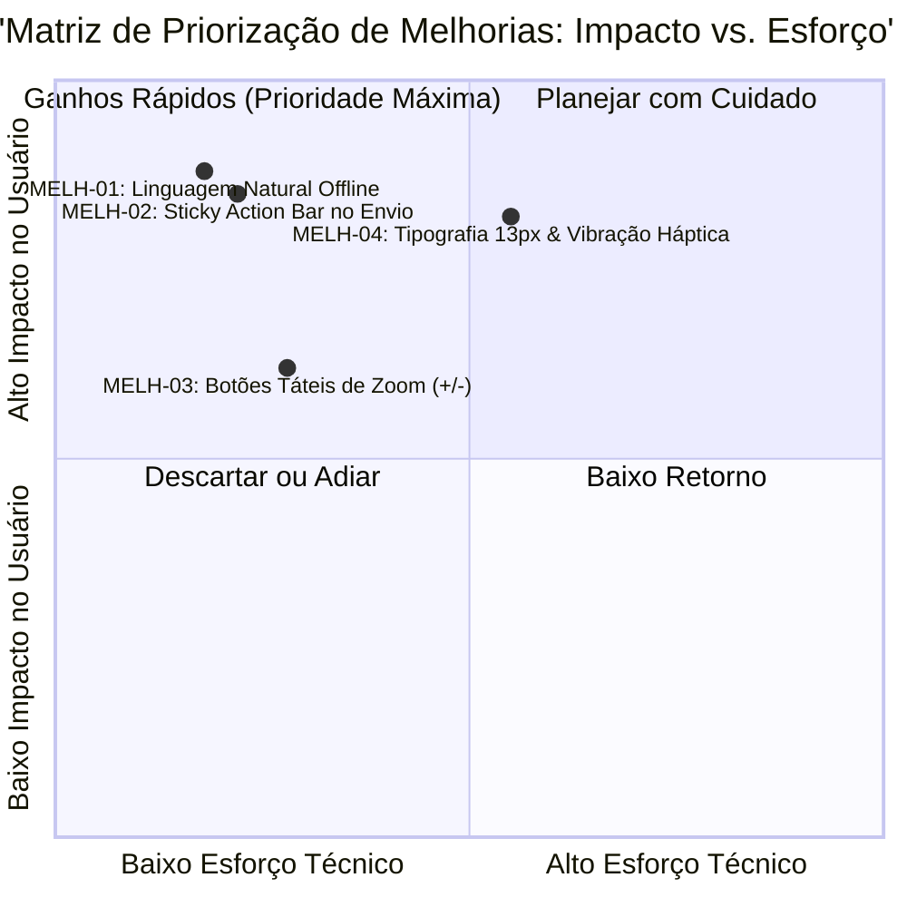

# Matriz de Melhorias Priorizadas (Pós-Testes de Usabilidade): ÁguaViva PB

## 1. Identificação de Oportunidades de Aperfeiçoamento
Durante os testes de usabilidade com os 6 participantes e a aplicação da técnica *Think-Aloud*, foram catalogados pontos de atrito e dificuldades de navegação. Esses apontamentos resultaram em 4 propostas de melhoria (MELH-01 a MELH-04).

## 2. Matriz de Priorização (Impacto na Experiência × Esforço Técnico)

| ID | Oportunidade de Melhoria | Impacto na Experiência | Esforço Técnico | Prioridade de Implementação | Status |
|---|---|---|---|---|---|
| **MELH-01** | Substituição de jargões técnicos no modo offline (*"Cache IndexedDB ativo; API REST"*) por redação clara em linguagem natural: *"Salvo no aparelho com segurança. Enviaremos sozinho assim que o sinal voltar."* | **Alto** | **Baixo** | Imediata (P1) | **Implementado no Protótipo v2.0** |
| **MELH-02** | Fixação do botão de envio do formulário em barra inferior fixa (*sticky action bar*), garantindo visibilidade mesmo com o teclado virtual aberto em telas compactas. | **Alto** | **Baixo** | Imediata (P1) | **Implementado no Protótipo v2.0** |
| **MELH-03** | Inclusão de botões táteis explícitos de ampliação e redução (+ / -) com dimensão mínima de 48 × 48 px no mapa interativo, eliminando a dependência exclusiva do gesto multitouch de pinça (*pinch-to-zoom*). | **Médio** | **Baixo** | Curto Prazo (P2) | **Implementado no Protótipo v2.0** |
| **MELH-04** | Aumento da tipografia das legendas e eixos dos gráficos de 10 px para 13 px em negrito de alto contraste e integração de feedback háptico (vibração curta de 100 ms) ao concluir a sincronização assíncrona. | **Alto** | **Médio** | Curto Prazo (P2) | **Implementado no Protótipo v2.0** |

## 3. Diagrama do Quadrante de Decisão

## 4. Conclusão da Implementação
As quatro melhorias catalogadas foram incorporadas ao **Protótipo Versão 2.0 Revisado**, adequando a interface às heurísticas de usabilidade de Nielsen e às diretrizes de acessibilidade WCAG 2.2 AA `[F007]`. O detalhamento comparativo entre a versão inicial e a revisada está documentado em `06_testes/comparativo_v1_v2.md` e sintetizado no [Dossiê de Testes](file:///home/campos/Documents/Projetos/Projeto_Integrador/06_testes/dossie_testes.md).
