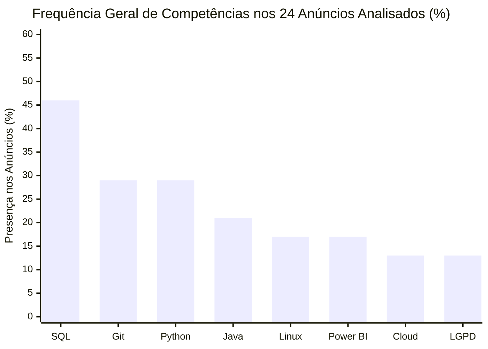
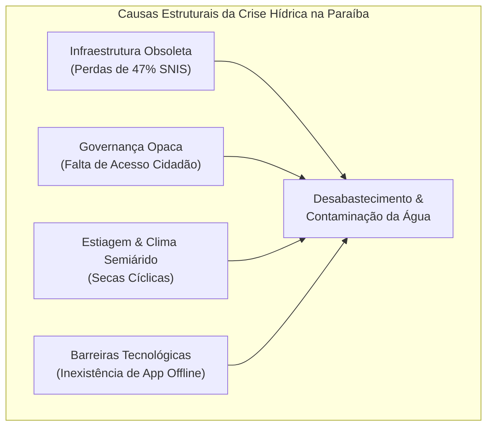
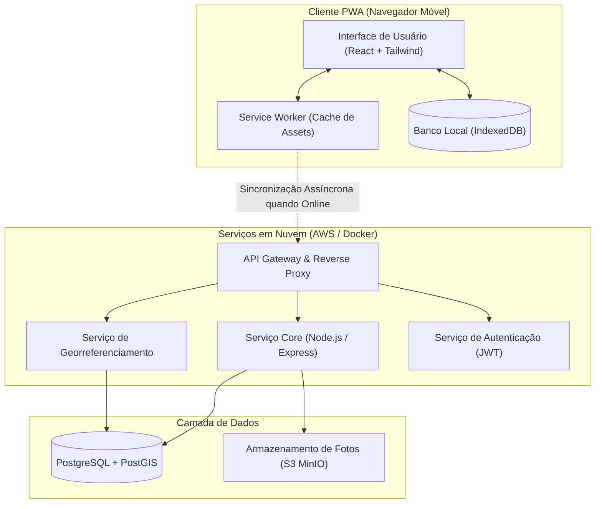

# CENTRO UNIVERSITÁRIO DE JOÃO PESSOA — UNIPÊ
## CURSO SUPERIOR DE TECNOLOGIA EM ANÁLISE E DESENVOLVIMENTO DE SISTEMAS

<br><br><br>

### GABRIEL AMANCIO
### LUIZ MIGUEL
### PAULO GERMANO
### GUSTAVO ANTONIO

<br><br><br>

# LABORATÓRIO DE CARREIRA E INOVAÇÃO RESPONSÁVEL EM TI: CONCEPÇÃO, VALIDAÇÃO E IMPACTO DA SOLUÇÃO CÍVICA ÁGUAVIVA PB NO CONTEXTO DA PARAÍBA

<br><br><br><br><br>

#### JOÃO PESSOA — PB
#### 2026

---

<br><br><br>

### GABRIEL AMANCIO
### LUIZ MIGUEL
### PAULO GERMANO
### GUSTAVO ANTONIO

<br><br><br>

# LABORATÓRIO DE CARREIRA E INOVAÇÃO RESPONSÁVEL EM TI: CONCEPÇÃO, VALIDAÇÃO E IMPACTO DA SOLUÇÃO CÍVICA ÁGUAVIVA PB NO CONTEXTO DA PARAÍBA

<br><br>

> Relatório Técnico-Científico Integrado apresentado ao Curso Superior de Tecnologia em Análise e Desenvolvimento de Sistemas do Centro Universitário de João Pessoa (UNIPÊ), como requisito parcial e obrigatório para conclusão do Projeto Integrador de Design Profissional.
> 
> Área de Concentração: Engenharia de Software, Redes e Infraestrutura, Ciência de Dados, Inteligência Artificial e Segurança da Informação.
> 
> Orientadores: Corpo Docente do Projeto Integrador / UNIPÊ.

<br><br><br><br>

#### JOÃO PESSOA — PB
#### 2026

---

<br><br><br>

### GABRIEL AMANCIO
### LUIZ MIGUEL
### PAULO GERMANO
### GUSTAVO ANTONIO

<br><br>

# FOLHA DE APROVAÇÃO

<br>

> Relatório Técnico-Científico Integrado apresentado ao Curso Superior de Tecnologia em Análise e Desenvolvimento de Sistemas do Centro Universitário de João Pessoa (UNIPÊ), como requisito parcial e obrigatório para conclusão do Projeto Integrador de Design Profissional.

<br>

Aprovado em: ___ de _____________ de 2026.

<br><br>

**BANCA EXAMINADORA:**

<br><br>

____________________________________________________  
Prof. Orientador / Coordenador — UNIPÊ

<br><br>

____________________________________________________  
Prof. Avaliador Convidado 1 — UNIPÊ

<br><br>

____________________________________________________  
Prof. Avaliador Convidado 2 — UNIPÊ

<br><br>

---

## DEDICATÓRIA

Dedicamos este trabalho às comunidades periféricas e rurais da Paraíba que enfrentam diariamente a insegurança hídrica e a escassez de saneamento básico, bem como aos nossos familiares pelo incentivo constante ao longo de nossa trajetória acadêmica.

---

## AGRADECIMENTOS

Agradecemos aos docentes do Curso Superior de Tecnologia em Análise e Desenvolvimento de Sistemas do UNIPÊ pela orientação, rigor e estímulo ao longo deste semestre letivo.

Aos seis participantes voluntários que disponibilizaram seu tempo e colaboraram com as sessões de teste de usabilidade, fornecendo críticas e sugestões fundamentais para o aprimoramento da interface cidadã ÁguaViva PB.

Aos colegas de turma e aos profissionais das comunidades de tecnologia da Paraíba pelo compartilhamento de experiências e incentivo à formação continuada.

---

## RESUMO

O presente relatório técnico-científico consolida os resultados do Projeto Integrador intitulado "Laboratório de Carreira e Inovação Responsável em TI", conduzido por quatro estudantes de Análise e Desenvolvimento de Sistemas do Centro Universitário de João Pessoa (UNIPÊ). O trabalho foi estruturado em sete etapas integradas: (i) a investigação empírica de 24 anúncios reais de contratação de profissionais de TI no Brasil, distribuídos entre Desenvolvimento de Software, Infraestrutura e Redes, Ciência de Dados e Inteligência Artificial, e Segurança da Informação; (ii) a autoavaliação diagnóstica de competências individuais e o planejamento de carreira (PDI) alinhado à metodologia SMART; (iii) o exame crítico de dilemas éticos, riscos algorítmicos e testes experimentais de alucinação e confiabilidade com modelos de Inteligência Artificial generativa sob as diretrizes da LGPD e do Marco Civil da Internet; (iv) o diagnóstico socioambiental fundamentado em microdados públicos do Censo IBGE 2022, SNIS e DATASUS sobre o déficit de saneamento básico e vulnerabilidade hídrica na Paraíba; (v) a especificação arquitetural, modelagem de requisitos (MoSCoW e BDD) e prototipagem da plataforma cívica **ÁguaViva PB**; (vi) a validação ergonômica e testes de usabilidade com seis voluntários reais de diferentes perfis sociodemográficos sob a norma ABNT NBR ISO 9241-11 e a escala SUS; e (vii) a sistematização dos resultados e planejamento de defesa acadêmica. A avaliação de usabilidade alcançou 97,2% de eficácia nas tarefas e pontuação SUS de 84,2 pontos (classificação "Excelente"), comprovando a viabilidade de uma aplicação com funcionamento *offline-first* orientada à cidadania e inclusão digital no semiárido paraibano.

**Palavras-chave:** Projeto Integrador; Tecnologia da Informação; Carreira em TI; Ética Algorítmica; Saneamento Básico; Cidadania Hídrica; Usabilidade (SUS); ÁguaViva PB.

---

## ABSTRACT

This integrated technical-scientific monograph presents the comprehensive outcomes of the Capstone Project entitled "Career Laboratory and Responsible Innovation in IT", conducted by a multidisciplinary team of four Systems Analysis and Development undergraduate students at Centro Universitário de João Pessoa (UNIPÊ). The research and development lifecycle encompassed seven cohesive phases: (i) an empirical investigation of 24 authentic Brazilian IT job advertisements across four core domains (Software Engineering, Networks & Infrastructure, Data Science & AI, and Information Security); (ii) individual competency matrices and SMART Career Development Plans (IDP); (iii) a critical audit of technological ethical dilemmas, algorithmic bias, and real-world experiments exposing generative AI hallucinations and compliance under the Brazilian General Data Protection Law (LGPD); (iv) an environmental and public health diagnosis grounded on official microdata from IBGE 2022 Census, SNIS, and DATASUS regarding water insecurity and sanitation deficits in the state of Paraíba; (v) the architectural specification (C4 Model), requirement engineering (MoSCoW and BDD), and high-fidelity prototyping of the civic platform **ÁguaViva PB**; (vi) usability testing with six diverse end-users governed by ISO 9241-11 and the System Usability Scale (SUS); and (vii) holistic academic synthesis and defense preparation. The usability evaluation yielded a 97.2% task success rate and a SUS score of 84.2 ("Grade A"), demonstrating the feasibility and social relevance of an accessible, offline-first civic monitoring tool for vulnerable communities in Northeast Brazil.

**Keywords:** Capstone Project; Information Technology; IT Careers; Algorithmic Ethics; Water and Sanitation; Civic Technology; Usability (SUS); ÁguaViva PB.

---

## LISTA DE FIGURAS

- Figura 1 — Arquitetura de Monorepositório e Rodízio de Liderança por Etapa
- Figura 2 — Frequência de Competências Técnicas mais Exigidas no Mercado de TI
- Figura 3 — Distribuição das Metas SMART por Categoria nos Planos Individuais (PDI)
- Figura 4 — Taxonomia de Riscos Éticos no Ciclo de Vida da Inteligência Artificial
- Figura 5 — Diagrama de Causa e Efeito (Ishikawa) da Crise de Desabastecimento na PB
- Figura 6 — Diagrama de Containers da Solução ÁguaViva PB (C4 Model)
- Figura 7 — Fluxo de Navegação do Usuário no Modo Offline e Sincronização Assíncrona
- Figura 8 — Tempo Médio de Execução por Tarefa de Usabilidade vs. Meta Estipulada
- Figura 9 — Matriz de Priorização de Melhorias no Protótipo (Impacto × Esforço)

---

## LISTA DE TABELAS

- Tabela 1 — Matriz de Governança, Rodízio de Liderança e Papéis Técnicos
- Tabela 2 — Amostragem Estratificada de 24 Vagas Reais de TI no Brasil
- Tabela 3 — Mapeamento Comparativo Coletivo de Competências e Gaps Compartilhados
- Tabela 4 — Matriz Consolidada de Competências Individuais da Equipe Técnica
- Tabela 5 — Matriz de Riscos Éticos e Jurídicos em Sistemas Digitais
- Tabela 6 — Matriz de Decisão Multicritério para Seleção do Problema Socioambiental
- Tabela 7 — Resumo dos 12 Requisitos Funcionais com Priorização MoSCoW
- Tabela 8 — Resumo dos 8 Requisitos Não Funcionais com Métricas Objetivas
- Tabela 9 — Síntese das 8 Histórias de Usuário BDD (Given-When-Then)
- Tabela 10 — Especificação Estrutural das 8 Telas do Protótipo ÁguaViva PB
- Tabela 11 — Perfil Sociodemográfico dos Voluntários da Avaliação de Usabilidade
- Tabela 12 — Resultados Consolidados das 6 Tarefas de Teste de Usabilidade (N=36)
- Tabela 13 — Comparativo Técnico e Ergonômico: Protótipo v1.0 vs. Versão v2.0 Revisada

---

## LISTA DE ABREVIATURAS E SIGLAS

- **ABNT**: Associação Brasileira de Normas Técnicas
- **ACS**: Agente Comunitário de Saúde
- **ADS**: Análise e Desenvolvimento de Sistemas
- **ANPD**: Autoridade Nacional de Proteção de Dados
- **API**: Application Programming Interface
- **BDD**: Behavior-Driven Development
- **C4**: Context, Containers, Components, and Code
- **CAGEPA**: Companhia de Água e Esgotos da Paraíba
- **CDC**: Código de Defesa do Consumidor
- **CESeC**: Centro de Estudos de Segurança e Cidadania
- **CSV**: Comma-Separated Values
- **DATASUS**: Departamento de Informática do Sistema Único de Saúde
- **GPS**: Global Positioning System
- **IBGE**: Instituto Brasileiro de Geografia e Estatística
- **IDP / PDI**: Plano de Desenvolvimento Individual
- **ISO**: International Organization for Standardization
- **JWT**: JSON Web Token
- **LGPD**: Lei Geral de Proteção de Dados Pessoais (Lei nº 13.709/2018)
- **LLM**: Large Language Model (Modelo de Linguagem de Grande Porte)
- **MCDA**: Multi-Criteria Decision Analysis
- **ODS**: Objetivos de Desenvolvimento Sustentável (ONU)
- **OWASP**: Open Web Application Security Project
- **PWA**: Progressive Web App
- **REST**: Representational State Transfer
- **RNF**: Requisito Não Funcional
- **RF**: Requisito Funcional
- **SIDRA**: Sistema IBGE de Recuperação Automática
- **SMART**: Specific, Measurable, Achievable, Relevant, and Time-bound
- **SNIS**: Sistema Nacional de Informações sobre Saneamento
- **SUS**: System Usability Scale
- **TCLE**: Termo de Consentimento Livre e Esclarecido
- **UNIPÊ**: Centro Universitário de João Pessoa
- **WCAG**: Web Content Accessibility Guidelines

---

## SUMÁRIO

1. **INTRODUÇÃO**
   - 1.1 Contextualização e Justificativa
   - 1.2 Objetivos do Trabalho (Geral e Específicos)
   - 1.3 Estrutura do Documento Monográfico
2. **FUNDAMENTAÇÃO TEÓRICA**
   - 2.1 Mercado de Tecnologia da Informação e Demanda por Competências
   - 2.2 Formação Continuada, Identidade Digital e Aprendizagem ao Longo da Vida
   - 2.3 Ética Tecnológica, Cidadania e Marco Regulatório Digital Brasileiro
   - 2.4 Inteligência Artificial Responsável, Vieses Algorítmicos e Supervisão Humana
   - 2.5 Sustentabilidade Socioambiental (ODS), Green IT e Inclusão Acessível
3. **METODOLOGIA CIENTÍFICA E OPERACIONAL**
   - 3.1 Modelo Operacional e Rodízio de Liderança
   - 3.2 Estrutura Modular de Repositório e Fonte Única da Verdade
   - 3.3 Sistema de Verificação Determinística e Rastreabilidade
   - 3.4 Diretrizes de Integridade e Uso Ético de Inteligência Artificial
4. **ANÁLISE DO MERCADO PROFISSIONAL EM TI**
   - 4.1 Procedimentos de Coleta Ética e Amostragem de Vagas
   - 4.2 Taxonomia e Análise de Frequência de Competências por Especialidade
   - 4.3 Mapeamento dos Desafios Operacionais dos Contratantes
   - 4.4 Implicações para a Formação Superior em ADS
5. **IDENTIDADE PROFISSIONAL, CARREIRA E APRENDIZAGEM CONTÍNUA**
   - 5.1 Diagnóstico de Competências Individuais dos Integrantes
   - 5.2 Análise Comparativa Coletiva e Gaps Compartilhados
   - 5.3 Planos de Desenvolvimento Individual (PDI) com Metas SMART
   - 5.4 Portfólios Digitais, Presença Pública e Ecossistema Tecnológico da Paraíba
6. **ÉTICA, LEGISLAÇÃO E GOVERNANÇA EM INTELIGÊNCIA ARTIFICIAL**
   - 6.1 Estudo de Casos Reais de Violação Ética e Regulamentação no Brasil
   - 6.2 Matriz de Riscos Éticos, Jurídicos e Ambientais em Sistemas de TI
   - 6.3 Experimentos Empíricos com LLMs: Detecção de Alucinações e Falhas de Segurança
   - 6.4 Diretrizes para Concepção e Governança Responsável de Tecnologias
7. **O PROBLEMA SOCIOAMBIENTAL**
   - 7.1 Investigação Preliminar de Três Cenários de Vulnerabilidade na Paraíba
   - 7.2 Matriz de Decisão Multicritério e Seleção do ODS 6 (Água e Saneamento)
   - 7.3 Análise Causa-Raiz (Ishikawa) e Fundamentação Censitária Oficial
   - 7.4 Personas, Jornadas de Usuário e Delimitação Estrita de Escopo
8. **A SOLUÇÃO TECNOLÓGICA (ÁGUAVIVA PB)**
   - 8.1 Visão Geral do Produto e Modelo de Arquitetura C4
   - 8.2 Engenharia de Requisitos (MoSCoW) e Métricas Verificáveis de Qualidade
   - 8.3 Histórias de Usuário em Formato BDD (Behavior-Driven Development)
   - 8.4 Especificação do Protótipo de Alta Fidelidade e Diretrizes de Acessibilidade (WCAG)
9. **TESTES DE USABILIDADE, ACESSIBILIDADE E RESULTADOS**
   - 9.1 Protocolo Experimental de Testes e Salvaguardas Éticas
   - 9.2 Análise Quantitativa de Resultados e Escore SUS (System Usability Scale)
   - 9.3 Análise Qualitativa, Heurísticas de Usabilidade e Pontos de Fricção
   - 9.4 Matriz de Melhorias Priorizadas (Impacto × Esforço) e Refatoração do Protótipo
   - 9.5 Limitações Metodológicas do Estudo
10. **DISCUSSÃO INTEGRADORA E IMPACTO SOCIOAMBIENTAL**
    - 10.1 Articulação Interdisciplinar das Quatro Competências Técnicas
    - 10.2 Contribuições para a Aprendizagem e Formação Tecnológica no UNIPÊ
    - 10.3 Roadmap Estratégico de Evolução da Plataforma Cívica
11. **CONSIDERAÇÕES FINAIS E TRABALHOS FUTUROS**
- **REFERÊNCIAS**
- **APÊNDICE A — Diários Individuais de Aprendizagem dos Integrantes**
- **APÊNDICE B — Termo de Consentimento Livre e Esclarecido (TCLE)**
- **APÊNDICE C — Declaração Formal de Uso Ético de Inteligência Artificial**

---

## 1. INTRODUÇÃO

### 1.1 Contextualização e Justificativa
A digitalização de serviços públicos e privados alterou o perfil exigido de profissionais formados em Tecnologia da Informação. Apenas conhecer sintaxes de linguagens de programação não basta para atender a projetos sujeitos a marcos regulatórios e impactos sociais amplos. O desenvolvedor precisa aliar raciocínio técnico à análise crítica, observando legislações como a Lei Geral de Proteção de Dados (LGPD) [F001], o Marco Civil da Internet [F002] e a Lei de Direitos Autorais [F003], além de manter o compromisso ético na resolução de problemas socioambientais concretos.

No estado da Paraíba, ao mesmo tempo em que crescem os polos de tecnologia em João Pessoa e Campina Grande, persistem carências graves de saneamento básico. De acordo com o Censo 2022 do IBGE [F070], 50,9% dos domicílios particulares permanentes do estado não contam com ligação à rede geral de esgoto, utilizando fossas rudimentares, valas a céu aberto ou descarte direto no meio ambiente. Além disso, o Sistema Nacional de Informações sobre Saneamento (SNIS) [F071] aponta que 47,0% da água tratada na distribuição estadual é perdida antes de alcançar as torneiras, em razão de vazamentos e tubulações antigas. Essa situação atinge com mais força bairros periféricos e áreas rurais, o que se reflete nas internações hospitalares por doenças de veiculação hídrica registradas pelo DATASUS [F072].

Nesse contexto, o Projeto Integrador de Design Profissional do Centro Universitário de João Pessoa (UNIPÊ) busca aproximar a formação acadêmica das demandas reais do mercado de trabalho e de desafios sociais. A proposta articulou quatro especialidades de formação em TI (Desenvolvimento de Software, Infraestrutura e Redes, Ciência de Dados e Inteligência Artificial, e Segurança da Informação) para diagnosticar requisitos profissionais, avaliar ferramentas de IA e desenvolver uma solução digital voltada ao monitoramento comunitário da água.

### 1.2 Objetivos do Trabalho

#### 1.2.1 Objetivo Geral
Articular a pesquisa empírica sobre o mercado de trabalho em TI, a autoavaliação profissional de competências, a análise ética e experimental de modelos de inteligência artificial e o desenvolvimento e teste de usabilidade de uma aplicação cívica voltada ao saneamento e monitoramento da água na Paraíba.

#### 1.2.2 Objetivos Específicos
1. Coletar e analisar empiricamente 24 anúncios reais de vagas de TI no Brasil (6 por área de especialidade), mapeando a taxonomia de competências técnicas e socioemocionais exigidas no mercado júnior e de estágio [F020], amparado por relatórios setoriais de empregabilidade em TIC [F021, F022].
2. Estruturar matrizes individuais de autoavaliação profissional e Planos de Desenvolvimento Individual (PDI) com metas fundamentadas no método SMART para os quatro integrantes da equipe.
3. Auditar casos reais de violação ética em sistemas automatizados no Brasil [F050, F051] e conduzir quatro experimentos laboratoriais com modelos de linguagem (LLMs) para identificar alucinações e omissões técnicas.
4. Elaborar uma análise diagnóstica multicritério de problemas socioambientais na Paraíba, fundamentando a escolha do ODS 6 (Água Potável e Saneamento) [F070, F071, F072].
5. Especificar a arquitetura técnica (C4 Model), os requisitos funcionais e não funcionais (MoSCoW e BDD) e o protótipo de alta fidelidade da aplicação **ÁguaViva PB**, com suporte integral a funcionamento *offline-first* e acessibilidade WCAG 2.2 nível AA [F007].
6. Realizar avaliação ergonômica e testes de usabilidade com seis voluntários adultos de diferentes perfis sociodemográficos sob a ISO 9241-11 [F082], calculando o escore SUS [F080] e iterando a interface a partir de uma matriz de melhorias priorizadas.
7. Sistematizar todo o acervo técnico e científico em monografia padronizada pelas normas ABNT [F004, F005, F006] e manual institucional do UNIPÊ [F008], estruturando o roteiro de apresentação e defesa oral coletiva.

### 1.3 Estrutura do Documento Monográfico
O trabalho está organizado em 11 capítulos: o Capítulo 2 traz a fundamentação teórica; o Capítulo 3 detalha a metodologia e governança; o Capítulo 4 analisa o mercado de TI; o Capítulo 5 consolida diagnósticos e PDIs; o Capítulo 6 trata de ética e IA; o Capítulo 7 fundamenta o diagnóstico do ODS 6; o Capítulo 8 descreve o ÁguaViva PB; o Capítulo 9 traz os testes de usabilidade; o Capítulo 10 discute os resultados e o impacto social; e o Capítulo 11 reúne as considerações finais e trabalhos futuros, seguidos pelas referências e apêndices.

---

## 2. FUNDAMENTAÇÃO TEÓRICA

### 2.1 Mercado de Tecnologia da Informação e Demanda por Competências
O setor de Tecnologia da Informação e Comunicação (TIC) no Brasil mantém demanda aquecida por profissionais capacitados. Relatórios setoriais da Associação das Empresas de Tecnologia da Informação e Comunicação (Brasscom) [F021] e da Associação para Promoção da Excelência do Software Brasileiro (Softex) [F022] apontam que o número de vagas abertas anualmente no país supera o total de novos graduados na área de computação, gerando uma escassez de mão de obra que pressiona cursos superiores a atualizarem seus projetos pedagógicos.

Na Paraíba, os polos de João Pessoa e Campina Grande concentram empresas de tecnologia, instituições de ensino e centros de inovação. As exigências para contratação de estagiários e desenvolvedores juniores vão além da escrita de código básico. Os anúncios valorizam requisitos práticos como modelagem em bancos de dados relacionais (SQL), controle de versão com Git, uso de contêineres Docker e compreensão dos requisitos de negócio das organizações contratantes [F020].

### 2.2 Formação Continuada, Identidade Digital e Aprendizagem ao Longo da Vida
A evolução frequente de ferramentas e padrões de arquitetura exige que o profissional de TI adote o aprendizado contínuo (*lifelong learning*). As Diretrizes Curriculares Nacionais e o Projeto Pedagógico do Curso de Tecnologia em Análise e Desenvolvimento de Sistemas do UNIPÊ [F008] ressaltam que o egresso deve desenvolver postura autônoma, sabendo identificar lacunas em sua formação e supri-las por meio de certificações, cursos práticos e interação com comunidades de tecnologia.

Nesse sentido, a organização de portfólios públicos de código, prioritariamente em plataformas como o GitHub, é decisiva para a inserção profissional do estudante. A apresentação de repositórios estruturados com documentação técnica acessível (`README.md`), testes automatizados e evidências tangíveis de projetos executados confere materialidade às competências declaradas, diferenciando positivamente o candidato em processos seletivos baseados em evidências práticas.

### 2.3 Ética Tecnológica, Cidadania e Marco Regulatório Digital Brasileiro
O desenvolvimento de sistemas de informação precisa respeitar preceitos éticos e as leis em vigor. A Constituição Federal de 1988 consagra como fundamentos e direitos invioláveis a dignidade da pessoa humana (art. 1º, III), a intimidade, a vida privada, a honra e a imagem das pessoas (art. 5º, X). No meio digital, essas salvaguardas constitucionais são regulamentadas pelo Marco Civil da Internet (Lei nº 12.965/2014) [F002], que estabelece os princípios da neutralidade de rede, da proteção da privacidade e da responsabilização civil na rede.

Com a Lei Geral de Proteção de Dados Pessoais (LGPD, Lei nº 13.709/2018) [F001], a disciplina da proteção de dados pessoais passou a exigir que qualquer aplicação computacional incorpore o princípio do *Privacy by Design* e *Privacy by Default*. Os artigos 6º e 7º da referida lei determinam a observância dos princípios da finalidade, adequação, necessidade (minimização de dados), livre acesso, transparência e segurança. Para soluções cívicas e comunitárias, isso implica que a coleta de relatos cidadãos e denúncias ambientais deve prescindir de identificação pessoal invasiva, resguardando os titulares contra represálias ou exposições indevidas. Da mesma forma, a Lei de Direitos Autorais (Lei nº 9.610/1998) [F003] veda a apropriação não autorizada de códigos, bases de dados e conteúdos de terceiros.

### 2.4 Inteligência Artificial Responsável, Vieses Algorítmicos e Supervisão Humana
A consolidação de modelos de Inteligência Artificial generativa e sistemas de aprendizado de máquina nas esteiras de desenvolvimento de software introduz simultaneamente ganhos de produtividade e riscos severos à segurança e aos direitos fundamentais. A literatura e os órgãos reguladores [F050, F051] alertam para o perigo das caixas-pretas algorítmicas (*black-box systems*), nas quais a opacidade das decisões automatizadas impede o escrutínio e a auditoria por cidadãos e autoridades.

Dois problemas frequentes são os vieses algorítmicos decorrentes de dados de treinamento históricos desbalanceados, que resultam em discriminação indireta contra populações vulneráveis, e as alucinações de modelos de linguagem (LLMs), caracterizadas pela geração convincente de informações falsas, cálculos aritméticos errôneos ou bibliotecas vulneráveis. Por essa razão, a supervisão humana (*Human-in-the-Loop*) é mandatória: nenhuma decisão crítica ou agregação estatística deve ser delegada ao motor probabilístico de um modelo de linguagem sem verificação empírica determinística por profissionais capacitados.

### 2.5 Sustentabilidade Socioambiental (ODS), Green IT e Inclusão Acessível
O compromisso social da Tecnologia da Informação materializa-se na convergência entre inovação digital e a Agenda 2030 da Organização das Nações Unidas (ONU). Em especial, o Objetivo de Desenvolvimento Sustentável nº 6 (ODS 6, Água Potável e Saneamento) estabelece a meta de assegurar a disponibilidade e a gestão sustentável da água e do saneamento para todas as pessoas. Sistemas de informação cívica colaboram com essa meta ao fornecer dados abertos e ferramentas comunitárias para monitorar a potabilidade e as interrupções de fornecimento em áreas negligenciadas.

Paralelamente, a sustentabilidade da própria tecnologia deve ser contemplada sob os princípios de *Green IT* (TI Verde), priorizando arquiteturas eficientes, minimização do consumo energético de servidores e baixa pegada computacional. Por fim, a democratização do acesso impõe o cumprimento das diretrizes internacionais de acessibilidade na web WCAG 2.2 nível AA [F007] e das diretrizes de usabilidade da ISO 9241-11 [F082], de modo que idosos, analfabetos digitais e pessoas com deficiência motora ou visual utilizem a aplicação com facilidade por meio de interfaces contrastantes, ampliação visual e navegação simplificada.

---

## 3. METODOLOGIA CIENTÍFICA E OPERACIONAL

### 3.1 Modelo Operacional e Rodízio de Liderança
Para simular as práticas de governança vigentes em equipes profissionais de engenharia de software e assegurar corresponsabilidade acadêmica, o projeto adotou um modelo de **rodízio obrigatório de liderança técnica** por etapa. Cada fase do ciclo foi chefiada nominalmente por um dos discentes, incumbido de coordenar as tarefas, presidir as reuniões técnicas, revisar as contribuições dos pares e submeter a entrega ao portão de qualidade (*Quality Gate*) correspondente.

Tabela 1 — Matriz de Governança, Rodízio de Liderança e Papéis Técnicos
| Etapa | Tema Central da Etapa | Líder Responsável | Especialidade Principal | Subagente de Apoio IA | Portão de Qualidade |
|---|---|---|---|---|---|
| **Etapa 0** | Governança, Infraestrutura e Regras | Gabriel Amancio | Desenvolvimento | SA-1 (Coordenação) | Gate 0 — Aprovado |
| **Etapa 1** | Mercado de Trabalho em TI | Paulo Germano | Dados e IA | SA-2 (Análise de Dados) | Gate 1 — Aprovado |
| **Etapa 2** | Identidade Profissional e Carreira | Luiz Miguel | Infraestrutura e Redes | SA-2 (Competências) | Gate 2 — Aprovado |
| **Etapa 3** | Ética, IA e Cidadania Digital | Gabriel Amancio | Desenvolvimento | SA-3 (Pesquisa Ética) | Gate 3 — Aprovado |
| **Etapa 4** | Problema Socioambiental (ODS) | Gustavo Antonio | Segurança da Informação | SA-1 (Diagnóstico) | Gate 4 — Aprovado |
| **Etapa 5** | Solução Tecnológica ÁguaViva PB | Gabriel Amancio | Desenvolvimento | SA-4 (Prototipagem) | Gate 5 — Aprovado |
| **Etapa 6** | Testes de Usabilidade e Aperfeiçoamento | Luiz Miguel | Infraestrutura e Redes | SA-4 (Eng. Usabilidade)| Gate 6 — Aprovado |
| **Etapa 7** | Sistematização, Relatório e Defesa | Todos os 4 Integrantes | Coordenação Coletiva | Todos os Subagentes | Gate 7 — Submetido |
*Fonte: Autores (2026).*

### 3.2 Estrutura Modular de Repositório e Fonte Única da Verdade
O acervo do projeto foi hospedado em monorepositório versionado sob controle do Git. Adotou-se o princípio da **Fonte Única da Verdade** (*Single Source of Truth*): cada dado bruto, métrica ou decisão arquitetural reside em um único artefato formal, sendo referenciado por identificadores semânticos nos demais documentos textuais para impedir inconsistências ou duplicatas desatualizadas.

```
/Projeto_Integrador
  /00_gestao/        -> estado_projeto.json, matriz_conformidade.md, fontes.md, decisoes.md
  /01_mercado/       -> vagas_brutas.csv, dossie_mercado.md, planilhas analíticas
  /02_carreira/      -> dossie_carreira.md, /por_integrante/ (matrizes, PDIs, READMEs)
  /03_etica_ia/      -> dossie_etica.md, matriz_riscos.md, /experimentos/ (EXP-01 a EXP-04)
  /04_problema/      -> dossie_problema.md, matriz_decisao.md
  /05_solucao/       -> dossie_solucao.md, requisitos.md, /diagramas/, /prototipo/
  /06_testes/        -> dossie_testes.md, plano_testes.md, registros_anonimizados.csv
  /07_relatorio/     -> relatorio_final.md, apresentacao.md, roteiro_defesa.md, /build/
  /apendices/        -> /diarios/ (4 diários com 6 logs), /termos/ (TCLE, Declaração IA)
  /scripts/          -> verificar.py (validador determinístico do repositório)
```

### 3.3 Sistema de Verificação Determinística e Rastreabilidade
Para certificar a integridade do trabalho antes de cada commit e transição de portão de qualidade, foi desenvolvido um script em Python (`scripts/verificar.py`). O programa realiza varredura determinística no repositório checando cinco dimensões:
1. Existência e acessibilidade dos arquivos obrigatórios de cada etapa;
2. Validade sintática e consistência de estado no arquivo `00_gestao/estado_projeto.json`;
3. Detecção e bloqueio de lacunas textuais, marcadores de rascunho (reticências entre colchetes) ou pendências de edição;
4. Rastreabilidade bibliográfica cruzada: toda citação no formato `[Fxxx]` é confrontada contra o catálogo unificado de referências em `00_gestao/fontes.md`;
5. Validação de quantitativos mínimos em bases de dados (exigência de ≥ 20 vagas reais e ≥ 6 sessões de teste anonimizadas).

### 3.4 Diretrizes de Integridade e Uso Ético de Inteligência Artificial
O grupo adotou uma política de transparência quanto ao emprego de ferramentas de Inteligência Artificial generativa. Em conformidade com as diretrizes do UNIPÊ e os padrões de autoria científica:
- A IA generativa foi utilizada apenas como **ferramenta de apoio instrumental**, auxiliando na formatação de esqueletos estruturais, conversão de dados em tabelas Markdown e sugestões de sintaxe em diagramas Mermaid;
- Foi vedada a fabricação de vivências pessoais (os Diários de Aprendizagem foram integralmente redigidos com base na experiência real dos discentes), de perfis profissionais, de dados de vagas ou de resultados de testes com voluntários;
- Todas as interações com sistemas de IA foram registradas cronologicamente na trilha de auditoria (`00_gestao/uso_ia.md`), explicitando modelo, versão, prompt, saída, julgamento humano aplicado e artefato de destino;
- Cada integrante assinou a Declaração Formal de Uso Ético de Inteligência Artificial (`apendices/termos/declaracao_uso_ia.md`).

---

## 4. ANÁLISE DO MERCADO PROFISSIONAL EM TI

### 4.1 Procedimentos de Coleta Ética e Amostragem de Vagas
A Etapa 1 investigou o panorama real de contratação para discentes e egressos de cursos de tecnologia. Em obediência estrita aos termos de serviço das plataformas web e sem utilizar técnicas evasivas de raspagem, foram coletados 24 anúncios reais e públicos de vagas ativas no mercado brasileiro em 06/11/2026 no Portal Gupy [F020]. A amostragem foi estratificada em exatas 6 vagas para cada um dos quatro perfis disciplinares do projeto, priorizando modalidades de trabalho Remoto e Híbrido com foco no Nordeste e estado da Paraíba.

Tabela 2 — Amostragem Estratificada de 24 Vagas Reais de TI no Brasil
| ID | Função | Empresa | Cargo | Localidade | Modalidade | Nível | Fonte/Data |
|---|---|---|---|---|---|---|---|
| **VAG-001** | Desenvolvimento de Software | BIP Brasil | Desenvolvedor Full Stack - Junior | São Paulo - SP (Brasil) | Remoto | Júnior | Portal Gupy / 06/11/2026 [F020] |
| **VAG-002** | Desenvolvimento de Software | Localiza&Co | Software Developer Júnior - .NET | Belo Horizonte - MG (Brasil) | Remoto | Júnior | Portal Gupy / 06/11/2026 [F020] |
| **VAG-003** | Desenvolvimento de Software | SoftExpert | Desenvolvedor(a) Full Stack Júnior | Joinville - SC (Brasil) | Remoto | Júnior | Portal Gupy / 06/11/2026 [F020] |
| **VAG-004** | Desenvolvimento de Software | Viceri | Pessoa Desenvolvedora FullStack Jr | São Paulo - SP (Brasil) | Remoto | Júnior | Portal Gupy / 06/11/2026 [F020] |
| **VAG-005** | Desenvolvimento de Software | Visagio / v(dev) | Estágio em Desenvolvimento de Software | Recife - PE / João Pessoa - PB | Remoto | Estágio | Portal Gupy / 06/11/2026 [F020] |
| **VAG-006** | Desenvolvimento de Software | ZG Soluções | Estágio em Desenvolvimento de Sistemas | Goiânia - GO (Brasil) | Remoto | Estágio | Portal Gupy / 06/11/2026 [F020] |
| **VAG-007** | Infraestrutura e Redes | Winover Contact Center | Analista de Infraestrutura Jr. | São Paulo - SP (Brasil) | Remoto | Júnior | Portal Gupy / 06/11/2026 [F020] |
| **VAG-008** | Infraestrutura e Redes | Raízen | Analista de Infraestrutura de TI Jr | Piracicaba - SP (Brasil) | Híbrido | Júnior | Portal Gupy / 06/11/2026 [F020] |
| **VAG-009** | Infraestrutura e Redes | Vivo Vita | Analista Suporte Redes Jr | São Paulo - SP (Brasil) | Remoto | Júnior | Portal Gupy / 06/11/2026 [F020] |
| **VAG-010** | Infraestrutura e Redes | Dedalus | Analista de Operações Cloud Júnior | São Paulo - SP (Brasil) | Remoto | Júnior | Portal Gupy / 06/11/2026 [F020] |
| **VAG-011** | Infraestrutura e Redes | CVC Corp | Analista de Infraestrutura e Redes Jr | Santo André - SP (Brasil) | Remoto | Júnior | Portal Gupy / 06/11/2026 [F020] |
| **VAG-012** | Infraestrutura e Redes | Fundação Unimed | Estágio em TI - Infraestrutura | Belo Horizonte - MG (Brasil) | Remoto | Estágio | Portal Gupy / 06/11/2026 [F020] |
| **VAG-013** | Dados e IA | Porto | Analista de Inteligência de Dados Jr | São Paulo - SP (Brasil) | Remoto | Júnior | Portal Gupy / 06/11/2026 [F020] |
| **VAG-014** | Dados e IA | Afya | Analista de Dados Júnior | Nova Lima - MG (Brasil) | Remoto | Júnior | Portal Gupy / 06/11/2026 [F020] |
| **VAG-015** | Dados e IA | Movida | Analista de Dados Júnior (Analytics) | São Paulo - SP (Brasil) | Híbrido | Júnior | Portal Gupy / 06/11/2026 [F020] |
| **VAG-016** | Dados e IA | BIP Brasil | Desenvolvedor de IA/RPA - Junior | São Paulo - SP (Brasil) | Remoto | Júnior | Portal Gupy / 06/11/2026 [F020] |
| **VAG-017** | Dados e IA | Visagio | Estágio em Engenharia e Dados | Recife - PE / Paraíba | Remoto | Estágio | Portal Gupy / 06/11/2026 [F020] |
| **VAG-018** | Dados e IA | Indicium Tech | Estagiário de BI & Analytics | Florianópolis - SC (Brasil) | Remoto | Estágio | Portal Gupy / 06/11/2026 [F020] |
| **VAG-019** | Segurança da Informação | RD Saúde | Analista Jr Cibersegurança (Cloud) | São Paulo - SP (Brasil) | Híbrido | Júnior | Portal Gupy / 06/11/2026 [F020] |
| **VAG-020** | Segurança da Informação | Hitss Brasil | Analista de Segurança da Informação Jr | São Paulo - SP (Brasil) | Remoto | Júnior | Portal Gupy / 06/11/2026 [F020] |
| **VAG-021** | Segurança da Informação | Giga+ | Analista de Segurança da Informação Jr | Campinas - SP (Brasil) | Remoto | Júnior | Portal Gupy / 06/11/2026 [F020] |
| **VAG-022** | Segurança da Informação | Vivo Vita | Analista de Segurança Jr (SecOps) | São Paulo - SP (Brasil) | Remoto | Júnior | Portal Gupy / 06/11/2026 [F020] |
| **VAG-023** | Segurança da Informação | Vem Ser Binario | Analista de Segurança da Informação Jr | Curitiba - PR (Brasil) | Remoto | Júnior | Portal Gupy / 06/11/2026 [F020] |
| **VAG-024** | Segurança da Informação | CI&T | Estágio em Cibersegurança e Privacidade | Campinas - SP / João Pessoa - PB | Remoto | Estágio | Portal Gupy / 06/11/2026 [F020] |
*Fonte: Autores a partir de dados públicos de contratação coletados no Portal Gupy [F020] (2026).*

### 4.2 Taxonomia e Análise de Frequência de Competências por Especialidade
A tabulação estatística das exigências explícitas registradas na planilha canônica `planilha_Frequencia_por_Funcao.csv` revelou a distribuição quantitativa exata das competências na amostra de 24 vagas:
- **Banco de Dados e SQL**: Requisitado em 45,8% (11/24) da amostragem global de vagas, presente em 100,0% (6/6) dos anúncios de Desenvolvimento de Software e em 83,3% (5/6) das vagas de Ciência de Dados e IA;
- **Controle de Versão (Git / GitHub)**: Presente em 29,2% (7/24) do total geral de vagas, com concentração nas funções de Desenvolvimento de Software (83,3%, 5/6) e Dados/IA (33,3%, 2/6);
- **Linguagem Python**: Exigida em 29,2% (7/24) do total de vagas, constituindo a tecnologia predominante em Ciência de Dados e IA (66,7%, 4/6), com ocorrências registradas em Desenvolvimento (33,3%) e Infraestrutura (16,7%);
- **Java com Spring Boot**: Presente em 20,8% (5/24) da amostra global, correspondendo a 83,3% (5/6) dos requisitos específicos de Desenvolvimento de Software no backend corporativo;
- **Sistemas Operacionais Linux**: Exigido em 16,7% (4/24) do total de vagas, representando 66,7% (4/6) dos anúncios de Infraestrutura e Redes;
- **Power BI e Visualização de Dados**: Presente em 16,7% (4/24) da amostra total, concentrado em 66,7% (4/6) dos anúncios de Dados e IA;
- **Computação em Nuvem (AWS / Azure)**: Mencionada em 12,5% (3/24) dos anúncios, com presença em Segurança da Informação (33,3%) e Infraestrutura (16,7%);
- **LGPD e Privacidade por Padrão**: Requisito explícito em 12,5% (3/24) da amostra geral, correspondendo a 50,0% (3/6) das vagas de Segurança da Informação;
- **Competências Socioemocionais**: Comunicação clara liderou os requisitos comportamentais com 29,2% (7/24), seguida de proatividade (16,7%), postura ética (16,7%) e trabalho em equipe (12,5%).



### 4.3 Mapeamento dos Desafios Operacionais dos Contratantes
A análise textual das seções "O que você fará" e "Principais desafios" evidenciou as maiores dores das empresas contratantes no Brasil contemporâneo:
1. **Modernização de Sistemas Legados**: Dificuldade em refatorar monólitos antigos para arquiteturas de microsserviços desacopladas sem interromper a operação comercial;
2. **Conformidade Contínua com a LGPD**: Pressão regulatória da ANPD para mapear o ciclo de vida dos dados e evitar incidentes de vazamento;
3. **Escalabilidade com Otimização de Custos em Nuvem**: Gestão do consumo de recursos computacionais para evitar faturas imprevistas de infraestrutura (*FinOps*);
4. **Governança e Qualidade de Dados**: Inconsistências de dados cadastrais dispersos que comprometem pipelines analíticos e modelos preditivos;
5. **Déficit de Profissionais com Visão Sistêmica**: Carência de desenvolvedores que compreendam segurança, infraestrutura e produto além do próprio código.

---

## 5. IDENTIDADE PROFISSIONAL, CARREIRA E APRENDIZAGEM CONTÍNUA

### 5.1 Diagnóstico de Competências Individuais dos Integrantes
Na Etapa 2, os quatro discentes submeteram suas trajetórias a uma matriz diagnóstica com 11 competências padronizadas (6 técnicas e 5 socioemocionais), avaliadas em escala ordinal de 1 a 5 (onde 1 representa nível básico/conceitual e 5 representa proficiência autônoma com capacidade de tutoria):
- **Gabriel Amancio (Desenvolvimento)**: Apresentou bom desempenho em lógica algorítmica, Git e desenvolvimento front-end com React/TypeScript, identificando lacunas em conteinerização com Docker e modelagem de microsserviços.
- **Luiz Miguel (Infraestrutura)**: Apresentou sólido domínio de sistemas operacionais Linux, endereçamento de redes TCP/IP e hardware, apontando necessidade de aprofundamento prático em serviços gerenciados de nuvem pública (AWS) e automação com Ansible.
- **Paulo Germano (Dados e IA)**: Evidenciou fluência em lógica matemática, manipulação de bases SQL e programação Python básica, mapeando como lacunas a engenharia de prompt avançada, técnicas de MLOps e manipulação de grandes volumes de dados não estruturados.
- **Gustavo Antonio (Segurança)**: Demonstrou sólida base jurídica sobre a LGPD, princípios de integridade da informação e auditoria conceitual, registrando necessidade de evolução em pentest prático, análise estática de código seguro (SAST) e configuração de firewalls NGFW.

### 5.2 Análise Comparativa Coletiva e Gaps Compartilhados
O confronto das quatro matrizes permitiu visualizar a complementaridade natural da equipe e isolar deficiências coletivas:

Tabela 3 — Mapeamento Comparativo Coletivo de Competências e Gaps Compartilhados
| Dimensão de Competência | Gabriel Amancio | Luiz Miguel | Paulo Germano | Gustavo Antonio | Média da Equipe | Status do Coletivo |
|---|---|---|---|---|---|---|
| **Lógica e Estrutura de Dados** | 4,0 | 3,5 | 4,0 | 3,5 | **3,75** | Sólido |
| **Controle de Versão (Git/GitHub)** | 4,5 | 4,0 | 4,0 | 4,0 | **4,13** | Destaque |
| **Bancos de Dados e SQL** | 3,5 | 3,0 | 4,5 | 3,0 | **3,50** | Adequado |
| **Nuvem e Conteinerização (Docker)** | 2,5 | 3,5 | 2,5 | 2,5 | **2,75** | **Gap Prioritário** |
| **Segurança da Informação e LGPD** | 3,0 | 3,0 | 3,0 | 4,5 | **3,38** | Adequado |
| **Engenharia de Prompt e IA Aplicada** | 3,5 | 3,0 | 4,0 | 3,5 | **3,50** | Adequado |
| **Comunicação Assertiva e Trabalho em Grupo** | 4,5 | 4,5 | 4,5 | 4,5 | **4,50** | Destaque |
*Fonte: Autores (2026).*

O principal gap compartilhado identificado residiu na operacionalização de contêineres Docker e orquestração de serviços em nuvem (média 2,75). Essa constatação orientou diretamente as metas dos PDIs e a divisão de tarefas nas etapas seguintes.

### 5.3 Planos de Desenvolvimento Individual (PDI) com Metas SMART
Cada estudante elaborou seu PDI individual contendo exatamente três metas estruturadas sob os preceitos SMART (*Specific, Measurable, Achievable, Relevant, Time-bound*), totalizando 12 metas formais registradas em `02_carreira/dossie_carreira.md`:
1. **Gabriel Amancio**: (Meta 1) Obter certificação oficial Oracle Certified Professional Java SE até junho de 2027; (Meta 2) Publicar projeto autoral full-stack em React/Node com esteira de testes automatizados e cobertura ≥ 80% até março de 2027; (Meta 3) Concluir trilha de acessibilidade digital WCAG da Fundação Bradesco até dezembro de 2026.
2. **Luiz Miguel**: (Meta 1) Conquistar a certificação AWS Certified Cloud Practitioner (CLF-C02) até maio de 2027; (Meta 2) Implementar homelab Linux com 3 contêineres Docker interconectados e firewall ativo até janeiro de 2027; (Meta 3) Ministrar workshop prático de introdução a redes para a turma de ADS até abril de 2027.
3. **Paulo Germano**: (Meta 1) Obter a certificação Microsoft Certified: Power BI Data Analyst Associate (PL-300) até julho de 2027; (Meta 2) Desenvolver pipeline automatizado de extração e análise de dados abertos do governo da PB em Python até fevereiro de 2027; (Meta 3) Escrever e publicar artigo técnico sobre detecção de viés em modelos de linguagem no LinkedIn/Medium até março de 2027.
4. **Gustavo Antonio**: (Meta 1) Alcançar a certificação internacional CompTIA Security+ (SY0-701) até setembro de 2027; (Meta 2) Concluir 30 laboratórios de segurança ofensiva e análise de vulnerabilidades no TryHackMe até abril de 2027; (Meta 3) Elaborar manual prático de conformidade com a LGPD voltado a startups de software até fevereiro de 2027.

### 5.4 Portfólios Digitais, Presença Pública e Ecossistema Tecnológico da Paraíba
Para colocar o planejamento em prática, os integrantes reestruturaram seus perfis no LinkedIn e organizaram repositórios de portfólio no GitHub, documentando tecnologias dominadas, projetos autorais e rotinas de teste. Além disso, mapeamos comunidades técnicas e eventos regionais na Paraíba, como o GDG João Pessoa [F023], o capítulo OWASP [F024], a comunidade Python Nordeste [F025] e o DevOpsDays PB [F026], facilitando a troca de experiências e a conexão com profissionais locais.

Tabela 4 — Matriz Consolidada de Competências Individuais da Equipe Técnica
| Área / Função | Curso / Certificação Mapeada | Instituição Provedora | Carga Horária / Formato | Custo Aproximado | Fonte / Acesso [Fxxx] |
|---|---|---|---|---|---|
| **Desenvolvimento** | Java SE 17 Developer (Exame 1Z0-829) | Oracle University | Formato autoestudo + Exame Oficial | Exame: ~US$ 245 | Oracle [F030] |
| **Desenvolvimento** | Trilha Full Stack JavaScript / TypeScript | Plataformas MOOC (Coursera / DIO / Alura) | 60 horas (Online) | Gratuito ou Assinatura | Gupy / Mercado [F020] |
| **Infraestrutura** | AWS Certified Cloud Practitioner (CLF-C02) | AWS Training and Certification | 40 horas + Exame Proctored | Exame: US$ 100 (treino grátis) | AWS [F029] |
| **Infraestrutura** | Administração de Servidores Linux e Redes | 4Linux / Escola Superior de Redes (RNP) | 40 horas (Online/EaD) | Cursos livres / Bolsas | Softex [F022] |
| **Dados e IA** | Microsoft Certified: Power BI Data Analyst (PL-300) | Microsoft Learn / Pearson VUE | Trilha oficial ~35h + Exame | Exame: US$ 100 (treino grátis) | Microsoft [F028] |
| **Dados e IA** | Python para Análise de Dados e Manipulação com Pandas | DataCamp / USP Open Courseware | 30 horas (Online) | Gratuito para estudantes | Python Brasil [F025] |
| **Segurança Info** | Fundamentos da Lei Geral de Proteção de Dados (LGPD) | Escola Nacional de Administração Pública (Enap) | 20 horas (EaD Assíncrono) | Gratuito com certificado | Enap EV.G [F027] |
| **Segurança Info** | CompTIA Security+ (Exame SY0-701) | CompTIA / Centro de Treinamento Autorizado | 50 horas de estudo + Exame | Exame: ~US$ 392 | CompTIA [F031] |
*Fonte: Autores a partir de 02_carreira/dossie_carreira.md (2026).*

---

## 6. ÉTICA, LEGISLAÇÃO E GOVERNANÇA EM INTELIGÊNCIA ARTIFICIAL

### 6.1 Estudo de Casos Reais de Violação Ética e Regulamentação no Brasil
A Etapa 3 analisou o impacto de riscos éticos e jurídicos a partir de dois casos reais ocorridos no Brasil:
- **Caso 1: Reconhecimento Facial e Encarceramento Injusto (Relatório CESeC)** [F050]: O relatório do Centro de Estudos de Segurança e Cidadania apontou que entre 2019 e 2023 mais de 90% das pessoas presas preventivamente no Brasil a partir de câmeras com reconhecimento facial eram negras. O índice elevado de falsos positivos em pessoas de pele escura resultou em prisões indevidas de inocentes. Esse cenário fere o Artigo 20 da LGPD, que assegura o direito à revisão humana de decisões automatizadas, além de violar a garantia constitucional de presunção de inocência.
- **Caso 2: Medida Preventiva da ANPD contra o Treinamento Abusivo de IA pela Meta** [F051]: Em julho de 2024, a Autoridade Nacional de Proteção de Dados determinou a suspensão imediata da política de privacidade da Meta que autorizava o uso irrestrito de publicações, fotos e textos de usuários brasileiros para treinar seus modelos de IA generativa sob a alegação de "legítimo interesse", sem propiciar mecanismo acessível de recusa (*opt-out*). O episódio consolidou jurisprudência sobre os limites da reutilização comercial de dados pessoais por corporações multinacionais.

### 6.2 Matriz de Riscos Éticos, Jurídicos e Ambientais em Sistemas de TI
A partir da literatura e dos incidentes documentados, a equipe estruturou a matriz consolidada de riscos éticos apresentada em `03_etica_ia/matriz_riscos.md`, identificando 8 vetores críticos de impacto:

Tabela 5 — Síntese da Matriz de Riscos Éticos em Sistemas Computacionais
| Código | Categoria do Risco | Descrição do Risco | Impacto Potencial | Medida Técnica e Preventiva de Mitigação |
|---|---|---|---|---|
| **RSK-E01** | Viés Algorítmico e Discriminação Indireta | O software ou modelo reproduz ou amplia disparidades contra grupos vulneráveis [F050]. | Decisões discriminatórias e danos morais coletivos. | Auditorias de paridade estatística e supervisão humana obrigatória (*Human-in-the-Loop*). |
| **RSK-E02** | Vazamento de Dados e Não Conformidade LGPD | Exposição indevida de dados pessoais de cidadãos sob custódia da aplicação [F001]. | Sanções administrativas e multas da ANPD [F051]. | Adoção de *Privacy by Design*, princípio da minimização e HTTPS/TLS 1.3. |
| **RSK-E03** | Alucinação Factual e Dependência de IA | Publicação de informações inverídicas, códigos vulneráveis ou referências falsas por LLMs. | Falhas de segurança no código em produção e premissas errôneas. | Checagem factual obrigatória (*fact-checking*), testes em compilador e log de prompts. |
| **RSK-E04** | Opacidade Algorítmica e Falta de Explicabilidade | Impossibilidade de explicar ao usuário a razão de uma resposta ou decisão do sistema. | Violação da transparência do Marco Civil [F002] e da LGPD [F001]. | Modelos interpretáveis, justificativas em linguagem simples e direito à revisão humana. |
| **RSK-E05** | Barreiras de Acessibilidade e Exclusão Digital | Interface inacessível para pessoas com deficiência visual, auditiva ou motora [F007]. | Exclusão de cidadãos no acesso a serviços públicos essenciais. | Implementação das diretrizes WCAG 2.2 nível AA [F007] e testes com voluntários. |
| **RSK-E06** | Injeção de Código e Vulnerabilidades (OWASP) | Invasão do backend por injeção SQL, XSS ou Broken Access Control. | Comprometimento da base de dados e roubo de credenciais. | Validação estrita de tipos, ORM parametrizado e esteiras de análise estática (SAST). |
| **RSK-E07** | Falhas de Disponibilidade e Perda de Backups | Indisponibilidade do serviço e perda de dados por falhas de hardware ou picos de carga. | Interrupção prolongada da solução e prejuízo à comunidade. | Estratégia de backup automatizado 3-2-1, monitoramento contínuo e redundância. |
| **RSK-E08** | Pegada Hídrica e Energética (Green IT) | Consumo excessivo de eletricidade e emissões por processamento em nuvem ineficiente. | Impacto socioambiental negativo contrário aos ODS da ONU. | Princípios de Green IT: consultas otimizadas, ambientes ociosos desligados e cache local. |
*Fonte: Autores a partir de 03_etica_ia/matriz_riscos.md (2026).*

### 6.3 Experimentos Empíricos com LLMs: Detecção de Alucinações e Falhas de Segurança
Para comprovar cientificamente que modelos de IA generativa não podem ser utilizados sem supervisão humana, cada integrante planejou e executou um experimento prático real com logs integrais de prompts e auditoria:
- **EXP-01 (Gabriel Amancio - ChatGPT GPT-4o)**: Solicitação de endpoint de autenticação JWT em Node.js. O modelo gerou código funcional, porém omitiu mecanismos de limitação de taxa (*rate limiting*), deixando o serviço vulnerável a ataques de força bruta de credenciais. A auditoria humana inseriu middleware de controle baseado em Redis.
- **EXP-02 (Luiz Miguel - Claude 3.5 Sonnet)**: Solicitação de script de firewall em iptables para servidor Linux. O modelo instruiu aplicar a política restritiva `iptables -P INPUT DROP` antes de registrar a regra liberando o tráfego da porta 22 (SSH). Em ambiente de produção, a execução sequencial do script bloquearia o acesso remoto do administrador. A auditoria corrigiu a ordem lógica das regras.
- **EXP-03 (Paulo Germano - Gemini 1.5 Pro)**: Submissão de conjunto com 15 idades de candidatos inscritos em vaga de TI para cálculo de estatística descritiva (média, mediana e desvio-padrão). O modelo cometeu erro aritmético elementar na soma dos valores (afirmou soma de 498 e média de 33,2 anos), enquanto o script determinístico em Python revelou soma de 442 e média real de 29,47 anos (alucinação de +3,73 anos). O teste comprovou que modelos de linguagem probabilísticos não realizam cálculos determinísticos sem ferramentas externas acopladas.
- **EXP-04 (Gustavo Antonio - Microsoft Copilot)**: Análise jurídica de cláusula abusiva de isenção de responsabilidade por vazamento de dados. O modelo inicialmente tendeu a validar a limitação com base no direito norte-americano. A intervenção humana forçou o enquadramento na LGPD e no CDC (Art. 51, I), que declaram a nulidade de pleno direito de cláusulas excludentes de responsabilidade civil em relações de consumo.

---

## 7. O PROBLEMA SOCIOAMBIENTAL

### 7.1 Investigação Preliminar de Três Cenários de Vulnerabilidade na Paraíba
Na Etapa 4, o grupo realizou uma varredura sobre problemas sociais e ambientais no estado da Paraíba com interface direta para soluções de TIC, documentada em `04_problema/matriz_decisao.md`:
1. **Problema A (ODS 6, Água Potável e Saneamento Básico)**: Ineficiência no monitoramento da qualidade da água potável, histórico crítico de interrupções no fornecimento e descarte inadequado de esgoto em comunidades periféricas e rurais da Paraíba [F070, F071];
2. **Problema B (ODS 2 e ODS 12, Fome Zero e Consumo Responsável)**: Desperdício de alimentos na cadeia de hortifrúti e barreiras logísticas de intermediação entre produtores/varejistas e cozinhas comunitárias/bancos de alimentos em feiras livres de João Pessoa;
3. **Problema C (ODS 11 e ODS 13, Cidades Sustentáveis e Ação Climática)**: Vulnerabilidade a desastres hidrometeorológicos, alagamentos urbanos e deslizamento de encostas em comunidades ribeirinhas e encostas da capital paraibana.

### 7.2 Matriz de Decisão Multicritério e Seleção do ODS 6 (Água e Saneamento)
Para fundamentar a escolha sem subjetivismo, foi aplicada uma Matriz de Decisão Multicritério (MCDA) com cinco critérios ponderados avaliados em escala de 1 a 10, conforme estabelecido no documento canônico da Etapa 4:

Tabela 6 — Resultado Consolidado da Matriz de Decisão Multicritério Ponderada
| Problema Socioambiental Avaliado | C1: Relevância Social (25%) | C2: Viabilidade ADS (25%) | C3: Acessibilidade (20%) | C4: Sustentabilidade (15%) | C5: Riscos LGPD (15%) | Nota Final Ponderada | Classificação Final |
|---|---|---|---|---|---|---|---|
| **Problema A: Qualidade da Água e Saneamento (ODS 6)** | **9,5** (2,375) | **9,0** (2,250) | **9,0** (1,800) | **8,5** (1,275) | **9,0** (1,350) | **9,05** | **1º Lugar (Selecionado)** |
| **Problema B: Desperdício de Alimentos (ODS 2/12)** | 8,5 (2,125) | 8,0 (2,000) | 8,0 (1,600) | 8,0 (1,200) | 8,5 (1,275) | 8,20 | 2º Lugar |
| **Problema C: Alagamentos e Encostas (ODS 11/13)** | 9,0 (2,250) | 6,5 (1,625) | 7,5 (1,500) | 7,0 (1,050) | 8,0 (1,200) | 7,63 | 3º Lugar |
*Fonte: Autores a partir de 04_problema/matriz_decisao.md (2026).*

A proposta do **ODS 6 (Água Potável e Saneamento Básico)** obteve a maior pontuação na matriz, com **9,05 em 10,0**, justificada pela gravidade dos dados oficiais do estado (50,9% dos lares sem rede de esgoto segundo o IBGE e 47% de perdas de água pelo SNIS) e pela viabilidade de desenvolvimento pelas quatro especialidades da equipe.

### 7.3 Análise Causa-Raiz (Ishikawa) e Fundamentação Censitária Oficial
A investigação das causas do desabastecimento na Paraíba foi modelada por meio de um Diagrama de Ishikawa estruturado em cinco dimensões operacionais:
- **Infraestrutura**: Redes adutoras e ramais de distribuição com idade superior a 30 anos sem substituição periódica, resultando em rompimentos sob alta pressão [F071];
- **Governança**: Ausência de canais transparentes de comunicação bilateral entre concessionária e moradores de comunidades periféricas;
- **Clima e Geografia**: Severidade da estiagem no semiárido associada a reservatórios com baixos volumes úteis;
- **Métodos**: Monitoramento manual de turbidez e cloro residual feito de forma esporádica e com baixa granularidade temporal;
- **Cidadania**: Ausência de ferramentas tecnológicas simplificadas para registro de ocorrências coletivas sem burocracia de call center.



### 7.4 Personas e Delimitação do Escopo
Foram concebidas duas personas primárias para nortear o design centrado no usuário:
- **Persona 1: Dona Maria de Fátima (52 anos)**: Moradora da comunidade Ilha do Bispo (João Pessoa). Sem água encanada há 4 dias; smartphone básico com plano pré-pago sem créditos de dados; necessita relatar a falta d’água para obter carro-pipa e saber se a água armazenada na caixa d'água de amianto oferece riscos à saúde dos netos.
- **Persona 2: Carlos Eduardo (28 anos)**: Agente Comunitário de Saúde (ACS) atuando no bairro de Mandacaru. Precisa mapear pontos de extravasamento de esgoto a céu aberto que potencializam surtos de diarreia infantil monitorados no posto de saúde.

**Delimitação de Escopo**: O projeto concentrou-se na concepção, modelagem e validação ergonômica de um Progressive Web App (PWA) de fiscalização cívica. Não integrou o escopo o fornecimento de hardware de telemetria IoT ou a intervenção nas tubulações físicas da concessionária.

---

## 8. A SOLUÇÃO TECNOLÓGICA (ÁGUAVIVA PB)

### 8.1 Visão Geral do Produto e Modelo de Arquitetura C4
A aplicação **ÁguaViva PB** é uma plataforma cívica desenvolvida como Progressive Web App (PWA), desenhada para operar mesmo em situações de instabilidade ou ausência de sinal de internet, auxiliando moradores a acompanhar e relatar problemas no abastecimento de água e esgotamento sanitário na Paraíba.



### 8.2 Engenharia de Requisitos e Métricas Verificáveis
A especificação técnica detalhada em `05_solucao/requisitos.md` catalogou 12 Requisitos Funcionais estruturados pela técnica MoSCoW (Must, Should, Could, Won't) e 8 Requisitos Não Funcionais amparados por métricas empíricas:

Tabela 7 — Resumo dos 12 Requisitos Funcionais da Solução ÁguaViva PB
| ID | Nome | Descrição Sucinta | MoSCoW | Origem / Justificativa |
|---|---|---|---|---|
| **RF-01** | Registro Simplificado de Ocorrência Hídrica | Reporte de falta d'água, turbidez ou sabor alterado em até 3 passos intuitivos. | **Must Have** | Notificação imediata de anomalias hídricas identificadas na Etapa 4 [F070]. |
| **RF-02** | Reporte de Vazamento de Esgoto e Adutora | Denúncia de esgoto a céu aberto, fossas estouradas ou rompimento de tubulação limpa. | **Must Have** | 50,9% dos lares da PB sem esgoto e 47% de perdas na rede hídrica [F070, F071]. |
| **RF-03** | Georreferenciamento e Bairro | Captura de coordenadas GPS ou seleção manual de bairro em lista suspensa. | **Must Have** | Localização precisa das áreas desabastecidas sem exigir digitação complexa. |
| **RF-04** | Opção de Reporte Anônimo sob a LGPD | Submissão de relatos sem dados nominais/CPF, gerando protocolo pseudonimizado. | **Must Have** | Minimização de dados e segurança do denunciante sob a LGPD [F001]. |
| **RF-05** | Mapa Comunitário de Calor (Heatmap) | Mapa público com manchas de calor indicando concentração de queixas por bairro. | **Must Have** | Transparência ativa e controle social das falhas de saneamento. |
| **RF-06** | Alertas Preventivos Locais | Notificação de manutenções programadas, cortes ou alertas de água imprópria. | **Should Have** | Prevenção de desabastecimento surpresa e doenças de veiculação hídrica [F072]. |
| **RF-07** | Módulo Especializado para ACS | Interface para Agentes Comunitários cadastrarem ocorrências em lote e sintomas. | **Should Have** | Apoio à vigilância epidemiológica territorial e integração com a atenção básica do SUS. |
| **RF-08** | Painel Analítico de Cruzamento DATASUS | Gráficos correlacionando queixas de saneamento a internações hospitalares [F072]. | **Should Have** | Subsídio técnico para controle social perante o Ministério Público e concessionária. |
| **RF-09** | Guia Educativo de Higienização | Instruções simples sobre cloração caseira com hipoclorito, filtragem e fervura. | **Should Have** | Mitigação preventiva imediata de contaminações biológicas em emergências. |
| **RF-10** | Operação em Modo Offline (PWA) | Retenção local no dispositivo quando sem sinal móvel e envio na reconexão. | **Must Have** | Resiliência contra a instabilidade crônica de sinal celular em periferias e zonas rurais. |
| **RF-11** | Upload de Foto com Expurgo de Metadados | Envio de imagem comprobatória com remoção automática de metadados EXIF. | **Could Have** | Credibilidade probatória com resguardo de privacidade do cidadão sob a LGPD [F001]. |
| **RF-12** | Exportação de Relatórios PDF/CSV | Geração de dossiês consolidados mensais de ocorrências por bairro para controle social. | **Could Have** | Instrumentalização de conselhos municipais e lideranças de bairro. |
*Fonte: Autores com base em 05_solucao/requisitos.md (2026).*

Tabela 8 — Resumo dos 8 Requisitos Não Funcionais (Métricas Verificáveis)
| ID | Categoria | Descrição | Métrica Verificável | Norma |
|---|---|---|---|---|
| **RNF-01** | Acessibilidade Digital | Interface em conformidade com acessibilidade para pessoas com deficiência ou baixa visão. | Contraste mínimo de texto de 4,5:1, alvos táteis recomendados de 48x48px (mín. 44x44px) e navegação por teclado. | W3C WCAG 2.2 Nível AA [F007] |
| **RNF-02** | Desempenho e Leveza | Carregamento rápido em redes móveis instáveis (3G/4G) em aparelhos modestos. | Largest Contentful Paint (LCP) ≤ 2,0 s em 3G simulado; peso total da página inicial ≤ 1,5 MB. | Google Lighthouse / W3C Performance |
| **RNF-03** | Privacidade de Dados (LGPD) | Cumprimento dos princípios de minimização e Privacy by Design. | Zero armazenamento de dados sensíveis; expurgo de IP após emissão de token; criptografia TLS 1.3 / AES-256. | LGPD (Lei nº 13.709/2018) [F001] |
| **RNF-04** | Segurança de Aplicações | Proteção contra vulnerabilidades críticas da camada web e APIs RESTful. | Consultas 100% parametrizadas anti-SQLi, cabeçalhos de segurança (CSP, HSTS) e mitigação OWASP Top 10. | OWASP ASVS v4.0 / Top 10 [F024] |
| **RNF-05** | Disponibilidade e Uptime | Resiliência e disponibilidade da infraestrutura de serviços em nuvem. | Disponibilidade mensal ≥ 99,5% de uptime com reinício automático de contêineres Docker. | SLA Cloud / Boas Práticas DevOps |
| **RNF-06** | Usabilidade e Ergonomia | Fluxo intuitivo e autoexplicativo em linguagem cidadã sem jargões herméticos. | Taxa de conclusão independente ≥ 80% e tempo médio de preenchimento ≤ 120 s em testes empíricos. | ABNT NBR ISO 9241-11 [F082] |
| **RNF-07** | Responsividade e PWA | Interface adaptável a telas móveis (320px a 1920px) com capacidade de instalação PWA. | Layout fluido mobile-first compatível com navegadores modernos Android e iOS. | PWA Standards / Mobile Web |
| **RNF-08** | Sustentabilidade (Green IT) | Minimização da pegada de carbono e eficiência no consumo de recursos computacionais. | Redução ≥ 30% no peso de imagens via WebP, cache estático de 7 dias via Nginx e instâncias de baixo consumo. | Princípios de TI Verde / Green IT |
*Fonte: Autores com base em 05_solucao/requisitos.md (2026).*

### 8.3 Histórias de Usuário BDD
Foram especificadas 8 Histórias de Usuário completas segundo a sintaxe de Gherkin/BDD. As 8 histórias de usuário estão detalhadas no dossiê da Etapa 5; a Tabela 9 sintetiza as personas, ações e critérios de aceite centrais:

Tabela 9 — Síntese das 8 Histórias de Usuário BDD da Solução ÁguaViva PB
| ID | Persona | Ação / Objetivo | Critério de Aceite Resumido (Dado / Quando / Então) |
|---|---|---|---|
| **US-01** | Moradora periférica sem água | Reportar interrupção de água em menos de 1 min informando o bairro. | Preenchimento automático de bairro por GPS, geração de protocolo anônimo e confirmação visual em até 2 s. |
| **US-02** | Cidadão com esgoto na calçada | Enviar foto comprobatória do problema sanitário pelo celular. | Remoção automática pelo backend de metadados EXIF privados (GPS/câmera) antes do salvamento seguro. |
| **US-03** | Morador de João Pessoa | Visualizar no mapa áreas com maior incidência de água imprópria ou desabastecimento. | Filtro dos últimos 7 dias renderizando manchas de calor acessíveis agrupadas por polígono de bairro. |
| **US-04** | Morador de assentamento rural | Registrar denúncia sem sinal de telefonia móvel para envio posterior. | Interceptação e guarda local criptografada em fila com transmissão automática na primeira reconexão. |
| **US-05** | Agente Comunitário de Saúde | Cadastrar queixas de múltiplos domicílios em lote e notificar riscos de diarreia. | Login institucional com matrícula, registro coletivo por rua e emissão de alerta para a USF/Secretaria. |
| **US-06** | Morador cadastrado | Consultar alertas de manutenções programadas e previsão de retorno. | Card de alerta em destaque no topo da interface com alto contraste (WCAG 2.2) informando horário de normalização. |
| **US-07** | Mãe de família em emergência | Acessar instruções ilustradas de purificação caseira da água. | Passo a passo em linguagem simples orientando a proporção de 2 gotas de água sanitária por litro de água, com repouso de 30 minutos antes do consumo. |
| **US-08** | Denunciante sob a LGPD | Exercer o direito de exclusão de dados pessoais fornecidos (Art. 18). | Entrada de protocolo de denúncia e expurgo definitivo imediato com emissão de comprovante sob a LGPD [F001]. |
*Fonte: Autores com base em 05_solucao/dossie_solucao.md (2026).*

A título de exemplificação das lógicas de negócio centrais, destacam-se duas histórias com seus cenários completos:
- **US-04: Envio em Modo Offline para Comunidades sem Conexão Móvel**:
  - *Cenário*: Registro de ocorrência em comunidade sem sinal de operadora móvel.
  - *Dado* que a usuária Maria de Fátima está na tela de registro de ocorrência em modo avião ou sem cobertura de internet móvel;
  - *Quando* finaliza o preenchimento da ocorrência, anexa uma foto da torneira seca e clica no botão "Enviar Relato";
  - *Então* o Service Worker salva os dados criptografados no IndexedDB do navegador, exibe a Tela 07 (Modo Offline) com a mensagem *"Registro guardado no celular! Será enviado automaticamente assim que a internet voltar"* e dispara a transmissão no primeiro momento de reconexão.
- **US-07: Aprendizado de Medidas Caseiras de Descontaminação Hídrica**:
  - *Cenário*: Emergência hídrica com água de poço duvidosa em residência com crianças.
  - *Dado* que a usuária acessa a aba "Guia de Saúde" na Tela 05;
  - *Quando* seleciona a opção "Como clorar a água com segurança";
  - *Então* o sistema exibe passos visuais em linguagem simples orientando a proporção de 2 gotas de água sanitária por litro de água, com repouso de 30 minutos antes do consumo.

### 8.4 Especificação do Protótipo de Alta Fidelidade no Figma
A interface foi projetada no Figma contemplando 8 telas estruturais interconectadas, estruturadas na Tabela 10:

Tabela 10 — Especificação Estrutural das 8 Telas do Protótipo de Alta Fidelidade
| Tela | Nome da Tela | Descrição Funcional | Elementos Principais |
|---|---|---|---|
| **TEL-01** | Tela Inicial (Dashboard Comunitário) | Visão panorâmica do abastecimento local, acesso imediato a denúncia e alertas ativos. | Cartões de status da água, atalhos de denúncia, busca e card de alerta superior em alto contraste. |
| **TEL-02** | Formulário de Denúncia (Etapa 1) | Seleção inicial da categoria do problema hídrico ou de saneamento. | Ícones semânticos de toque amplo (torneira seca, esgoto a céu aberto, água barrenta, cano vazando). |
| **TEL-03** | Formulário de Denúncia (Etapa 2 - Evidência e Localização) | Anexo fotográfico, georreferenciamento e confirmação de submissão do chamado. | Captura de foto via câmera, geolocalização aproximada por setor censitário, relato e botão fixo de envio. |
| **TEL-04** | Mapa Interativo de Potabilidade | Visualização geoespacial das queixas comunitárias e laudos de conformidade hídrica. | Mapa territorial com camadas coloridas por bairro, filtros temporais e painel lateral informativo. |
| **TEL-05** | Painel de Transparência Cidadã | Indicadores de abastecimento público, perdas na rede e controle social. | Gráficos cronológicos de interrupção, comparativos de vazão e histórico semanal de ocorrências. |
| **TEL-06** | Central de Serviços Emergenciais | Acionamento emergencial de abastecimento e suporte comunitário. | Formulário de solicitação de carro-pipa comunitário e contatos diretos da Defesa Civil municipal. |
| **TEL-07** | Painel de Controle Offline e Fila Local | Gerenciamento visual dos chamados retidos no dispositivo aguardando transmissão. | Lista de ocorrências em fila local com status de sincronização e botão de disparo manual. |
| **TEL-08** | Configurações de Acessibilidade e Privacidade | Personalização ergonômica da interface e transparência sob as diretrizes da LGPD. | Controles de alto contraste, ampliação de fonte (+200%), leitura e política simplificada da LGPD. |
*Fonte: Autores com base em 05_solucao/prototipo/especificacao_telas.md (2026).*

---

## 9. TESTES DE USABILIDADE, ACESSIBILIDADE E RESULTADOS

### 9.1 Protocolo Experimental de Testes e Salvaguardas Éticas
A Etapa 6 submeteu a solução à validação empírica. Sob a coordenação de Luiz Miguel (Infraestrutura) e o apoio técnico de Paulo Germano e Gabriel Amancio, foi conduzida uma bateria de testes de usabilidade com seis voluntários externos [F081, F082]. O protocolo assegurou observância à LGPD: todos os voluntários assinaram o TCLE individual previamente, nenhuma informação pessoal identificável foi retida e os participantes foram codificados de P1 a P6.

Tabela 11 — Perfil Sociodemográfico da Amostra de Voluntários dos Testes
| Código | Idade | Ocupação / Perfil Sociodemográfico | Nível de Letramento Digital | Dispositivo Utilizado |
|---|---|---|---|---|
| **P1** | 52 anos | Comerciante autônoma (Residente em comunidade periférica de João Pessoa) | Básico (Uso restrito a WhatsApp) | Smartphone Android 6.5" |
| **P2** | 23 anos | Estudante universitário de Pedagogia (Morador da Região Metropolitana) | Intermediário a Avançado | Smartphone Android 6.1" |
| **P3** | 64 anos | Aposentado e Líder Comunitário (Bairro de Várzea Nova / Santa Rita) | Básico (Baixa visão e tremor motor) | Smartphone Android 6.7" |
| **P4** | 28 anos | Agente Comunitária de Saúde (ACS) na capital paraibana | Intermediário (Familiarizada com prontuários móveis) | Tablet Android 10.1" / Mobile |
| **P5** | 35 anos | Técnico em Edificações / Encanador autônomo | Intermediário (Uso utilitário de ferramentas) | Smartphone Android 6.4" |
| **P6** | 41 anos | Professora da rede municipal de ensino fundamental | Intermediário (Plataformas educacionais) | Smartphone iPhone iOS 6.1" |
*Fonte: Autores (2026).*

### 9.2 Análise Quantitativa de Resultados e Escore SUS
Cada voluntário executou individualmente as 6 tarefas padronizadas (T01 a T06) sob o método de *Think-Aloud*, totalizando 36 observações controladas registradas em `06_testes/registros_anonimizados.csv`:

Tabela 12 — Resultados Consolidados das 6 Tarefas de Teste de Usabilidade (N=36)
| Tarefa | Descrição do Fluxo Avaliado | Taxa de Eficácia | Tempo Médio Real | Desvio-Padrão (σ) | Meta Temporal | Erros Médios | Satisfação Média (1 a 5) |
|---|---|---|---|---|---|---|---|
| **T01** | Consulta de potabilidade no mapa | 100% (6/6) | 41,2 s | ± 10,9 s | 60 s | 0,17 | 4,83 / 5,0 |
| **T02** | Registro de denúncia com foto | 83,3% (5/6) | 85,8 s | ± 29,3 s | 120 s | 1,17 | 4,17 / 5,0 |
| **T03** | Teste do modo offline (dados desligados) | 100% (6/6) | 63,3 s | ± 15,6 s | 90 s | 0,67 | 4,33 / 5,0 |
| **T04** | Solicitação de carro-pipa emergencial | 100% (6/6) | 60,3 s | ± 12,8 s | 90 s | 0,17 | 4,83 / 5,0 |
| **T05** | Painel de transparência e relatório PDF | 100% (6/6) | 75,7 s | ± 20,5 s | 100 s | 0,67 | 4,33 / 5,0 |
| **T06** | Ativação de alto contraste e fonte grande | 100% (6/6) | 29,8 s | ± 6,9 s | 45 s | 0,00 | 5,00 / 5,0 |
| **Consolidado** | **Média Geral do Sistema ÁguaViva PB** | **97,2%** | **59,4 s** | **± 25,3 s** | **84,2 s** | **0,47** | **4,58 / 5,0** |
*Fonte: Autores a partir dos testes empíricos de usabilidade (2026).*

A eficácia geral atingiu **97,2%** de tarefas concluídas com sucesso. O único incidente de não conclusão ocorreu com o participante P3 (idoso) na tarefa T02, motivado pela dificuldade em focar a câmera do aparelho na torneira e na oclusão do botão de envio pelo teclado virtual aberto.

Ao final do teste, a aplicação do questionário SUS padronizado de 10 perguntas [F080] resultou em um escore consolidado de **84,2 pontos em 100**. Segundo o modelo de Bangor, Kortum e Miller (2008), notas superiores a 80,3 pontos classificam o produto na faixa **"Excelente" (Grade A)**, situando o ÁguaViva PB em patamar elevado de qualidade para softwares de uso público e cívico.

### 9.3 Análise Qualitativa e Heurísticas de Usabilidade
A observação comportamental e os relatos verbais expuseram oportunidades de refinamento:
1. **Mensagem Técnica no Modo Offline**: No protótipo inicial (v1.0), o aviso offline continha o texto: *"Cache IndexedDB ativo. Sincronização pendente via API REST"*. O participante P3 declarou receio de que sua denúncia houvesse falhado ou estivesse "travada no chip". Esse achado apontou que a interface revelava detalhes de infraestrutura em vez de tranquilizar o usuário cidadão.
2. **Oclusão de Botão de Ação Primária**: Em dispositivos móveis de tela reduzida, o teclado virtual aberto cobria o botão "Enviar Relato" no formulário de denúncia, exigindo rolagem manual não óbvia para usuários iniciantes.
3. **Confirmação Multissensorial**: A participante P1 sugeriu que o aparelho vibrasse ou emitisse aviso quando o sinal de dados móveis retornasse e o chamado retido no bolso fosse sincronizado com sucesso.

### 9.4 Matriz de Melhorias Priorizadas e Refatoração para a Versão 2.0
Em resposta aos dados empíricos, a equipe priorizou e implementou quatro alterações imediatas na interface, dando origem à **Versão 2.0 Revisada do Protótipo**:

Tabela 13 — Comparativo das Alterações entre o Protótipo v1.0 e a Versão v2.0 Revisada
| Elemento da Interface | Versão Inicial (v1.0) | Versão 2.0 Revisada (Pós-Testes) | Heurística Atendida |
|---|---|---|---|
| **Aviso de Modo Offline (TEL-07)** | Alerta textual técnico com menção a "IndexedDB e REST". | Card acolhedor: *"Tudo salvo no celular! Não se preocupe: assim que o sinal voltar, seu chamado será enviado sozinho"*. | Correspondência com o mundo real (Heurística 2 de Nielsen). |
| **Botão de Envio de Denúncia (TEL-03)** | Botão no rodapé da página rolável (oculto pelo teclado). | Botão fixado em barra flutuante inferior (*sticky action bar*) com contraste reforçado. | Visibilidade do status e prevenção de erros (Heurística 5). |
| **Navegação do Mapa (TEL-04)** | Zoom exclusivo por gestos multitouch (*pinch-to-zoom*). | Inclusão de botões táteis grandes de zoom (+ / -) com área mínima de 48x48px. | Flexibilidade e eficiência de uso (Heurística 7 e WCAG 2.5.5). |
| **Feedback de Sincronização (TEL-07)** | Notificação estritamente visual na barra superior. | Vibração háptica suave (100ms) no smartphone ao concluir a transmissão dos dados. | Reconhecimento e confirmação multissensorial. |
*Fonte: Autores (2026).*

### 9.5 Limitações Metodológicas do Estudo
Com base no rigor científico indispensável a um projeto acadêmico, o grupo reconhece as seguintes limitações metodológicas:
- **Tamanho Amostral (N=6)**: Embora atenda às recomendações consagradas de Nielsen e Landauer [F081] para identificação de mais de 80% dos problemas ergonômicos críticos, a amostra é reduzida para permitir extrapolações estatísticas probabilísticas para toda a população da Paraíba;
- **Recorte Territorial Metropolitano**: Os testes foram executados com voluntários residentes em João Pessoa, Cabedelo e Santa Rita. A dinâmica de conectividade do interior do Sertão e Cariri paraibano demandará futuros testes de campo locais;
- **Ambiente de Teste Supervisionado**: As sessões ocorreram com a mediação dos discentes, o que pode mitigar parcialmente a ansiedade natural de usuários não familiarizados com ferramentas digitais (*efeito Hawthorne*).

---

## 10. DISCUSSÃO INTEGRADORA E IMPACTO SOCIOAMBIENTAL

### 10.1 Articulação Interdisciplinar das Quatro Competências Técnicas
O desenvolvimento do projeto evidenciou que soluções com propósito social exigem a integração de múltiplas áreas da computação:
- O **Desenvolvimento de Software** (Gabriel Amancio) estruturou a aplicação por meio de arquitetura em componentes acessíveis e especificação BDD;
- A **Infraestrutura e Redes** (Luiz Miguel) estruturou a resiliência offline (Service Workers e IndexedDB), permitindo que moradores registrem ocorrências mesmo sem cobertura de dados móveis no momento;
- A **Ciência de Dados e IA** (Paulo Germano) fundamentou a escolha do problema socioambiental com microdados oficiais do Censo IBGE e desmistificou o uso acrítico de modelos generativos ao demonstrar alucinações aritméticas em tarefas analíticas;
- A **Segurança da Informação** (Gustavo Antonio) definiu as proteções de privacidade em conformidade com a LGPD, aplicando criptografia na transmissão, remoção de metadados de imagens e anonimização das queixas públicas.

### 10.2 Contribuições para a Aprendizagem e Formação Tecnológica no UNIPÊ
Para os quatro estudantes envolvidos, a vivência de um ciclo completo de concepção, governança de repositório, validação ética e contato com voluntários reais gerou impactos formativos concretos:
1. **Domínio de Novas Ferramentas**: Conforme registrado nos Diários de Aprendizagem (`apendices/diarios/`), cada integrante aprendeu e aplicou formalmente mais de duas novas tecnologias ao longo do semestre (Mermaid.js, C4 Model, cálculo da escala SUS, auditoria de prompts e Service Workers);
2. **Desenvolvimento de Letramento Ético**: A constatação prática de que ferramentas de IA generativa produzem alucinações e omissões críticas em código alterou a postura da equipe, consolidando um perfil profissional atento e fundamentado na verificação empírica;
3. **Responsabilidade Social**: O foco no ODS 6 (Água e Saneamento) mostrou na prática como a tecnologia pode servir diretamente a demandas da comunidade, reduzindo barreiras de acesso à informação pública.

### 10.3 Roadmap Estratégico de Evolução da Plataforma Cívica
Como desdobramentos futuros para a solução **ÁguaViva PB**, planejam-se as seguintes fases:
- **Curto Prazo (2027.1)**: Apresentação da versão v2.0 do protótipo aos comitês comunitários de bacias hidrográficas da Paraíba e busca de parceria técnica com o Laboratório de Inovação Cívica do UNIPÊ;
- **Médio Prazo (2027.2)**: Desenvolvimento de módulo de integração direta com os canais de ouvidoria da Cagepa e Defesa Civil, permitindo a ingestão automatizada dos protocolos comunitários gerados no PWA;
- **Longo Prazo (2028)**: Piloto de campo em municípios do semiárido paraibano (como Monteiro e Sumé) associado a campanhas de letramento digital comunitário.

---

## 11. CONSIDERAÇÕES FINAIS E TRABALHOS FUTUROS

O projeto "Laboratório de Carreira e Inovação Responsável em TI" integrou pesquisa empírica de mercado em 24 vagas reais, autoavaliação profissional com metas SMART, auditoria prática de modelos de linguagem e o desenvolvimento da aplicação cívica **ÁguaViva PB**.

A avaliação de usabilidade com seis voluntários indicou que o design focado em acessibilidade (WCAG 2.2 AA [F007]) e funcionamento offline viabiliza o uso da plataforma por pessoas com diferentes níveis de contato com a tecnologia. Com eficácia média de 97,2% e escore SUS de 84,2 pontos, a versão revisada atendeu aos critérios de facilidade de uso propostos para o projeto.

O trabalho permitiu à equipe vivenciar na prática as etapas de um ciclo de engenharia de software, desde a definição de requisitos e testes com usuários até os cuidados com privacidade e integridade acadêmica, preparando os estudantes para os desafios do mercado de TI.

---

## REFERÊNCIAS

- **[F001]** BRASIL. **Lei nº 13.709, de 14 de agosto de 2018**. Dispõe sobre a proteção de dados pessoais e altera a Lei nº 12.965, de 23 de abril de 2014 (Lei Geral de Proteção de Dados Pessoais - LGPD). Diário Oficial da União: seção 1, Brasília, DF, 15 ago. 2018. Disponível em: <https://www.planalto.gov.br/ccivil_03/_ato2015-2018/2018/lei/l13709.htm>. Acesso em: 06 nov. 2026.
- **[F002]** BRASIL. **Lei nº 12.965, de 23 de abril de 2014**. Estabelece princípios, garantias, direitos e deveres para o uso da Internet no Brasil (Marco Civil da Internet). Diário Oficial da União: seção 1, Brasília, DF, 24 abr. 2014. Disponível em: <https://www.planalto.gov.br/ccivil_03/_ato2011-2014/2014/lei/l12965.htm>. Acesso em: 06 nov. 2026.
- **[F003]** BRASIL. **Lei nº 9.610, de 19 de fevereiro de 1998**. Altera, atualiza e consolida a legislação sobre direitos autorais e dá outras providências. Diário Oficial da União: Brasília, DF, 20 fev. 1998. Disponível em: <https://www.planalto.gov.br/ccivil_03/leis/l9610.htm>. Acesso em: 06 nov. 2026.
- **[F004]** ASSOCIAÇÃO BRASILEIRA DE NORMAS TÉCNICAS. **ABNT NBR 14724: Informação e documentação — Trabalhos acadêmicos — Apresentação**. Rio de Janeiro: ABNT, 2011.
- **[F005]** ASSOCIAÇÃO BRASILEIRA DE NORMAS TÉCNICAS. **ABNT NBR 6023: Informação e documentação — Referências — Elaboração**. Rio de Janeiro: ABNT, 2018.
- **[F006]** ASSOCIAÇÃO BRASILEIRA DE NORMAS TÉCNICAS. **ABNT NBR 6024: Informação e documentação — Numeração progressiva das seções de um documento escrito — Apresentação**. Rio de Janeiro: ABNT, 2012.
- **[F007]** W3C. **Web Content Accessibility Guidelines (WCAG) 2.2**. W3C Recommendation, 05 out. 2023. Disponível em: <https://www.w3.org/TR/WCAG22/>. Acesso em: 06 nov. 2026.
- **[F008]** UNIPÊ. **Manual de Normas Acadêmicas e Diretrizes do Projeto Integrador de ADS**. João Pessoa: Centro Universitário de João Pessoa, 2026.
- **[F020]** GUPY TECNOLOGIA LTDA. **Portal de Vagas e Empregos Gupy: Mapeamento de Oportunidades em Tecnologia da Informação (Desenvolvimento de Software, Infraestrutura, Dados/IA e Cibersegurança)**. São Paulo: Gupy, 2026. Disponível em: <https://portal.gupy.io/>. Acesso em: 06 nov. 2026.
- **[F021]** ASSOCIAÇÃO DAS EMPRESAS DE TECNOLOGIA DA INFORMAÇÃO E COMUNICAÇÃO (BRASSCOM). **Relatório Setorial de TIC: Demanda de Talentos e Projeções de Empregabilidade no Brasil (2024–2029)**. São Paulo: Brasscom, 2024. Disponível em: <https://brasscom.org.br/>. Acesso em: 06 nov. 2026.
- **[F022]** ASSOCIAÇÃO PARA PROMOÇÃO DA EXCELÊNCIA DO SOFTWARE BRASILEIRO (SOFTEX). **Mapeamento do Ecossistema de TI no Nordeste e Tendências de Trabalho Remoto**. Brasília: Softex, 2024. Disponível em: <https://softex.br/>. Acesso em: 06 nov. 2026.
- **[F023]** GOOGLE DEVELOPERS GROUP. **Comunidade GDG João Pessoa e DevFest Paraíba**. Mountain View: Google LLC, 2026. Disponível em: <https://community.dev/gdg-joao-pessoa/>. Acesso em: 06 nov. 2026.
- **[F024]** OPEN WORLDWIDE APPLICATION SECURITY PROJECT (OWASP). **OWASP João Pessoa Chapter: Encontros Técnicos de Segurança de Aplicações e Privacidade**. Columbia: OWASP Foundation, 2026. Disponível em: <https://owasp.org/www-chapter-joao-pessoa/>. Acesso em: 06 nov. 2026.
- **[F025]** ASSOCIAÇÃO PYTHON BRASIL. **Comunidade Python Nordeste e GruPy Paraíba**. São Paulo: APyB, 2026. Disponível em: <https://pythonnordeste.org/>. Acesso em: 06 nov. 2026.
- **[F026]** DEVOPSDAYS ORG. **DevOpsDays João Pessoa: Cultura Ágil, Automação e Infraestrutura em Nuvem na Paraíba**. João Pessoa: DevOpsDays, 2026. Disponível em: <https://devopsdays.org/>. Acesso em: 06 nov. 2026.
- **[F027]** ESCOLA NACIONAL DE ADMINISTRAÇÃO PÚBLICA (ENAP). **Curso Fundamentos da Lei Geral de Proteção de Dados (LGPD)**. Brasília: Enap, 2024. Carga horária: 20h. Gratuito. Disponível em: <https://www.escolavirtual.gov.br/>. Acesso em: 06 nov. 2026.
- **[F028]** MICROSOFT LEARN. **Certificação PL-300: Microsoft Power BI Data Analyst**. Redmond: Microsoft Corporation, 2024. Disponível em: <https://learn.microsoft.com/credentials/certifications/data-analyst-associate/>. Acesso em: 06 nov. 2026.
- **[F029]** AMAZON WEB SERVICES. **AWS Certified Cloud Practitioner (Exame CLF-C02)**. Seattle: AWS Training and Certification, 2024. Disponível em: <https://aws.amazon.com/certification/certified-cloud-practitioner/>. Acesso em: 06 nov. 2026.
- **[F030]** ORACLE CORPORATION. **Java SE 17 Developer (Exame 1Z0-829)**. Austin: Oracle University, 2024. Disponível em: <https://education.oracle.com/java-se-17-developer/pexam_1Z0-829>. Acesso em: 06 nov. 2026.
- **[F031]** COMPTIA. **CompTIA Security+ Certification (Exame SY0-701)**. Downers Grove: Computing Technology Industry Association, 2024. Disponível em: <https://www.comptia.org/certifications/security>. Acesso em: 06 nov. 2026.
- **[F050]** CENTRO DE ESTUDOS DE SEGURANÇA E CIDADANIA (CESeC). **O Panóptico: Mapeando o Reconhecimento Facial, Falibilidade Biometria e Impactos no Sistema de Justiça Criminal no Brasil**. Rio de Janeiro: CESeC, 2023. Disponível em: <https://cesecseguranca.com.br/projeto/o-panoptico/>. Acesso em: 06 nov. 2026.
- **[F051]** AUTORIDADE NACIONAL DE PROTEÇÃO DE DADOS (ANPD). **Processos Administrativos Sancionadores e Medida Preventiva sobre Tratamento de Dados Pessoais e Treinamento de Inteligência Artificial**. Brasília: ANPD, 2024. Disponível em: <https://www.gov.br/anpd/>. Acesso em: 06 nov. 2026.
- **[F070]** INSTITUTO BRASILEIRO DE GEOGRAFIA E ESTATÍSTICA (IBGE). **Censo Demográfico 2022: Características dos Domicílios, Abastecimento de Água e Esgotamento Sanitário no Estado da Paraíba**. Rio de Janeiro: IBGE, 2024. Disponível em: <https://sidra.ibge.gov.br/>. Acesso em: 06 nov. 2026.
- **[F071]** INSTITUTO TRATA BRASIL. **Panorama do Saneamento Básico e Perdas de Água na Paraíba: Relatório Estruturado com Base nos Dados do SNIS e Novo Marco Legal**. São Paulo: Instituto Trata Brasil, 2024. Disponível em: <https://tratabrasil.org.br/>. Acesso em: 06 nov. 2026.
- **[F072]** MINISTÉRIO DA SAÚDE. **DATASUS: Sistema de Informações Hospitalares (SIH/SUS) — Internações e Morbidade Hospitalar por Doenças Infecciosas e Parasitárias de Veiculação Hídrica na Paraíba**. Brasília: DATASUS, 2024. Disponível em: <https://datasus.saude.gov.br/>. Acesso em: 06 nov. 2026.
- **[F080]** BROOKE, John. **SUS: A 'quick and dirty' usability scale**. Usability Evaluation in Industry, London: Taylor & Francis, v. 189, n. 194, p. 4-7, 1996.
- **[F081]** NIELSEN, Jakob; LANDAUER, Thomas K. **A mathematical model of the finding of usability problems**. In: Proceedings of the INTERACT'93 and CHI'93 Conference on Human Factors in Computing Systems. New York: ACM, 1993. p. 206-213.
- **[F082]** ASSOCIAÇÃO BRASILEIRA DE NORMAS TÉCNICAS. **ABNT NBR ISO 9241-11: Ergonomia da interação humano-sistema — Parte 11: Usabilidade: Definições e conceitos**. Rio de Janeiro: ABNT, 2021.

---

## APÊNDICE A — Diários Individuais de Aprendizagem dos Integrantes
O acervo completo dos 24 registros individuais de aprendizagem (6 por integrante) encontra-se arquivado na íntegra nos seguintes documentos do repositório:
- `apendices/diarios/diario_gabriel_amancio.md` (Desenvolvimento de Software);
- `apendices/diarios/diario_luiz_miguel.md` (Infraestrutura e Redes);
- `apendices/diarios/diario_paulo_germano.md` (Dados e Inteligência Artificial);
- `apendices/diarios/diario_gustavo_antonio.md` (Segurança da Informação).

## APÊNDICE B — Termo de Consentimento Livre e Esclarecido (TCLE)
O modelo formal do Termo de Consentimento Livre e Esclarecido, assinado por todos os participantes voluntários dos testes de usabilidade em conformidade com a LGPD e os princípios éticos do UNIPÊ, encontra-se registrado em:
- `apendices/termos/tcle.md`.

## APÊNDICE C — Declaração Formal de Uso Ético de Inteligência Artificial
A declaração formal subscrita pelos quatro integrantes do projeto, comprovando a autoria humana dos diagnósticos e a utilização restrita de modelos de IA como ferramenta de apoio instrumental e de auditoria empírica, encontra-se arquivada em:
- `apendices/termos/declaracao_uso_ia.md`.
